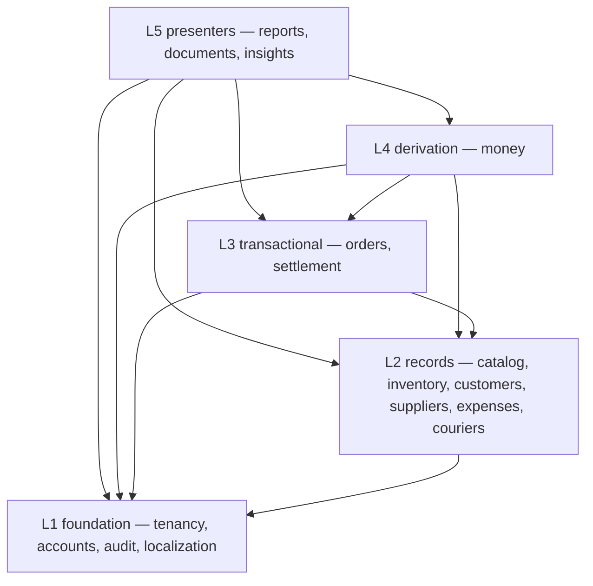
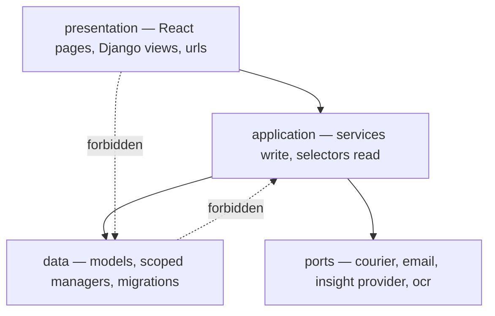
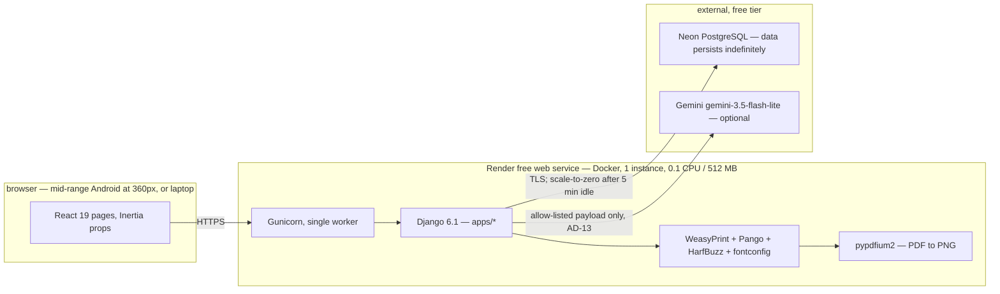
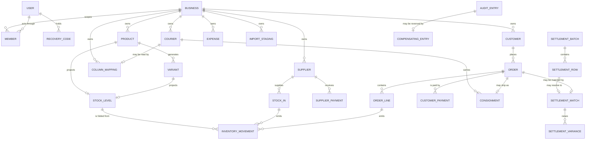

# Architecture Spine — SmartBiz BD

## Design Paradigm

A **layered modular monolith**. One Django project, one deployable process, one database. Each capped module is a Django app owning its own tables; the seams between them are enforced by dependency rules rather than by network boundaries, because at 50 orders a day a service boundary would buy nothing and cost the atomicity NFR-6 requires.

Three layers, and the mapping to directories is the whole of the structure:

| Layer | Lives in | May be touched by |
| --- | --- | --- |
| presentation | `apps/<module>/views.py`, `urls.py`, `frontend/pages/` | the router |
| application | `apps/<module>/services.py` (writes), `selectors.py` (reads) | presentation, other modules |
| data | `apps/<module>/models.py`, `managers.py`, `migrations/` | its own module's application layer only |

Three named specialisations sit on the layering, and each carries a whole model for free:

- **A derived-state ledger core.** Stock and cost are not stored values that code updates. They are folds over immutable typed rows — event sourcing applied to one aggregate, in two dimensions. Reversal, audit and reproducibility all fall out of that one choice.
- **A single derivation module.** Every figure computed from more than one module's records is owned by `money` and by nothing else. No identity module computes a balance about itself.
- **Ports and adapters at every optional transport.** The seams the PRD marks optional are ports whose fallback adapter is always present and always built. Absence of a provider is a configuration, never an error path.

## Inherited Invariants

This spine has no parent architecture spine. It inherits from final upstream artifacts, and the following bind here read-only — they are not re-derived, and a local decision contradicting one is a conflict raised under *Conflicts to resolve*, never a silent override.

| Inherited | From parent | Binds here |
| --- | --- | --- |
| FR-1..FR-82, NFR-1..NFR-28 | PRD `prd-SmartBiz-2026-09-07` | Every capability and cross-cutting requirement. The architecture chooses mechanism, never scope. |
| §4 module depth caps, fifteen capped rows | PRD §4 | A structure that makes a *does not include at this tier* item easy is wrong even where it is elegant. |
| §6.2 Roles and money visibility — a **31-row matrix**, not a ladder | PRD §6.2 | Five Roles against named figures. Manager sees every figure but no audit trail. AD-3 fixes only where the matrix is enforced, and treats it as a per-cell lookup. |
| Ten Insight Queries, set closed | PRD FR-65 | Routing targets are exactly ten, plus a withheld answer and an unroutable outcome (AD-14). |
| Seven reversible operations, set closed | PRD FR-64 | AD-10 governs mechanism; membership of the set is fixed upstream. |
| Colour tokens, contrast floors, component inventory, the amber/brass redundancy rule | UX `DESIGN.md` | The presentation layer implements these values and does not choose them. AD-24 gives them a home and a test. |
| IA — 58 routes over 56 screens — state patterns, named reversible operations, accessibility floors | UX `EXPERIENCE.md` | Route and screen structure follow the experience spine. |
| Twelve modules, ten core business rules | `docs/scope.md` | The origin of scope; PRD §14 maps each rule to the requirement discharging it. Business rule 7, customer dues, is carried here by AD-8. |

## Invariants & Rules

### AD-1 — Modules depend downward only; a schema reference is not a dependency `[ADOPTED]`

- **Binds:** all sixteen apps, all fifteen capped capabilities
- **Prevents:** the monolith collapsing into mutual imports, and the divergence where several modules each grow their own read path into another module's tables so that one figure computes three ways.
- **Rule:** two kinds of reference, and only one is restricted. A **schema reference** — a `ForeignKey` declared as a lazy string (`"orders.Order"`) — is legal in any direction and is how the entity diagram is built. A **behavioural dependency** — importing another module's `models`, `managers` or querysets to read or write through them — is forbidden outright. Cross-module behaviour goes through the other module's `services` and `selectors` only. A view never touches a model; it calls a service or a selector.

Tiers are strictly ordered, and a module may call only strictly below itself. Within a tier a schema reference is legal and a behavioural call is not.





### AD-2 — Business scoping lives in the manager, and each exception has exactly one door `[ADOPTED]`

- **Binds:** NFR-1, FR-44, FR-46, every table carrying business data
- **Prevents:** the endpoint added in week three that forgets its tenant filter. Review cannot be the control, because the failure is an omission. The second, quieter divergence: an unscoped escape hatch opened for the Platform Administrator and then reused by a module that hands the result to a third party.
- **Rule:** every tenant-owned model inherits `BusinessScoped`, whose default manager filters on the request-bound current Business. The unfiltered manager is `objects_all_businesses`, and it is reachable only from inside its own module. Each legal exception has exactly one named door: migrations, management commands, and **one** selector in `tenancy` serving the FR-46 read-only view. That selector returns counts and names only, is never re-exported, and no module above L1 may call it — asserted by a test that enumerates its callers. There is no unscoped selector anywhere in `orders`, `money` or any module `insights` may call.

### AD-3 — Capability filters every egress surface, and derivable figures too

- **Binds:** NFR-2, FR-45, PRD §6.2, every Inertia payload, CSV, PDF, summary image and insight answer
- **Prevents:** two distinct leaks. First, the React-specific one this stack created: a Sales Staff page hides the cost column in the component while the cost still sits in the JSON props, one devtools panel away. Second, the subtler one, and the requirements produce a live instance of it — §6.2 grants Inventory Staff Purchase Cost and withholds margin, so any surface showing that Role a selling price beside a cost hands them the withheld figure by subtraction, while each field on its own is compliant.
- **Rule:** one capability function, a per-cell lookup against the §6.2 matrix, is the single gate. It guards the view **and** filters every outbound representation: Inertia props, CSV export, all three PDFs, the Daily Summary image and text, and insight answers. A test asserts, per Role and per surface, that no denied cell appears in the rendered output. The gate covers **derivable** quantities, not only named fields: where two figures a Role may see would yield one it may not, the coarser figure is withheld. The pack slip is the one deliberate exception, declared in `EXPERIENCE.md` and named explicitly in the gate rather than left to the test to trip over.

### AD-4 — Money is decimal, reported at two places and derived at four, and crosses JSON as a string `[ADOPTED]`

- **Binds:** NFR-8, every money field, every payload, every export and document
- **Prevents:** three separate precision failures. A JSON number becomes a JavaScript binary float on arrival, so `1234.55` renders as `1234.5499999999999` after one client-side sum. A weighted-average unit cost is a **division** and does not survive two decimal places: a pool of ৳1,073.85 over 10 units is ৳107.385, which stored at two places gives a line cost of ৳1,073.90 against ৳1,073.85 actually paid, unreconciled by five poisha. And a `0.00` default on an absent Purchase Cost would void the Completeness Indicator in the profit-**overstating** direction, which is the one direction that flatters the seller falsely.
- **Rule:** reported money is `DecimalField(max_digits=12, decimal_places=2)`. **Derived unit costs and rates are `decimal_places=4`**, rounded to two only when reported. Purchase Cost is **nullable with no default**; absence is a Completeness source, never a zero. Every money value crosses JSON as a **string**, typed on the client so arithmetic on it does not type-check; React formats money and never computes with it, and a test asserts no money prop is consumed as a number. Rounding is `ROUND_HALF_UP` and happens only in `localization`. Quantities are integers.

### AD-5 — Stock **and cost** are folds over one immutable movement ledger `[ADOPTED]`

- **Binds:** NFR-7, FR-53..FR-56, FR-9, FR-14, FR-64, and every cost or stock reversal
- **Prevents:** the asymmetry that would have made this whole paradigm a half-measure. If quantity is an immutable fold but cost is a stored mutable average, reversal corrupts money while passing every test: buy 10 at ৳100 then 10 at ৳120, sell 8 at the blended ৳110, then reverse the first Stock-In — the quantity floor passes at 12 ≥ 10, and the stored average becomes ৳160 where the truth is ৳120, poisoning every later Order Line. FR-64's claim that the Purchase Cost contribution "backs out cleanly" is arithmetically false unless cost is a fold too.
- **Rule:** `InventoryMovement` rows are insert-only and carry a **signed quantity and a signed `cost_total`**. Nothing updates or deletes one. Stock Level is the fold of quantities; weighted-average unit cost is the fold `Σ cost_total ÷ Σ quantity` at four decimal places. Both are maintained as projection rows written only by the movement writer, inside the same transaction as the insert, and the reconciliation test asserts **both dimensions** against the ledger. When a Product gains its first Variant, the parent's projection is retired by a movement pair that moves its balance and its cost to the Variant rows — one rule, so the three plausible answers do not each pass the sum test.

### AD-6 — Every read-then-write over a shared balance takes a lock, in one global order `[ADOPTED]`

- **Binds:** NFR-9, FR-9, FR-52, FR-32, FR-59, FR-70
- **Prevents:** two Orders confirmed simultaneously both reading stock of 1 and both allocating. And the deadlock that survives a naive fix, when two multi-line Orders touch the same rows in opposite sequence. And the case a stock-only rule misses entirely: a Settlement Batch closing while one of its rows is still being matched, leaving a closed immutable Batch holding an undispositioned Variance — the exact state AD-11 forbids, with no route out through the interface.
- **Rule:** every read-then-write over a shared balance acquires `select_for_update()` first, and the checked comparison happens inside the lock and inside the same transaction as the write. Four lock classes are named: stock projections, Customer Due, Supplier balance, and Settlement Batch close. Locks are taken in one **global order — the declared table order, then primary key within a table** — so no two paths can order them differently. Batch close takes the Batch lock and asserts every row is matched-or-disposed inside it.

### AD-7 — Cost flow is weighted average, and it is a fold, not a stored number `[ADOPTED]`

- **Binds:** FR-8, FR-53, FR-69, and every profit figure
- **Prevents:** one module averaging while another consumes purchase layers, after which Earned profit disagrees with itself. Layered costing is also unavailable by scope: §4.2 excludes batch, lot and expiry tracking, and FR-64's note fixes the reversal floor as a quantity check on the Product or Variant, not on which units came from which Stock-In.
- **Rule:** unit cost is the AD-5 fold, never a stored mutable average. The Order Line captures that cost **as a snapshot at allocation**, at four places, and a later Stock-In never restates a historical Order. Reversing a Stock-In removes its own `cost_total` and quantity contribution arithmetically. Where cost is absent, FR-69 completion writes the movement's `cost_total` and clears the Completeness source; it never recomputes history.

### AD-8 — `money` owns every derived figure, and a figure carries its basis, its period key and its completeness `[ADOPTED]`

- **Binds:** FR-18, FR-23, FR-35, FR-37, FR-38, FR-48, FR-58, FR-59, FR-60, FR-61, FR-82, original business rule 7, SM-12
- **Prevents:** the sharpest divergence in the product, and it is wider than profit. Money With Couriers has three consumers and an explicit "conflating them is a defect" rule. Customer Due, Supplier balance, Collection Status, Unsettled Profit, the Customer Risk Ratio and the Ageing Buckets are all cross-module derivations that an identity module would happily compute about itself — and then disagree with the report. Fixing only the return shape is not enough: two conforming callers still diverge if one buckets by `created_at` and the other by `delivered_at`.
- **Rule:** **no derived figure is ever stored**, and every one of them is computed in `money` and nowhere else. Identity modules hold records, never balances about themselves. Each derivation returns value, Recognition Basis, period key and completeness as one inseparable result — a caller cannot obtain the value alone. The **period key is fixed per basis**: Earned buckets by delivery, Realized by settlement date, and no caller chooses. The **basis per surface** is fixed by the PRD, not by the caller, and FR-38's "on the realized basis" qualifier is carried, so one figure cannot read complete on one surface and incomplete on another. Revenue is defined once as gross with discounts and returns netted explicitly. Completeness reports exactly the three PRD sources and no fourth may be added.

### AD-9 — One service call is one transaction and one Audit Entry `[ADOPTED]`

- **Binds:** NFR-6, FR-63, every money or stock change
- **Prevents:** partial state after a mid-operation failure, and the quieter failure where a change lands with no audit row because the audit write sat outside the transaction or in a signal that did not fire. Also the ambiguity a bare rule leaves: an Order confirmation that also creates a Customer is one business operation or two, and two builders will answer differently.
- **Rule:** a **business operation** is what a user initiated, and it is one service function, one `transaction.atomic()`, one Audit Entry with before and after values written inside it. A service may call another service; the inner call joins the outer transaction and writes **no** second Audit Entry, because only the user-initiated operation is auditable. Views open no transactions. Signals carry no business effects. A money- or stock-changing write with no Audit Entry in its transaction is a defect.

### AD-10 — Reversal is a compensating write, and modules register their own reverse `[ADOPTED]`

- **Binds:** FR-64, FR-12..FR-15, NFR-23
- **Prevents:** a reversal implemented as an update or delete, which destroys the history that makes the ledger trustworthy. And the structural contradiction of putting a registry that writes into six modules inside `audit`, which sits at L1 and depends on nothing.
- **Rule:** the dependency is **inverted**. Each owning module registers its own `reverse()` callable with `audit` at app-ready; `audit` stores and invokes callables and never imports a module. Reversal writes new opposite rows plus a Compensating Entry linked one-to-one to the original, and never mutates or deletes a prior financial or inventory row. A Compensating Entry is **unique per original**, so an operation cannot be reversed twice. Reversal obeys AD-6 and AD-9 like any other write. An operation outside the seven has no reverse path.

### AD-11 — Settlement is one-to-one, cash is recognised once, and imports are idempotent `[ADOPTED]`

- **Binds:** FR-25, FR-28..FR-34, FR-23, and the COD Settlement report
- **Prevents:** a matcher that spreads one remittance line across several Orders to make the arithmetic close, hiding the discrepancy the module exists to surface. And a double count that a green test suite would not catch: on a grouped ৳4,500 row, one conforming matcher raises an Accepted ৳3,000 Variance that gets added to Realized Profit, and then adds it again when the sibling Orders settle. And the same settlement file imported twice.
- **Rule:** a Settlement Match links exactly one settlement row to exactly one Order, and is **unique on the Order**. Cash is recognised **once, at the Match**; a Settlement Variance is a reconciliation record and **never a second cash input** — its Disposition adjusts the receivable, not revenue. FR-34's partial and grouped cases resolve into one-to-one Matches plus Variances, never a fractional allocation. Import is idempotent: a content hash is unique per Business, and a re-upload is recognised rather than re-applied. A Batch cannot close with an undispositioned Variance, under the AD-6 lock.

### AD-12 — Optional transports are ports, and absent, failing and exhausted are three states

- **Binds:** FR-22, FR-27, FR-43, FR-75, FR-79, FR-80, NFR-20, §4.3, §4.4
- **Prevents:** an optional dependency growing into a required one — a concrete client imported into a core flow, so a missing key breaks order capture. And the divergence where one module treats "no provider configured" and "provider returned 429" as the same thing while another does not, so the same condition is a silent fallback in one place and an error in the other.
- **Rule:** each optional transport defines an interface in its own module, selected by configuration; core flows import the port, never a concrete adapter. Three states are distinguished and each maps to a declared surface: **absent** (no key — the fallback is the whole feature, no notice), **failing** (unreachable or timed out — fallback plus a transient notice), **exhausted** (quota — fallback plus a notice that wording is unassisted, per FR-80). A fallback that is a *transparent substitute* (templated phrasing) is distinguished from one that creates a *substitute entity* (a simulated courier consignment is a real record and is marked as simulated). The test suite has a full pass with every optional adapter absent, and it must be green.

### AD-13 — The outbound insight payload is constructed from allow-listed parameters `[ADOPTED]`

- **Binds:** NFR-27, NFR-28, FR-65, FR-79, FR-80
- **Prevents:** any serialisation route by which a Customer name, phone number, database row, table or column name, credential, or another Business's figure reaches a third party — a hard rule because free-tier model terms generally permit the provider to retain and learn from what is submitted.
- **Rule:** the payload builder's parameters are exactly the permitted fields: question text, Insight Query name, and already-computed aggregates obtained from `money`. It accepts no object, no queryset, no model-field dictionary and no `**kwargs` passthrough, and it may not be reached from any unscoped selector (AD-2). A test asserts a payload containing a Customer field cannot be constructed. Only the provider adapter reads the API key environment variable; it is never returned, logged, sent to the browser, or exposed by any endpoint, and no client code holds a provider address.

### AD-14 — The model never originates a number, and there are three outcomes `[ADOPTED]`

- **Binds:** FR-81, FR-65, FR-79, FR-82
- **Prevents:** the failure that comes free with a language model — a confident figure nobody computed. And the flattening of a **withheld** answer into a refusal: EXPERIENCE.md is explicit that a withheld answer is not a refusal, and collapsing them tells the seller the product is broken when it is being careful.
- **Rule:** figures are computed in code and handed to phrasing as pre-formatted strings. Returned text is validated before display: every numeral in it must appear in the supplied figure set, else templated phrasing is used. Routing yields exactly one of **three** outcomes — a routed query, a **withheld** answer (understood but not answerable for this Role or this completeness state), or **unroutable** (outside the ten). It never composes a query.

### AD-15 — Each stage of the insight path carries its own deadline, enforced by its own owner `[ADOPTED]`

- **Binds:** NFR-14, FR-79, FR-81
- **Prevents:** a slow provider becoming a hung page, and each caller inventing its own timeout. Also a mis-assignment in the first draft of this spine: the compute stage has no adapter, so its deadline cannot live in one.
- **Rule:** routing ≤ 3s, enforced in the provider adapter, then the button list is offered. Compute ≤ 3s, enforced by a statement timeout on the `money` selector, because this stage is the application's own work and has no adapter. Phrasing ≤ 3s, enforced in the adapter, then templated wording is used. A question always resolves within nine seconds to either an answer or the button list, and phrasing latency extends only how long fluent wording takes to arrive.

### AD-16 — One rendering pipeline serves every generated artifact `[ADOPTED]`

- **Binds:** FR-68, FR-40, FR-62, and the three PDF reports
- **Prevents:** the defect this constraint exists to stop. Bangla is a complex script needing conjunct formation and vowel-sign repositioning; a browser shapes it natively, most PDF and image libraries do not. Two renderers means two font stacks and two shaping paths, and conjuncts come out correct in the invoice and broken in the summary card, discovered late.
- **Rule:** one HTML and CSS template set under `templates/documents/` is rendered by WeasyPrint to PDF, and the Daily Summary image is **that same PDF rasterised** by pypdfium2. One font file, one shaping stack — Pango with HarfBuzz. No second renderer, no client-side canvas or SVG text, and no Chromium in the production image. Playwright is a test dependency only. Because the container has 512 MB (AD-20), a render is bounded to a declared maximum page count and runs in the requesting worker.

### AD-17 — Formatting and strings are centralised, and identifiers are exempt

- **Binds:** FR-66, FR-67, NFR-18, and every surface that renders a number
- **Prevents:** three renderers formatting independently — the React page, the PDF template and the Bangla summary text each growing their own digit conversion and currency placement, so one amount appears three ways in one day's output. And the collision the first draft created: localising digits everywhere would turn `ORD-1042` into Bangla numerals and break the human code a seller reads aloud to a courier.
- **Rule:** `localization` owns digit, currency and date formatting, and every surface calls it — the React formatter is a thin binding over the same contract, never a parallel implementation. **Human identifiers are exempt** and always render in Latin digits. All *interface* text goes through `gettext` with Bangla as source and English selectable per Member; no string literal is authored in a React component. **Content** fields the seller types (Product name, category, note) are bilingual data, not translations, and are stored as paired columns — never in the `gettext` catalogue. Bangla-digit input is normalised at one input boundary.

### AD-18 — No durable local filesystem; multi-step work stages in the database `[ADOPTED]`

- **Binds:** NFR-5, FR-25..FR-29, FR-75, FR-76, and the deployment envelope
- **Prevents:** the class of feature that works locally and vanishes on the next deploy, because the container disk is ephemeral. And the contradiction the first draft created: discarding an upload inside its request makes the specified `import → map → preview → commit` wizard unbuildable, since that is three round trips.
- **Rule:** no uploaded file is ever written to disk, executed, or served as static content. A multi-step import parses in-request and stages its **rows** in a database staging entity scoped to the Business and the Member, which the commit step consumes and which expires. Generated PDFs and images are streamed in the response, never written and linked. No feature assumes a *file* exists after its response ends. The FR-75 message image is downscaled in the browser and never persisted, matching the Hero-tier exclusion of screenshots on the Order record.

### AD-19 — Credential recovery is a one-time code, and nothing else `[ADOPTED]`

- **Binds:** FR-41, FR-43, NFR-3, PRD §12 Q7
- **Prevents:** a reset flow depending on an email transport FR-43 makes optional. This is not merely a preference on this host: Render free services cannot use SMTP ports 25, 465 or 587, so an email-dependent reset would have been impossible, not just inconvenient.
- **Rule:** registration issues a single-use recovery code, displayed exactly once and stored only as a salted hash. Reset requires the code plus a new password; consuming a code invalidates it and issues the next. No reset path depends on email. The consequence is stated plainly in delivery documentation rather than hidden: a lost code makes the account unrecoverable without direct database access.

### AD-20 — One 512 MB web process, no scheduler, no warm state `[ADOPTED]`

- **Binds:** NFR-20, NFR-21, NFR-22, NFR-26, and every module tempted by background work
- **Prevents:** an architecture that assumes what the free tier does not sell. The instance is **0.1 CPU and 512 MB RAM**, single, spins down after fifteen minutes idle and takes about a minute to return. There is no second process, no cron, and no always-warm memory.
- **Rule:** all work happens in the request that asked for it. No background worker, no task queue, no scheduled job. Nothing periodic is automatic: the Daily Summary is produced on request and the NFR-22 backup is a documented manual procedure with a named destination and cadence. In-process memory is never a cache of record — a projection is a database row, not a dictionary. Gunicorn runs a single worker, and any bounded-memory operation (AD-16 rendering, AD-18 import) declares its bound. The cold start is a first-class UI state per NFR-21, not an error.

### AD-21 — Integrity is declared in the database, not only in services

- **Binds:** NFR-6, NFR-7, NFR-23, FR-5, FR-52, FR-64, AD-5, AD-10, AD-11
- **Prevents:** the single most efficient way to void this entire paradigm. A Django cascading delete never calls `Model.delete()`, so AD-5's insert-only guarantee dies quietly to one `on_delete=CASCADE` on a parent. Service-level rules also cannot stop a second Compensating Entry against one original, a second Settlement Match on one Order, or a negative quantity written by a data migration that bypasses every service.
- **Rule:** every relation declares an explicit `on_delete`, and **no ledger or audit table is ever the target of a cascade** — `PROTECT` on anything an `InventoryMovement`, `AuditEntry`, `CompensatingEntry` or Settlement record points at. Named database constraints carry the invariants that must hold regardless of code path: unique on `SettlementMatch(order)`, on `CompensatingEntry(original)`, on Customer phone per Business, on Variant combination per Product, and on settlement import content hash per Business; check constraints for non-negative stock projections and for movement sign against movement type. Sign is fixed by physical effect and not by which requirement mentions it: a movement that removes units from the shop carries a negative quantity, so a Damage Write-Off is negative and its **reversal** is the positive row — which is what FR-14 is describing. A migration that touches money or stock writes Audit Entries exactly as a service would.

### AD-22 — Plain CSS with custom properties, and the contrast floors are tested

- **Binds:** NFR-17, DESIGN.md in full, FR-66
- **Prevents:** the loss of an asset the greenfield decision would otherwise discard. DESIGN.md's floors are asserted arithmetically off token values, and the prototype's harness is their only enforcement; nothing else in this system can tell that a caption sits at 2.9:1, because it looks *quiet* rather than broken. Under a CSS-in-JS or utility-class stack, 2,254 lines of AA-validated CSS would be rewritten and every floor re-derived by hand.
- **Rule:** styling is **plain CSS with custom properties**, imported through Vite — no CSS-in-JS, no utility framework. DESIGN.md's tokens live in `frontend/styles/tokens.css` as the single source, and a test asserts them against DESIGN.md's frontmatter so the two cannot drift. The contrast, control-boundary and amber/brass redundancy assertions are ported from the prototype harness into `tests/invariants/` and run in CI. Class names stay string-literal in `className` so a static scan can still resolve them; a computed class list must resolve statically or the control is declared in the test's own registry. Touch targets separate two measurements that the two UX documents state independently: EXPERIENCE.md's 44px is the **hit area**, extended by padding, and DESIGN.md's 32 and 26px are the **visual box**. Both hold, and the test measures the hit area.

### AD-23 — Client-held drafts are per-device, unscoped by Role, and never a figure

- **Binds:** FR-6, NFR-11, NFR-21, EXPERIENCE.md's cold-open and offline patterns
- **Prevents:** the leak a naive client cache creates on the one device that matters. A shop phone is shared: if Role-filtered props or computed figures persist client-side, a Packer opening the app after the Owner sees the Owner's numbers, inverting AD-3 with no server involved.
- **Rule:** the only thing the client may persist is the seller's **own unsent input** — an order draft, per device, keyed to the authenticated Member and cleared on logout, Role change and Member switch. No figure, no aggregate, no Role-filtered payload and no report is ever cached client-side. A cold open shows the AD-20 loading state and fetches; it does not show a remembered number. There is no service worker, no outbox and no sync path: offline reach is exactly draft survival, and nothing else in the product is available offline.

### AD-24 — A minimum invariant floor exists, and retreat cuts depth above it only

- **Binds:** PRD §4.4's retreat order, §8's funded-reduction rule, every epic in Step 6, and the sprint plan in Step 7
- **Prevents:** the failure mode this schedule actually has. Independent review puts the build at 8–12 weeks solo against a 2–4 week window, and §4.4's retreat path cuts *feature depth* while the likely overruns sit in invariants that cannot retreat — the ledger, the settlement matcher, the 31-cell gate, Bangla shaping. Without a declared floor, two epics under time pressure each decide independently what may be dropped, and the first thing to go is always a test, because dropping one breaks nothing visible today. What remains is then a broad system that is quietly wrong, which is the worse artifact of the two.
- **Rule:** the floor is one Hero flow end to end — capture, confirm, ship, settle — carrying the AD-5 two-dimensional ledger, the AD-11 matcher, the AD-3 gate over every egress surface, one Bangla PDF through the AD-16 pipeline, and the `tests/invariants/` suite for every AD clause reading *a test asserts*. **The floor does not retreat**, and no reduction may be funded from it under §8. Everything above it retreats in §4.4's declared order, and a dropped capability moves to §16.2 rather than being half-built. An epic that cannot meet its scope reduces its own breadth and reports it; it does not reduce the floor.

## Prohibitions and Budgets

Three reviewers found the same structural gap: this spine reliably captures decisions and reliably loses **negative** requirements and **client-path budgets**, because neither is shaped like a decision. They are collected here so they have one home.

| Kind | Requirement | Where it binds |
| --- | --- | --- |
| Budget | Capture form interactive within 2s on mid-range Android over 3G (NFR-11) | The page bundle is code-split per route; capture ships no chart or report code. |
| Budget | Paste-and-parse returns a filled form within 1s for ≤500 characters (NFR-12) | Parsing is synchronous, rule-based, in-process — never a provider call (AD-12). |
| Budget | 500-row settlement or order import matched within 10s; images downscaled to ≤1,600px long edge (NFR-13) | AD-18 staging is bulk-inserted, not row-by-row; downscale is client-side. |
| Budget | Any report over a one-year range renders within 3s (NFR-14) | Enforced by the AD-15 statement timeout on `money` selectors. |
| Prohibition | No credential, session token or Invitation Code in any log line (NFR-3) | One logging filter; AD-13 covers the provider key. |
| Prohibition | Uploads validated by content, never executed, never served (NFR-5) | AD-18. |
| Prohibition | Nothing deleted on a schedule; no bulk delete of Orders, Movements, Audit Entries or Batches (NFR-23) | AD-21's `PROTECT`; no such capability is built. |
| Prohibition | Deactivating a Member destroys no records, so Audit attribution survives (NFR-24) | Deactivation sets a flag; AD-21 forbids the cascade that would break it. |
| Prohibition | No device feature beyond a modern mobile browser — no camera, no native app, no installed font (NFR-18) | The Bangla font ships in the image (AD-16), not on the device. |

## Consistency Conventions

| Concern | Convention |
| --- | --- |
| Apps and capabilities | Sixteen apps serve fifteen capped capabilities; the mapping is **not** one-to-one and the Capability map below is authoritative. `tenancy` and `accounts` together serve one row; `money` serves the Dashboard row and every derived figure named in AD-8. |
| Naming | `snake_case` app directories. Services are verbs (`confirm_order`, `match_settlement_row`); selectors are nouns (`order_list`, `stock_level`). One React page component per Inertia page, `PascalCase`, at `frontend/pages/<module>/<Page>.tsx`. |
| Typed constants | Movement types, Order Statuses, Dispositions, audit operations and Insight Query names are `UPPER_SNAKE` string constants in the owning module — never integers, never inline literals at a call site. |
| Identifiers | Primary keys are `BigAutoField` and internal. Every reference a seller reads or says aloud is a per-Business human code (`ORD-1042`, `P-101`), generated by the owning module, never reused, and exempt from digit localization per AD-17. No UUID in a user-facing URL. |
| Money and quantities | Reported money `DecimalField(12,2)`; derived unit costs and rates `(12,4)`; string across JSON per AD-4. Quantities are integers. Rounding only in `localization`. |
| Dates and time | Stored UTC, rendered `Asia/Dhaka`. A business day is a Dhaka calendar day, and every daily figure uses that one boundary. Period keys are fixed by AD-8, not by the caller. |
| Error shape | Services raise a module-local exception deriving from a shared `DomainError`; the view layer translates it into an Inertia validation payload. Per NFR-19, no Customer personal data and no money value appears in a log message. |
| State mutation | Only through a service function, per AD-9. No `save()` in a view, template, React handler, signal or management command. Signals carry no business effects. |
| Configuration | Environment variables only, read once under `config/settings/`. No secret in the repository, no committed `.env`. The provider key is read solely by its adapter, per AD-13. |
| Tests | Every AD clause reading "a test asserts" has a named test under `tests/invariants/`. Playwright covers the Hero flows plus a full pass with every optional adapter absent (AD-12). |
| Migrations | Forward-only. A data migration touching money or stock writes Audit Entries exactly as a service would, and cannot bypass AD-21's constraints. |

## Stack

Every version below was verified against a live source on 2026-09-08.

| Name | Version |
| --- | --- |
| Python | 3.13 |
| Django | 6.1.1 |
| PostgreSQL (Neon, free) | 17 |
| inertia-django | 2.0.0 |
| React | 19.2.8 |
| Vite | 8.2.2 |
| TypeScript | 7.0.2 |
| Styling | plain CSS with custom properties — no CSS-in-JS, no utility framework (AD-22) |
| WeasyPrint | 70.0 |
| Pango / HarfBuzz / fontconfig | Pango 1.44.0+, in the image |
| pypdfium2 | 5.13.0 |
| Gunicorn | 26.2.0 |
| Playwright (test only) | 1.63.0 npm / 1.62.0 PyPI |
| Gemini model, pinned | `gemini-3.5-flash-lite` |
| Host | Render free web service, 0.1 CPU / 512 MB, built from Dockerfile |

## Structural Seed

### Deployment and environments

Two environments only: local development, and one deployed free-tier instance that is both the demonstration and the assessed artifact. There is no staging tier, because a second free instance would draw on the same 750-hour allowance.



What each verified fact costs the design. The instance is 0.1 CPU and 512 MB, single, spinning down after fifteen minutes idle and taking about a minute to return — absorbed by AD-20 and NFR-21, and the reason AD-16 excludes Chromium and bounds a render. Its filesystem is ephemeral, absorbed by AD-18. Render's own free PostgreSQL **expires thirty days after creation**, verified, so the database is deliberately not Render's; Neon free persists indefinitely and scales to zero at five minutes instead. Neon's instant restore covers a **six-hour history window capped at 1 GB and not extendable**, so beyond six hours NFR-22's manual logical dump is the only recovery mechanism and the recovery point is whenever it was last run — which resolves NFR-26's assumption concretely, in the direction its own note predicted. Render free services cannot use SMTP ports 25, 465 or 587, which independently vindicates AD-19.

One acknowledged operational risk: Render may suspend a free web service for high self-initiated outbound traffic, and its documentation names accessing an external database and invoking external APIs as examples — both load-bearing edges here. At 50 orders a day the volume is far below any plausible threshold, but the clause is real and is recorded rather than discovered.

`[ASSUMPTION]` Docker build support on the **free** instance specifically is established by omission rather than by an affirmative statement: Docker is absent from the free plan's itemised exclusion list, and free services do consume build-pipeline minutes. Confirmed at first deploy.

### Core entities



Five shapes there are decisions rather than description. `INVENTORY_MOVEMENT` carries cost as well as quantity, which is what makes AD-5 whole. `STOCK_IN` is its own record rather than a movement type, because FR-70 hangs a payment state and a Supplier balance off it, and it *emits* a movement. `COLUMN_MAPPING` belongs to the **Business**, optionally qualified by Courier, because FR-76's order import file has no Courier at all. `IMPORT_STAGING` exists because AD-18 forbids files but the wizard needs three round trips. And every optional edge is `o|`, not `||` — not every Order has a Consignment or a Match, and an Audit Entry usually has no Compensating Entry, which is also where AD-21's uniqueness constraint lands.

**No entity stores a derived balance.** There is no `DUE`, no supplier balance column and no profit column; all of them are AD-8 folds.

### Source tree

```text
SmartBiz/
  config/                   # settings/, urls.py, wsgi.py — the only place env vars are read
  apps/
    tenancy/                # Business, Member, §6.2 matrix, BusinessScoped, the one FR-46 door
    accounts/               # User, registration, login, RecoveryCode (AD-19)
    audit/                  # AuditEntry, CompensatingEntry, the inverted reverse registry
    localization/           # gettext catalogues, digit / currency / date formatting (AD-17)
    catalog/                # Product, Category, VariantDimension, Variant
    inventory/              # InventoryMovement (qty + cost_total), StockLevel projection, StockIn
    customers/              # Customer identity only — no balance (AD-8)
    suppliers/              # Supplier identity, SupplierPayment — no balance (AD-8)
    expenses/               # Expense, categories
    couriers/               # Courier, Consignment, ColumnMapping, courier port
    orders/                 # Order, OrderLine, CustomerPayment, lifecycle, rule-based parser
    settlement/             # Batch, Row, Match, Variance, Disposition, ImportStaging
    money/                  # EVERY derived figure + the dashboard views (AD-8)
    reports/                # the nine reports, CSV, PDF hand-off
    documents/              # the single WeasyPrint pipeline, Daily Summary card
    insights/               # ten queries, routing, provider port, answer validation
  frontend/
    pages/                  # one component per Inertia page
    components/             # DESIGN.md component inventory
    styles/tokens.css       # DESIGN.md tokens, single source, drift-tested (AD-22)
    lib/format.ts           # thin binding over localization's contract
  templates/documents/      # HTML + CSS for PDF and the summary card — one pipeline
  tests/
    invariants/             # AD-2,3,4,5,8,13,14,21,22 assertions + ported prototype harnesses
    e2e/                    # Playwright: Hero flows, plus a full no-adapter pass
  Dockerfile                # Pango, HarfBuzz, fontconfig, the Bangla font
  pyproject.toml
```

## Capability → Architecture Map

| Capability / Area | Lives in | Governed by |
| --- | --- | --- |
| Order management (Hero) | `orders` | AD-1, AD-6, AD-7, AD-9, AD-10, AD-23 |
| COD and delivery (Hero) | `couriers`, `settlement` | AD-11, AD-12, AD-18, AD-21 |
| Dashboard money view (Hero) | `money` | AD-8, AD-3, AD-23 |
| Authentication and business setup | `accounts`, `tenancy` | AD-2, AD-3, AD-19, AD-12 |
| Customer management | `customers` + `money` (Risk Ratio) | AD-2, AD-8 |
| Product management and Variants | `catalog` | AD-2, AD-5, AD-21 |
| Inventory management | `inventory` | AD-5, AD-6, AD-7, AD-9, AD-21 |
| Expense management | `expenses` | AD-2, AD-9 |
| Customer due management | `orders` (payments) + `money` (balance, ageing) | AD-8, AD-6, AD-4 |
| Supplier management | `suppliers` + `money` (balance, history) | AD-8, AD-7, AD-9 |
| Reports and export | `reports` | AD-1, AD-3, AD-8, AD-16, AD-17 |
| Audit trail and reversal | `audit` | AD-9, AD-10, AD-21 |
| Localization and Bangla rendering | `localization`, `documents` | AD-16, AD-17, AD-22 |
| Daily Summary | `documents` | AD-16, AD-8, AD-3, AD-20 |
| AI-assisted insights | `insights` | AD-12, AD-13, AD-14, AD-15 |

## Conflicts resolved

Five contradictions between this architecture and its final upstream inputs. Each was raised rather than overridden; three were the user's to settle and were settled on 2026-09-08, and two were resolvable from the documents themselves.

| Conflict | Resolution | Landed in |
| --- | --- | --- |
| PRD §6.2's five Roles vs `EXPERIENCE.md`'s substituted Packer on a coarser money level | **PRD wins.** `EXPERIENCE.md` amended — the three-level ladder becomes a per-Role table, Packer becomes Inventory Staff, Staff becomes Sales Staff. `EXPERIENCE.md` was right that the matrix is not a ladder; AD-3 already treats it as a per-cell lookup. | AD-3; `EXPERIENCE.md` §Role and Money Gating, IA, Flow 3, Flow 6 |
| `EXPERIENCE.md`'s offline capture vs AD-20 and AD-23 | **Reduced to draft resilience.** The in-progress order survives a dropped connection, reload and backgrounded tab. No service worker, no outbox, no sync path — that scope is unfunded under §8 and is the most schedule-hostile item on the board. | AD-23; `EXPERIENCE.md` Offline state row |
| 8–12 weeks estimated vs the 2–4 week window | **A minimum invariant floor is declared and does not retreat.** Depth above it retreats in §4.4's order. | AD-24 |
| `EXPERIENCE.md`'s 44px tap target vs `DESIGN.md`'s 32 and 26px stepper | **Both hold** — they measure different things. 44px is the hit area, extended by padding; 32 and 26px are the visual box. The test measures the hit area. | AD-22 |
| FR-55 and FR-14 implying opposite signs for a Damage Write-Off | **Sign follows physical effect.** A movement removing units is negative, so the write-off is negative and FR-14 describes its positive *reversal*. | AD-21 |

One consequence of the first resolution is worth recording, because it came from the requirements rather than from a reviewer: §6.2 grants Inventory Staff Purchase Cost and withholds margin, so that Role must also be denied **selling price**, or margin is theirs by subtraction. That is AD-3's derivable-quantities clause arriving independently — and it is what preserves the pack slip as a genuine exception under the PRD's Roles rather than a leftover of the Packer.

Fixing the first also closed a contradiction internal to `EXPERIENCE.md` that neither UX review had caught: the Insight destination group was labelled as requiring full money visibility, while the Ask SmartBiz row four lines below it correctly stated every Role reaches that screen.

## Deferred

- **OCR provider for FR-75 (PRD §12 Q11).** Deferred to the epic that builds the capture paths; AD-12 already makes a no-provider answer complete, so it cannot block. If §4.4's retreat order reaches FR-75 first, the question dissolves.
- **Quota detection for the shared Insight Provider key (PRD §12 Q14).** The *behaviour* is now fixed — AD-12 makes exhausted a distinct declared state. What remains is only whether exhaustion is reported to the Owner, which is an `insights` epic call within AD-12's three states.
- **Caching.** Nothing is cached, server or client, beyond AD-23's unsent input. At this volume a query plan is cheaper than a stale figure. Revisit only if a measured report breaches NFR-14 after the AD-15 timeout is in place.
- **Per-Business provider keys and model selection.** v2 per PRD §16.2. The port is shaped so this is configuration, not redesign.
- **Rate limiting and abuse controls.** One Business and five Members do not motivate it, and the free tier caps throughput. Revisit if the deployment outlives assessment.
- **Error monitoring and log aggregation.** NFR-19 fixes what a log line may contain, not where logs go. Platform stdout is the v1 answer; an external collector is out of scope for the free tier.
- **CI topology.** Whether the suite runs on a hosted runner or locally before deploy is a Step 7 call, not an architectural invariant. The *content* of the floor is not deferred — AD-22 and the Conventions test row fix it.
- **The Variant stock-key representation.** Whether per-combination rows key on a composite axis string or on normalised axis-value rows is the `catalog` epic's call — but it is bounded here, because AD-6's global lock order requires whichever table exists to have a declared position in that order, and AD-5 requires the parent-retirement movement pair either way.
- **Epic-level module internals.** Per-story structure inside each app — form objects, parser rule organisation, report query shapes — is owned by the epics and by the code. This spine fixes only what would let two of them diverge.
