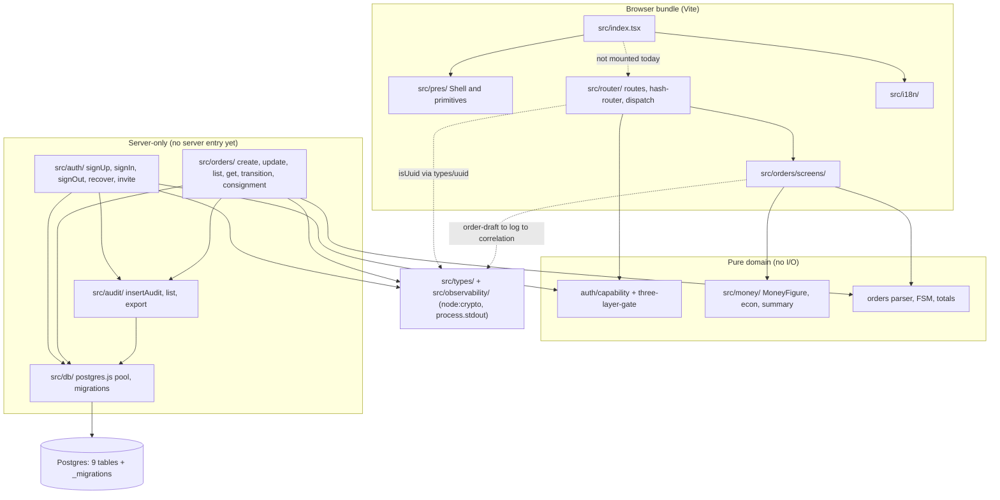
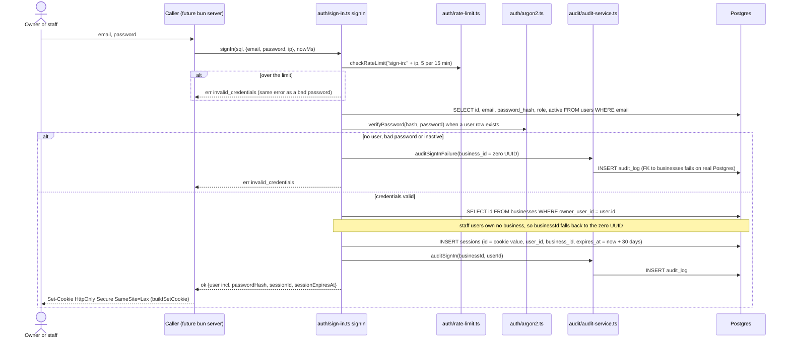
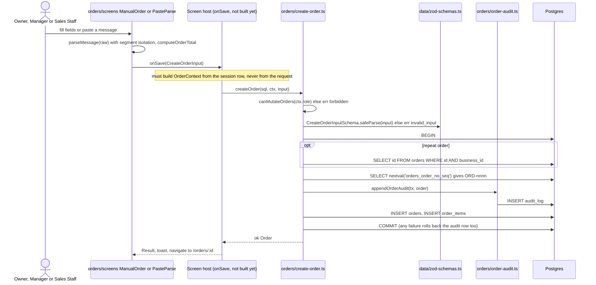
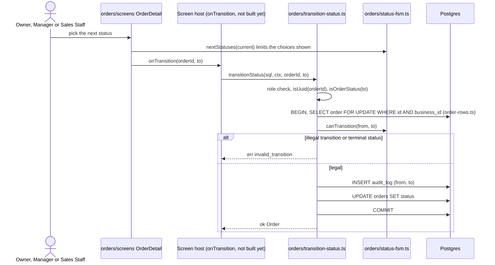
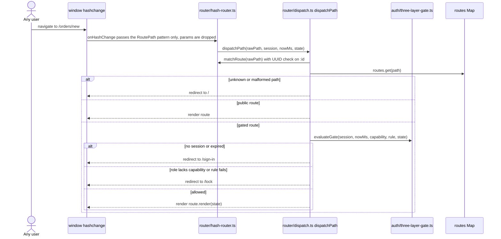
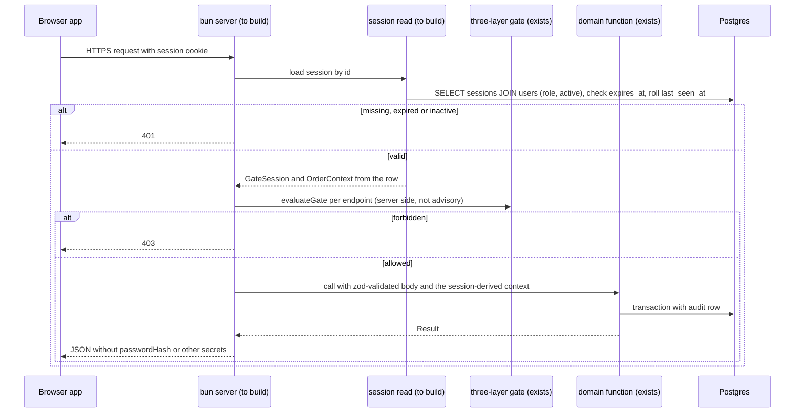

# SmartBiz BD — Architecture

> **Store history.** Prototype sections from intent `261004-mvp` (2026-10-04). Production sections added by intent `261027-app-wiring` (2026-10-27) from a focused scan of `src/`, `tests/`, `.github/` and the root build config.

## Production system overview (`src/`, as of commit `4ea59ad`)

The production tree is a **single TypeScript package** (`smartbiz-bd@0.1.0`) holding three kinds of code that will eventually run in two places:

1. **Domain services** (`src/auth/`, `src/orders/` repository functions, `src/audit/`, `src/db/`). They need Postgres (postgres.js), argon2 (a native addon) and `node:crypto`, so they can only run on the server.
2. **Pure domain logic** (`src/money/`, `src/orders/` parser, FSM and totals, `src/auth/capability.ts`, `src/auth/three-layer-gate.ts`). It has no I/O and could run anywhere.
3. **Browser UI** (`src/index.tsx`, `src/pres/`, `src/router/`, `src/orders/screens/`, `src/i18n/`). React 18 rendered at `#root`, bundled by Vite.

The server does not exist yet. Today the "API" is an in-process function-call surface: every DB function has the shape `(sql, ctx | input, …) → Promise<Result<T, E>>`. Typed business failures come back as `Result` errors, and database faults are thrown. [dev-scan §"APIs Discovered"] [src/orders/create-order.ts header]

## Architectural style

**Modular monolith, pre-wiring.** One package, one future bun process (project.md §Tech Stack: "the API server runs on bun's built-in HTTP server, with no separate web framework"), one Postgres database, one business per deployment (team.md §Dep-4). The modules follow the 1:1 module-to-component split chosen at domain design (project.md §Corrections, Q1=A): AuthComponent owns the role × capability gate and the AuditService, DataComponent owns the MoneyEngine, and OrdersComponent owns the paste parser.

Evidence for "pre-wiring": no `fetch(`, `Bun.serve`, `createServer` or `XMLHttpRequest` anywhere in `src/` or `tests/`. The browser entry does not mount the router, and every auth route renders `renderStub`. [dev-scan §"Packages Found"] [src/router/routes.ts line 18]

## Layers (production)

| Layer | Modules | Runs on | Notes |
|---|---|---|---|
| Entry | `src/index.tsx`, `index.html` | browser | Mounts `<Shell>` only. No router, no session, no data. |
| Presentation | `src/pres/` (Shell, Screen, Field, LockSheet, Pill, BasisPill, CompletenessControl, Toast, tokens.css, typography) | browser | `Shell` accepts `children`, but nothing passes any. Nav labels all use `common.save` (P-9). |
| Client routing | `src/router/` (`routes.ts`, `hash-router.ts`, `dispatch.ts`, `screens/`) | browser (intended) | Typed `Map<RoutePath, Route>` of 17 paths; pure `dispatchPath()` applies the three-layer gate. **Its import closure reaches `node:crypto`, so it cannot be bundled for the browser yet** (P-1). |
| Feature screens | `src/orders/screens/` | browser | Five screens driven by the `OrdersRouteState` callback contract. Only tests build that state. |
| Domain services | `src/auth/`, `src/orders/{create,update,get,list}-order.ts`, `transition-status.ts`, `consignment.ts`, `src/audit/` | server | `(sql, ctx, input) → Result`. Orders take `OrderContext` "from the session, never from the URL". |
| Pure domain | `src/money/`, `src/orders/{parse-message*,status-*,order-total,order-figure}.ts`, `src/auth/{capability,three-layer-gate}.ts` | both | No I/O. |
| Shared kernel | `src/types/` (`Result`, `Uuid`, `sha256`), `src/data/` (`StateContainer`, clock, zod schemas), `src/i18n/`, `src/observability/` | both (intended) | `types/uuid.ts`, `types/sha256.ts` and `observability/correlation.ts` import `node:crypto`. `observability/log.ts` writes to `process.stdout`. These break the browser build. |
| Persistence | `src/db/client.ts` (postgres.js pool, max 5, `prepare: false`), `migrate.ts`, `migrations/0001–0010`, `role-grants.ts` | server | Nine tables plus the `_migrations` ledger. `app_role` (NOLOGIN) is the least-privilege role. |

## Component relationships (production)



Text fallback: `src/index.tsx` imports only `pres/Shell` and `i18n`. The router (`src/router/`) depends on the pure gate and on the order screens, which depend on the pure order and money logic. The dashed edges are the problem edges: the router and the order screens reach `src/types/uuid.ts` and `src/observability/` (node-only), and `index.tsx` does not mount the router. On the server side, `src/auth/` and the order repository both call `src/audit/` and `src/db/`, and `src/db/` talks to Postgres. No server entry connects the browser half to the server half.

## Data flow (production, as built)

1. A domain call receives a postgres.js handle. Mutations (`createOrder`, `updateOrder`, `transitionStatus`, `linkConsignment`, `signUp`, `acceptInvite`) open a transaction, validate with zod, check the role, append the audit row with `insertAudit(tx, …)`, then write the entity. A failure rolls back the audit row with the entity, so the log never records a write that did not happen. [src/orders/create-order.ts lines 1–12]
2. Reads (`getOrder`, `listOrders`) take a `Queryable` and filter by `ctx.businessId`. `listOrders` uses a keyset cursor `"<ISO>|<uuid>"`, 50 rows by default and at most 1000.
3. Money leaves the domain as `MoneyFigure` (integer paise plus basis plus completeness). The UI renders it with `BasisPill` and `CompletenessControl`.
4. In the browser, `dispatchPath(rawPath, session, nowMs, state)` decides between render, redirect to `/sign-in` (no or expired session), redirect to `/lock` (missing capability or failed business rule) and redirect to `/` (unknown path). Today nothing supplies `session`: no code builds a `GateSession` from a real session row (P-4).

## Interaction Diagrams

The diagrams show how the main business transactions run across production components **as the code is written today**. Where a step does not exist yet, the diagram says so. The prototype's four flows are kept in the prototype reference section below.

### 1. Sign in (AuthComponent → AuditService → Postgres)



Text fallback: the caller passes email, password and IP to `signIn`. The in-process rate limiter allows five attempts per 15 minutes per IP and, when exceeded, returns the same `invalid_credentials` error. `signIn` loads the user by email and verifies the argon2id hash. On a missing user, wrong password or inactive account it writes a failure audit row with the zero-UUID business id, which violates the `audit_log.business_id` foreign key on real Postgres, and returns `invalid_credentials`. On success it resolves the business only through `businesses.owner_user_id` (staff fall back to the zero UUID, which also breaks the `sessions` FK), inserts a `sessions` row whose primary key is the cookie value, audits the sign-in and returns the user **including `passwordHash`**. The cookie is built by `buildSetCookie`. No server exists yet to set it.

### 2. Create an order (OrdersComponent → AuditService → Postgres)



Text fallback: the screen parses the pasted message (each item reads only its own words) and computes the total. It hands a `CreateOrderInput` to the injected `onSave` callback. Nothing implements that callback outside tests today. The host must build `OrderContext {businessId, actorUserId, role}` from the session, then call `createOrder`. `createOrder` checks the role, validates with zod, opens a transaction, checks a repeat source order belongs to the business, draws the next `ORD-####` from the global sequence, appends the audit row, inserts the order and its lines, and commits. A failure anywhere rolls the audit row back with the order.

### 3. Change an order's status



Text fallback: the detail screen asks the FSM which statuses can follow the current one, so the user only sees legal choices. The host calls `transitionStatus`, which locks the row with `FOR UPDATE` inside the caller's business, re-checks the transition with `canTransition`, appends the audit row, updates the status and commits. Illegal or terminal transitions return a typed error. The `FOR UPDATE` lock can only be checked on real Postgres; the in-memory SQL stub ignores it (project.md §Testing Posture).

### 4. Client route dispatch (three-layer gate)



Text fallback: on a hash change the router matches the path (an `:id` segment must be a UUID), looks it up in the typed route map and, for a gated route, runs the three layers in order: session present and unexpired, role holds the capability (for any-of routes the first capability the role holds), and the optional business rule. Failures redirect to `/sign-in` or `/lock`; an unknown path redirects to `/`. Today `session` is never supplied by real code, and `src/index.tsx` never calls the router.

### 5. The missing request path the intent must add (target, not built)



Text fallback: this is the seam the intent must build, drawn from the developer's risks (b), (c) and (d). The browser sends the session cookie. The server loads the session row joined to the user's role and active flag, rejects missing or expired sessions with 401, and builds `GateSession` and `OrderContext` from that row. It runs the same three-layer gate on the server for every endpoint, because the client gate becomes advisory once data comes over HTTP. It validates the body with the existing zod schemas, calls the domain function and serialises the result without `passwordHash`. None of the server, session-read or serialisation steps exists today.

## Key design decisions visible in the production code

| Decision | Evidence | Implication for wiring |
|---|---|---|
| Domain functions take the DB handle as their first argument and return `Result` | every repository function | A thin HTTP adapter can wrap them one-to-one; transactions stay inside the domain |
| Audit append happens inside the same transaction as the write | `create-order.ts` header, `insertAudit(sql: Queryable, …)` | The server must not add its own audit writes around domain calls, or rows would be doubled |
| `OrderContext` comes from the session, never the URL | `src/orders/types.ts` comment | The server is the only place that may build it |
| Audit log is insert-only at the database | `0007_grants.sql`, CI realdb grant check | New grant migrations must leave `audit_log` at `INSERT, SELECT` |
| No HTTP in B1 | `src/auth/index.ts` lines 2–6 | This intent reverses the decision; the reversal needs its own ADR |
| Hash router, typed route map, pure dispatcher | `src/router/` | Dispatch is testable without a browser (R1.2 absence test walks every route × role) |
| Process-local rate limiter, locale store and correlation counter | `rate-limit.ts`, `i18n/locale.ts`, `observability/correlation.ts` | Fine for one bun process; must not be shared by accident between the server and client bundles (P-15) |

## Improvement opportunities (production)

1. **Split browser-safe and server-only code** before the router is mounted: `isUuid` and a browser logger must not import `node:crypto` or `process` (use `globalThis.crypto`). Without this, `bun run build` fails (P-1).
2. **Add a session read path and a membership model** so staff sessions have a real business id (P-3, P-4).
3. **Add the server-side gate per endpoint**, reusing `evaluateGate` (risk d).
4. **Add `app_role` grants for the five auth tables** in a new migration and extend the CI realdb grant check (P-5).
5. **Enforce BR1.4** in `signUp` and the schema, and define first-run versus later sign-in behaviour (P-7).

---

## Prototype reference (`prototype/`, preserved from the 261004-mvp scan of 2026-10-04)

The prose below was written by the 261004-mvp reverse-engineering run against `prototype/` and is kept unchanged except that every heading moved down one level. The prototype is read-only guidance (team.md §WoW-4); it was not re-read in depth by this run.

### System shape

The prototype is a **single-page web app, no bundler, no transpiler, no minifier, no persistence**. It opens directly from the filesystem via `file://` and ships zero runtime dependencies. The whole product is 11 JavaScript modules + 3 CSS files + 1 HTML file (≈3 900 LoC), and a parallel test sub-package (`prototype/tests/`) with 8 Node CommonJS harnesses (≈1 720 LoC). [dev-scan §"Build System"]

The system is built around **one mutable global** (`window.App`) populated by ordered `<script>` tags in `prototype/index.html` lines 62–73:

```
i18n.js → data.js → ui.js → [screen-map.js from mockup set]
  → screens-core.js → screens-orders.js → screens-catalog.js
  → screens-money.js → screens-system.js → screens-journeys.js → app.js
```

The comment at line 61 — *"load order matters: tokens → helpers → data → components → screens → router"* — is the dependency graph. Every module is an IIFE attached to `window.App`; there are no `import` statements anywhere. [index.html line 61–73] [ui.js line 6]

### Layers

| Layer | Files | Responsibility |
|---|---|---|
| Tokens | `css/tokens.css` | `:root` vocabulary — ink/canvas/text/text-on-ink ramps, six hue ramps (green/brass/amber/red/teal/violet), semantic `--realized`/`--earned`/`--incomplete`, type/space/radius/elevation/motion/frame. Honours `prefers-reduced-motion`. |
| Shell | `css/app.css` + `css/screens.css` | Presentation chrome (`.chrome`, `.seg`, `.chrome-mark`), shell (`.sidebar`, `.tabbar`, `.topbar`, `.statusbar`), primitives (`.btn`, `.chip`, `.money`, `.basis`, `.completeness`, `.field`, `.toggle-row`, `.sheet`, `.toast`, `.empty`), screen-specific compositions (`.splash`, `.auth`, `.journey-*`, `.pc-`, `.cash-cell`, `.variant-axis`, `.matrix-grid`, `.settlement-*`, `.ratio-bar`, `.daygroup`). |
| Helpers | `js/i18n.js` | `App.lang`, `L(bn,en)`, `bnDigits`, `n()`, `tk()`, `tkPlain()`, `unit()`, `date()`, `time()`, `ago()`. Bangla-first with localised digits. |
| Data + computed domain | `js/data.js` | Seed + `App.TODAY` + `App.ROLES` + `App.business` + `App.products/customers/couriers/orders/settlementRun/expenses/dues/suppliers/audit` + the `econ()` engine + `summary()` + `risk()` + `stockOf()` + `lowVariants()` + `RECOGNITION`. |
| Components | `js/ui.js` | `App.I` icon set (35+ inline SVG icons), `App.esc()`, role money-gating (`moneyLevel`, `seesProfit`, `seesPrice`, `seesCost`, `canCreateOrders`, `canReach` — the two-level money gate + explicit `roles` list), `App.STATUS` vocabulary, `App.NAV` (6 grouped nav entries), `shell`/`sidebar`/`tabbar`/`topbar`/`statusbar`/`sheet`/`toast`/`basisPill`/`completeness`/`moneyEl`/`field`/`toggleRow`/`riskChip`/`barRow`/`provenance`/`emptyState`/`roleLock`. |
| Screens (5 modules) | `js/screens-core.js` · `js/screens-orders.js` · `js/screens-catalog.js` · `js/screens-money.js` · `js/screens-system.js` | Each registers `App.screens.<route>` (view → `{title, body, …}` HTML-string) and `App.actions.<name>` (verb → function). Each screen may carry `roles` / `money` / `price` / `cost` flags consumed by `App.canReach()`. |
| Journey presentation | `js/screens-journeys.js` | Story-to-screen hub for 12 epics / 76 stories. Consumes `window.SMARTBIZ_SCREEN_MAP` from the mockup set. The only file using ES2015+ syntax (`const`, arrow functions, `Object.assign`). |
| Router + chrome wiring | `js/app.js` | Hash router (`parse`/`go`/`back`/`render`), 75-entry `App.SCREEN_INDEX`, presentation chrome (`buildScreenSelect`, `syncChrome`, `wireChrome`, `wireBody`), global action dispatch (`completeness-why`, `basis-why`), `boot()`. |

### Patterns

- **Single mutable global, one registry per concern.** `App.screens`, `App.actions`, `App.state` are populated by every module and consumed by `app.js`. There is no Redux / Zustand / MobX. [ui.js line 14–16] [app.js line 12–14]
- **Component model = string-template HTML + a small set of helper functions.** No virtual DOM, no JSX. Every screen is `(args) → {title, body, …}`. Helpers in `ui.js` keep patterns consistent. `App.esc()` is the only sanitiser. [ui.js line 70–75]
- **Hash router, full `app.innerHTML` rebuild on every navigation.** A 40-entry in-memory `App.history` powers back. `boot()` re-routes to `#/splash` if no hash. No `pushState`, no SPA framework. [app.js line 22–96]
- **Two-form role gate, encoded twice.** `App.canReach(route)` consults `s.roles` plus `s.money`/`s.price`/`s.cost`; role-adaptive screens also self-gate (`roleLock()`, `dailySummary`). The third encoding — absence over every route — lives in `truth.js`. [ui.js line 77–108] [truth.js §3]
- **Sheet + toast for ephemeral UI.** Sheets stack in `App.sheetStack`; the router closes every open sheet on navigation. Toasts live in a host div detached and re-attached across render so they survive navigation. [ui.js line 274–316] [app.js line 57–61, 88–92]
- **Action dispatch via a single registry.** `App.actions[name](arg, el, e)`; built-ins `back`/`close-sheet`/`noop`/`toggle`/`press`/`pick` handle the common patterns. Naming convention: kebab-case verb (`order-filter`, `paste-parse`, `pick-variant`, `completeness-why`, `disposition-save`). [app.js line 269–307]
- **Token-based design system.** All visual decisions come from `tokens.css`; `contrast.js` validates the WCAG luminance ratios off the tokens (not off runtime). [tokens.css] [contrast.js]

### Component relationships

```
                ┌─────────────────────────────────────┐
                │  index.html (load order matters)    │
                │  ─────────────────────────────────  │
                │  i18n.js ─► data.js ─► ui.js         │
                │       ─► screens-core.js            │
                │       ─► screens-orders.js          │
                │       ─► screens-catalog.js         │
                │       ─► screens-money.js           │
                │       ─► screens-system.js          │
                │       ─► screens-journeys.js        │
                │       ─► app.js  (router + chrome)  │
                └────────┬───────────────┬────────────┘
                         │               │
                  ┌──────▼──────┐ ┌──────▼──────┐
                  │  window.App │ │   #app DOM  │
                  │  namespace  │ │  (rebuilt   │
                  │  (mutable)  │ │   per nav)  │
                  └──────┬──────┘ └─────────────┘
                         │
       ┌─────────────────┼──────────────────┐
       │                 │                  │
  ┌────▼─────┐    ┌──────▼──────┐    ┌──────▼──────┐
  │ App.     │    │ App.screens │    │ App.actions │
  │ screens  │    │  • register │    │  • registry │
  │ (route→  │    │    routes   │    │  • dispatch │
  │  view)   │    │             │    │  via data-  │
  │          │    │             │    │  act attr   │
  └──────────┘    └─────────────┘    └─────────────┘
       │                 │                  │
       └─────────────────┼──────────────────┘
                         │
                  ┌──────▼──────┐
                  │ App.canReach│  (router-side gate)
                  │ + roleLock  │  (screen-side gate)
                  │ + truth.js  │  (absence-asserted gate)
                  └─────────────┘
```

### Interaction Diagrams

The four flows below are the highest-value business transactions the prototype implements. Each is a Mermaid sequence diagram of how a request moves through the layers.

#### 1. Create an order via paste-and-parse

The most architecturally interesting flow: a raw Messenger message becomes a draft order. The "real" paste-parser is the prototype's most regression-prone code path (`screens-orders.js` line 141–262), and it is preserved verbatim in the production system.

```mermaid
sequenceDiagram
    actor U as Owner
    participant V as Browser DOM
    participant R as app.js (router)
    participant O as screens-orders.js
    participant P as parseMessage
    participant D as data.js (App.*)
    participant I as i18n.js

    U->>V: paste text into #f-paste, click data-act="paste-parse"
    V->>R: click bubbles to closest [data-act]
    R->>O: App.actions["paste-parse"](arg, el, e)
    O->>P: parseMessage(raw)
    Note over P: anchor on 11-digit phone (01xxxxxxxxx)<br/>normalise BN digits → Latin<br/>name from explicit label or line above phone<br/>address from line below or place-word line<br/>split text into item-segments by newline/punctuation/"আর"/"এবং"/"and"
    loop for each product in App.products
        P->>P: hitWord = product words found in text
        alt segment contains hitWord
            P->>P: scope = joined segments (item's own words)
        else
            P->>P: scope = whole text (fallback)
        end
        P->>P: pick 1 variant per axis, else leave "?"
        P->>P: quantity from "1টা/1টি/1 পিস/pcs" in scope
    end
    P-->>O: {fields:{phone,name,address}, items:[{p,v,qty,incomplete}], missing, notes}
    O->>O: App.state.parsed = result
    O->>D: App.get.customer(known?), App.unitPrice, App.risk
    O->>I: App.L / App.bnDigits / App.n
    O-->>R: returns manualScreen(App.state.parsed) → HTML string
    R->>V: app.innerHTML = shell({...}); attach #toasts back
    V-->>U: review screen with extracted fields + per-item variant-pickers for "?"
```

#### 2. Record a COD payment (settlement variance disposition)

```mermaid
sequenceDiagram
    actor U as Accountant
    participant V as Browser DOM
    participant R as app.js (router)
    participant M as screens-money.js
    participant D as data.js
    participant I as i18n.js

    U->>V: navigate to settlement/STL-0831 (via data-go)
    V->>R: hashchange → render()
    R->>M: App.screens.settlement({STL-0831}) → App.screens.matchReview({STL-0831})
    M->>D: App.settlementRun.rows (5: matched/short/unmatched/duplicate)
    M->>I: App.L / App.tk / App.bnDigits
    M-->>R: HTML with rows; row PT-991204 carries state="short" +84
    R->>V: render
    U->>V: click row "PT-991204" (data-go="settlement/STL-0831/PT-991204")
    V->>R: go()
    R->>M: App.screens.variance({STL-0831, PT-991204})
    M-->>R: HTML with disposition form (accept-partial / dispute / write-off)
    R->>V: render
    U->>V: pick disposition, click "Save" (data-act="disposition-save" data-arg="accept_partial")
    V->>R: action dispatch
    R->>M: App.actions["disposition-save"](arg, el, e)
    M->>D: would mutate App.settlementRun.rows[].state to "matched-partial"
    M->>I: App.ui.toast(L("সংরক্ষিত","Saved"), "ok")
    M-->>R: App.render()
    R->>V: re-render settlement/STL-0831; variance count drops
```

#### 3. Collect a customer due (recognition basis)

```mermaid
sequenceDiagram
    actor U as Owner
    participant V as Browser DOM
    participant R as app.js (router)
    participant Y as screens-money.js
    participant D as data.js
    participant I as i18n.js
    participant Ux as ui.js

    U->>V: navigate to dues/D-03 (data-go)
    V->>R: hashchange → render()
    R->>Y: App.screens.due({D-03})
    Y->>D: App.get.customer('C-03'), App.dues['D-03']
    Y->>I: App.L / App.tk / App.bnDigits
    Y-->>R: due detail with amount, since, orders ['ORD-0996','ORD-1001']
    R->>V: render
    U->>V: click "Collect partial" (data-act="disposition" data-arg="collect_partial")
    V->>R: action dispatch
    R->>Y: App.actions["disposition"](arg, el, e)
    Y->>Ux: App.ui.openSheet({title, sub, body, foot}) — collection form
    Y-->>R: openSheet pushes wrapper into App.sheetStack
    R->>V: render inside sheet (no full nav)
    U->>V: enter amount, click "Save" (data-act="disposition-save" data-arg="...")
    V->>R: action dispatch
    R->>Y: App.actions["disposition-save"](arg, el, e)
    Y->>D: would mutate App.dues['D-03'].amount -= collected; append App.audit entry
    Y->>Ux: App.ui.closeSheet(); App.ui.toast("আদায় হিসাব হয়েছে","ok")
    Y-->>R: App.render()
    R->>V: re-render due detail; basisPill stays "earned" (cash collected but not yet courier-reconciled)
```

#### 4. Restock: low-stock alert → order from supplier

```mermaid
sequenceDiagram
    actor U as Inventory Staff
    participant V as Browser DOM
    participant R as app.js (router)
    participant C as screens-catalog.js
    participant D as data.js
    participant I as i18n.js
    participant Ux as ui.js

    U->>V: navigate to inventory/low (data-go)
    V->>R: hashchange → render()
    R->>C: App.screens.inventoryLow()
    C->>D: App.products.filter(p => App.lowVariants(p).length > 0)
    C->>I: App.L / App.tk / App.bnDigits
    C-->>R: HTML list of products with at least one low variant
    R->>V: render
    U->>V: click product P-101 (data-go="inventory/P-101")
    V->>R: go()
    R->>C: App.screens.inventoryProduct({P-101})
    C->>D: App.products['P-101'].stock, App.lowVariants, App.suppliers
    C-->>R: HTML with stock matrix + suggested-supplier CTA
    R->>V: render
    U->>V: click "Order from supplier" (data-go="supplier/S-01" data-arg)
    V->>R: go()
    R->>C: App.screens.supplier({S-01})
    C->>D: App.suppliers['S-01']: name, phone, payable, items:['P-101','P-103']
    C-->>R: HTML with supplier detail
    R->>V: render
    U->>V: click "Record purchase" (data-act="vstock" data-arg="restock")
    V->>R: action dispatch
    R->>C: App.actions["vstock"](arg, el, e) — would mutate App.products['P-101'].stock and append App.audit entry
    C->>Ux: App.ui.toast(L("স্টক যোগ হয়েছে","Stock added"), "ok")
    C-->>R: App.render()
    R->>V: re-render inventory/P-101; lowVariants count drops
```

### Build, run, test

- **Build:** none. `index.html` opens directly via `file://` or any static server. The `screen-map.js` (line 66) is consumed by `screens-journeys.js` from `_bmad-output/.../mockups/screen-map.js` — that path must be reachable. [index.html line 66]
- **Runtime deps:** Google Fonts (`Hind Siliguri`, `Noto Serif Bengali`); falls back to system Bengali fonts if offline. [index.html line 9] [tokens.css]
- **Test deps:** `jsdom@^29.1.1` and `ws@^8.21.3` only, declared in `prototype/tests/package.json`. Eight bespoke Node CJS harnesses — `smoke`, `auth-zero`, `truth`, `flows`, `classes`, `contrast`, `story-coverage`, plus `shot`/`measure` over real-Chrome CDP. [tests/package.json] [dev-scan §"Test Coverage"]

### What this architecture is *not*

- **No persistence layer.** Zero `localStorage` / `sessionStorage` / IndexedDB. Every reload reverts to `App.TODAY = '2026-09-07'` seed. The production system must design the schema, migration, and storage abstraction from scratch — the prototype offers only seed values. [data.js line 11] [dev-scan §"Tech debt signals" #1]
- **No data-flow / state boundary.** Everything is a single global; the hash router triggers a full DOM rebuild on every navigation. Acceptable for 16 000+ render cases in tests, but a re-architecture for production. [dev-scan §"Tech debt signals" #2]
- **No SPA framework, no virtual DOM, no type annotations.** ES5 IIFEs everywhere except `screens-journeys.js`. [dev-scan §"Tech debt signals" #3]

## Sources

- `[dev-scan]` — this run's developer scan: packages, build system, browser and server split, APIs, technical debt TD-1 to TD-15, handoff risks (a) to (h)
- `[src/auth/sign-in.ts]` — lines 50–90, zero-UUID fallbacks, owner-only business lookup, `passwordHash` in the result (re-read by the architect)
- `[src/auth/three-layer-gate.ts]` — the three layers and their error kinds (re-read by the architect)
- `[src/router/dispatch.ts]` — `dispatchPath`, `gateCapability`, the `as unknown as` business-rule read (re-read by the architect)
- `[src/router/routes.ts]` — the 17-path map and `renderStub` (re-read by the architect)
- `[src/orders/create-order.ts]` — transaction order of work (re-read by the architect)
- `[src/money/money-figure.ts]` — basis guard (re-read by the architect)
- `[src/index.tsx]` — the unmounted router (re-read by the architect)
- `[src/db/migrations/0001–0010]` — schema and grants
- `[project.md §Tech Stack, §Testing Posture, §Corrections]` — bun built-in server; real-Postgres rule; component ownership decisions Q1–Q5
- `[team.md §Dep-4, §Dep-6]` — single tenant per deployment; audit insert-only

### Prototype sources (preserved from the 261004-mvp scan)

- `[dev-scan]` — full developer scan, file inventory, build system, API discovery, test coverage
- `[prototype:index.html]` — load order and presentation chrome
- `[prototype:js/app.js]` — router, `SCREEN_INDEX`, `wireBody`, `completeness-why`, `basis-why`
- `[prototype:js/ui.js]` — role gate, `NAV`, shell, `basisPill`, `completeness`, `roleLock`, `sheetStack`
- `[prototype:js/data.js]` — `RECOGNITION`, `econ`, `summary`, `risk`, `variantLabel`
- `[prototype:js/screens-orders.js]` — `parseMessage` and the seven capture paths
- `[prototype:js/screens-money.js]` — settlement variance disposition, dues collection
- `[prototype:js/screens-catalog.js]` — variant matrix, low-stock, supplier link
- `[prototype:js/screens-core.js]` — onboarding, dashboard
- `[prototype:js/screens-system.js]` — audit, settings, flows
- `[prototype:js/screens-journeys.js]` — story-to-screen hub
- `[prototype:tests/README.md]` — mutual-blindness harness design
- `[prototype:css/tokens.css]` — design tokens (ink/canvas/text/money hues/semantic)
- `[prototype:css/app.css]` — shell + primitive styles
- `[prototype:css/screens.css]` — per-screen compositions
- `[scope-md §5.1–§5.9, §6]` — module scope, core business rules
- `[intent-backlog]` — proto-units, dependency-first sequencing
- `[rough-mockups:user-flow.md]` — happy-path screens
