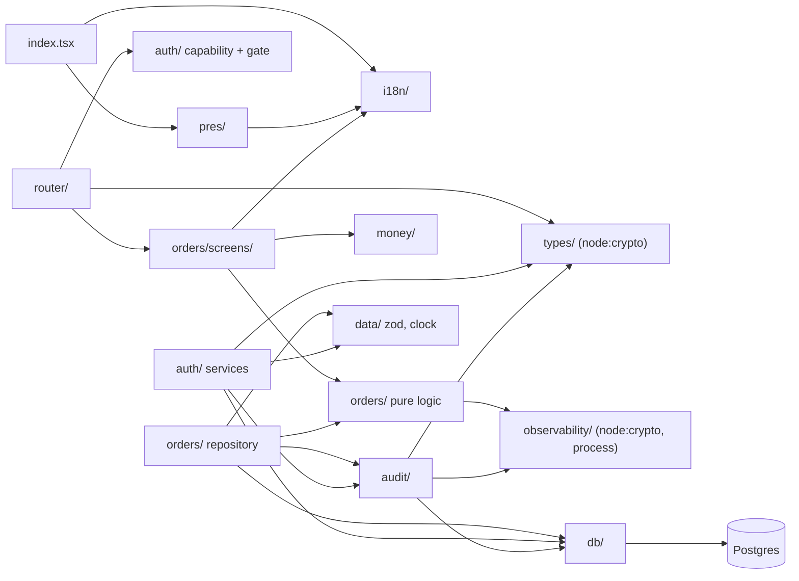

# SmartBiz BD — Dependencies

> **Store history.** Prototype dependencies from intent `261004-mvp` (2026-10-04). Production dependencies added by intent `261027-app-wiring` (2026-10-27). Versions are in `technology-stack.md`.

## Production dependencies

### 1. External packages by runtime

| Package | Browser | Server | Test | Notes |
|---|---|---|---|---|
| react, react-dom | yes | — | yes | |
| zod | yes (if screens validate) | yes | yes | Runtime dependency; advisories on it fail Build and Test (project.md §Testing Posture) |
| postgres | **must not** | yes | yes (realdb, via stub elsewhere) | Pool singleton in `src/db/client.ts` |
| argon2 | **must not** (native) | yes | yes | |
| `node:crypto`, `node:fs`, `node:path` | **must not** | yes | yes | `node:crypto` currently reaches the browser closure (P-1) |
| happy-dom, @testing-library/react | — | — | yes | |
| vite, @vitejs/plugin-react | build | — | — | |

### 2. External services

| Service | Status | Notes |
|---|---|---|
| PostgreSQL (managed, free tier, team.md §Dep-3) | Required; schema in 10 migrations | Only external service the code talks to |
| Email delivery | Interface only (`EmailGateway`), with no-op and failing gateways | Invites and recovery need a real gateway or a documented manual fallback |
| Google Fonts | Preloaded by `src/pres/typography.ts` | href likely not a valid stylesheet (P-14); team.md §CS-10 asks for a self-hosted or system Bengali fallback |
| Courier, payment, LLM providers | None | Out of scope for MVP (scope-md §7) |

### 3. Internal module dependencies



Text fallback: `index.tsx` depends only on `pres/` and `i18n/`. The router depends on the pure auth gate, the order screens and `types/` (which imports `node:crypto`). The order screens depend on the pure order logic, `money/` and `i18n/`; the pure order logic reaches `observability/` (node-only) through `order-draft.ts → log.ts`. The order repository and the auth services both depend on `db/`, `audit/`, `data/` and `types/`. `audit/` depends on `db/`, `observability/` and `types/`. No circular imports were found among the files the developer read.

### 4. Browser-closure dependency problem (verified by the developer)

Every module reachable from `src/router/dispatch.ts` was walked (46 files). Two edges pull node-only code into what must become the browser bundle:

| Edge | Node-only API | Fix direction |
|---|---|---|
| `router/hash-router.ts → types/uuid.ts` (for `isUuid`) | `node:crypto.randomUUID` | Move `isUuid` (pure regex) into a browser-safe module, or use `globalThis.crypto.randomUUID` |
| `orders/order-draft.ts → observability/log.ts → observability/correlation.ts` | `node:crypto.randomBytes`, `process.stdout.write` | Inject a logger, or split a browser logger from the server logger |

A trial `vite build` of `src/router/dispatch.ts` in the scratchpad failed with `src/types/uuid.ts (7:9): "randomUUID" is not exported by "__vite-browser-external"`. [dev-scan §"Build System"]

### 5. Database object dependencies

```
users ◄── businesses.owner_user_id (RESTRICT)
users ◄── sessions.user_id, password_resets.user_id (CASCADE), invitations.created_by (RESTRICT)
users ◄── audit_log.actor_user_id, orders.created_by, consignment_link.linked_by (SET NULL)
businesses ◄── sessions.business_id, invitations.business_id (NOT NULL, CASCADE)
businesses ◄── audit_log.business_id, orders.business_id, order_items.business_id,
               consignment_link.business_id (NOT NULL, RESTRICT)
audit_log ◄── audit_log.reverses_id (self, RESTRICT)
orders ◄── order_items.order_id, consignment_link.order_id (UNIQUE), orders.repeat_of_order_id
orders: UNIQUE (business_id, order_no), order_no drawn from one global sequence
orders.customer_id, order_items.variant_id → TEXT, no FK (customers and products have no tables yet)
```

The two `NOT NULL` foreign keys to `businesses` are why the zero-UUID fallback in `signIn` and `requestRecovery` fails on real Postgres (P-2).

### 6. Grant dependencies

The future server process connects as a member of `app_role`. Its grants (migrations 0007–0010) cover `audit_log`, `orders`, `order_items`, `consignment_link` and the order sequence only. The auth functions depend on SELECT, INSERT, UPDATE and DELETE on five tables that have **no grants** (P-5).

### 7. Upstream design-contract dependencies

The production code cites FR, NFR, BR and ADR ids from the `261004-mvp` record (functional design, NFR design, unit-of-work). The prototype's `screen-map.js` contract is not imported by production code; there is no story-coverage analogue yet.

---

## Prototype reference (`prototype/`, preserved from the 261004-mvp scan of 2026-10-04)

The prose below was written by the 261004-mvp reverse-engineering run against `prototype/` and is kept unchanged except that every heading moved down one level. The prototype is read-only guidance (team.md §WoW-4); it was not re-read in depth by this run.

### Scope

The prototype has **zero runtime dependencies**. The only network resource is the Google Fonts stylesheet declared in `index.html`. The test sub-package (`prototype/tests/`) has two resolved npm packages and one external binary (Google Chrome).

This document enumerates **every dependency** in the prototype — runtime, test, build-time, and design-contract — and the dependencies between prototype files (the load-order graph). For language/framework versions see `technology-stack.md`. For the in-process call graph see `architecture.md`.

---

### 1. Runtime dependencies

**None.** No npm runtime libraries, no bundled JavaScript, no CSS preprocessor output. The application runs in any modern browser that supports ES5 IIFEs, `Array.prototype.forEach`, `Object.keys`, custom properties, and CSS3 transitions.

| Type | Source | Where |
|---|---|---|
| Google Fonts stylesheet | `https://fonts.googleapis.com/css2?family=Hind+Siliguri:wght@400;500;600;700&family=Noto+Serif+Bengali:wght@500;600;700&display=swap` | `index.html` line 9 |
| Google Fonts preconnect | `https://fonts.googleapis.com` and `https://fonts.gstatic.com` (`crossorigin`) | `index.html` lines 7–8 |
| System Bengali fallback | Local OS fonts (`Noto Sans Bengali`, system Bengali) | `tokens.css` `--font-ui`, `--font-display` chains |

No analytics, no telemetry, no service workers, no manifest, no `localStorage`, no `sessionStorage`, no IndexedDB. Persistence is **none** — every reload reverts to `App.TODAY = '2026-09-07'` seed.

---

### 2. Test-time dependencies (`prototype/tests/`)

Declared in `prototype/tests/package.json` line 18–19. The `node_modules/` directory is gitignored.

| Package | Version | Resolved in | Used by | Purpose |
|---|---|---|---|---|
| **jsdom** | `^29.1.1` | `node_modules/jsdom` | `boot.js` (and 8× `smoke.js`/`auth-zero.js`/`truth.js`/`flows.js`/`classes.js`/`story-coverage.js`) | Headless DOM with `VirtualConsole`, `pretendToBeVisual`, `runScripts: 'outside-only'`, manual `window.eval` of the eleven script files |
| **ws** | `^8.21.3` | `node_modules/ws` | `shot.js`, `measure.js` | DevTools Protocol WebSocket client for real-Chrome CDP |

External binary (hard-coded path; not in `package.json`):

| Binary | Path | Used by | Purpose |
|---|---|---|---|
| **Google Chrome** (headless) | `/Applications/Google Chrome.app/Contents/MacOS/Google Chrome` | `shot.js` (line 10), `measure.js` (line 6) | CDP target on port 9333 (shot) / 9334 (measure) |

---

### 3. Build-time / design-contract dependencies

These are **not** npm packages but are loaded at runtime by the prototype and must be reachable at boot/test time.

| File | Where consumed | Owner |
|---|---|---|
| `_bmad-output/planning-artifacts/ux-designs/ux-SmartBiz-2026-09-07/mockups/screen-map.js` | Loaded by `index.html` line 66 between `ui.js` and `screens-core.js`. Exposes `window.SMARTBIZ_SCREEN_MAP` (a `RAW_SCREENS` array of 76 stories). Consumed by `screens-journeys.js` and `tests/story-coverage.js`. | Mockup set (authoritative). The prototype does not own story IDs, titles, states or proof copy. |
| `_bmad-output/planning-artifacts/epics.md` | Read by `tests/story-coverage.js` for the 76-story parity check. | Mockup set (authoritative). |

These two contracts are the **authoritative design surface**. The prototype's `App.SCREEN_INDEX` (75 entries) and `App.screens.*` registrations are an attempt to honour them; if they disagree, the bigger contract wins. [dev-scan §"Tech debt signals" #4]

---

### 4. Inter-file load-order graph

There are no `import` statements anywhere in `prototype/js/`. The dependency graph is the **load order** declared in `index.html` lines 62–73:

```
i18n.js
  └─► data.js
        └─► ui.js
              └─► [screen-map.js from mockup set]
                    └─► screens-core.js
                          └─► screens-orders.js
                                └─► screens-catalog.js
                                      └─► screens-money.js
                                            └─► screens-system.js
                                                  └─► screens-journeys.js
                                                        └─► app.js
```

Every module declares `window.App = window.App || {};` so the global is additive; every screen module writes to `App.screens`, `App.actions`, `App.state`, and (in one case) `App.parseMessage`.

#### 4.1 Each module's dependencies

| Module | Reads from `App.*` | Writes to `App.*` |
|---|---|---|
| `i18n.js` | — | `lang`, `L`, `bnDigits`, `n`, `tk`, `tkPlain`, `unit`, `date`, `time`, `ago` |
| `data.js` | `L` | `TODAY`, `ROLES`, `business`, `products`, `customers`, `couriers`, `orders`, `settlementRun`, `expenses`, `dues`, `suppliers`, `audit`, `initials`, `get.{product,customer,courier,order}`, `econ`, `unitPrice`, `risk`, `stockOf`, `lowVariants`, `summary`, `countByStatus`, `variantLabel`, `RECOGNITION` |
| `ui.js` | `L`, `n`, `tk`; reads `ROLES`, `role`, `summary`, `lang`; reads `screens`/`actions`/`state` (creates them) | `I`, `esc`, `moneyLevel`, `seesProfit/Price/Cost`, `canCreateOrders`, `canReach`, `STATUS`, `NAV`, `navVisible`, `sheetStack`, `screens`, `actions`, `state`, `ui` (16) |
| `screens-core.js` | `L`, `n`, `tk`, `bnDigits`, `esc`, `ui`, `I`, `ROLES`, `role`, `summary`, `canReach`, `seesProfit`, `parseMessage` | `screens.{splash,signin,register,recovery,invite,invitations,setup,home,insights}`; `actions.{pick-lang,share-card,ai-ask,ai-run,cust-band}` |
| `screens-orders.js` | `L`, `n`, `tk`, `bnDigits`, `esc`, `ui`, `I`, `orders`, `countByStatus`, `summary`, `seesProfit`, `unit`, `customers`, `parseMessage` | `screens.{orders,capture,order}`; `actions.{order-filter,paste-demo,paste-parse,pick-variant,advance}`; `parseMessage` |
| `screens-catalog.js` | `L`, `n`, `tk`, `bnDigits`, `esc`, `ui`, `I`, `role`, `summary`, `canReach`, `canCreateOrders`, `lowVariants`, `stockOf`, `risk`, `products`, `customers` | `screens.{customers,customer,products,product,inventory}`; `actions.{cust-band,vstock,vactive,vprice,do-repeat,voice-toggle,mic-toggle}` |
| `screens-money.js` | `L`, `n`, `tk`, `bnDigits`, `esc`, `ui`, `I`, `settlementRun`, `expenses`, `dues`, `suppliers`, `summary`, `econ`, `canReach` | `screens.{cod,settlement,expenses,dues,suppliers,reports}`; `actions.{disposition,variance-matched,disposition-save}` |
| `screens-system.js` | `L`, `n`, `tk`, `bnDigits`, `esc`, `ui`, `I`, `audit`, `ROLES`, `role`, `canReach` | `screens.{audit,settings,flows}`; `QUERIES`, `needs`, `askableQueries`, `answerFor` (AI assistant closed set); `actions.{audit-filter}` |
| `screens-journeys.js` | `L`, `bnDigits`, `esc`, `ui`, `I`, `lang`; `window.SMARTBIZ_SCREEN_MAP` | `screens.journeys`; `actions.{journey-action,journey-proof-toast}` |
| `app.js` | **All** (`L`, `lang`, `role`, `device`, `aiOn`, `summary`, `RECOGNITION`, `orders`, `screen`, `I`, `ui`, `n`, `sheetStack`, `ROLES`, `canReach`, `toast`, `closeSheet`) | `go`, `back`, `render`, `rerender`, `SCREEN_INDEX`, `history`, `screens`/`actions` (re-asserted), `boot`; `actions.{completeness-why,basis-why}`; built-ins `back`/`close-sheet`/`noop`/`toggle`/`press`/`pick` |

#### 4.2 Boot-time contracts

`app.js` line 420:

```js
if (document.readyState === 'loading') document.addEventListener('DOMContentLoaded', boot);
else boot();
```

The boot path depends on the order of script-tag evaluation: the IIFEs populate `App.screens`, `App.actions`, `App.state`, `App.I`, `App.ui`, `App.parseMessage`, and `App.RECOGNITION` before `app.js` runs. A reorder or an early `App.go()` call would crash.

`tests/boot.js` line 14–17 explicitly mirrors the load order (`['i18n.js', 'data.js', 'ui.js', '../../_bmad-output/.../screen-map.js', 'screens-core.js', 'screens-orders.js', 'screens-catalog.js', 'screens-money.js', 'screens-system.js', 'screens-journeys.js', 'app.js']`) and then yields to `DOMContentLoaded` to avoid the double-boot trap.

---

### 5. CSS file dependencies

```
tokens.css  (no @imports, no external fonts)
   └─► app.css  (consumes tokens)
         └─► screens.css  (consumes tokens + app primitives)
```

All three files are loaded by `<link>` tags in `index.html` lines 10–12 (in that order). There are no `@import` statements; no CSS preprocessor.

---

### 6. External services and integrations

**None.** No live integrations of any kind. The "Courier & COD" module is **fully simulated** — every courier (`pathao`, `steadfast`, `redx`, `self`) is a row in `App.couriers`, and the seeded `App.settlementRun` represents an imported payout file (`pathao_payout_2026-08-31.csv`). The paste-parser consumes a hard-coded `DEMO_MSG` (`screens-orders.js` line 130–136). The voice-dictation flow is a UI state toggle without actual microphone access.

This is consistent with `scope-md §7` (out-of-scope: "Direct Pathao/RedX/Steadfast integration", "Live bKash/Nagad/payment gateway integration", "WhatsApp Business API", etc.) and `intent-backlog` "Won't-have (deferred — planned)" classification for these items.

---

### 7. What this list is *not*

- It is **not** the production dependency list. The production system will require a bundler, a transpiler (or modern-ES target), a typing layer, a runtime framework (or commitment to vanilla), a database driver, a server framework, an LLM provider for `QUERIES`, and CI/CD tooling.
- It is **not** the design contract. Story IDs, titles, states, proof copy, and screen map are owned by the mockup set (`screen-map.js`, `epics.md`); the prototype's `App.SCREEN_INDEX` honours but does not own them.
- It is **not** the data schema. There is no schema in this prototype — only seed values. Production must design the schema, the migration strategy, and the storage abstraction from scratch.

---

## Sources

- `[dev-scan]` — this run's developer scan: build dependencies, browser and server split (trial build), schema, grants
- `[package.json]`, `[bun.lock]` — external packages
- `[src/db/migrations/0001–0010]` — foreign keys and grants (grant lines re-read by the architect)
- `[src/router/dispatch.ts]`, `[src/router/routes.ts]` — imports (re-read by the architect)
- `[team.md §Dep-3, §CS-10]` — free-tier managed DB; Bengali font fallback
- `[project.md §Testing Posture]` — advisories on runtime dependencies
- `[scope-md §7]` — out-of-scope integrations

### Prototype sources (preserved from the 261004-mvp scan)

- `[dev-scan]` — full developer scan, frameworks & libraries, build system, dependencies between files
- `[prototype:index.html]` — Google Fonts `<link>` (line 9), preconnect (lines 7–8), `<link>` order (lines 10–12), `<script>` load order (lines 62–73)
- `[prototype:tests/package.json]` — npm scripts, jsdom version, ws version
- `[prototype:tests/boot.js]` — `FILES` array mirrors load order (line 14–17), `runScripts: 'outside-only'`, `VirtualConsole`
- `[prototype:tests/shot.js]` — Chrome path (line 10), port 9333
- `[prototype:tests/measure.js]` — Chrome path (line 6), port 9334
- `[prototype:css/tokens.css]` — `--font-ui`, `--font-display` fallback chains
- `[prototype:js/i18n.js]` — leading block comment (line 1–4)
- `[prototype:js/data.js]` — `App.TODAY` (line 11), leading block (line 1–4)
- `[prototype:js/ui.js]` — `roleGate` (line 77–108), `NAV` (line 155–182), `App.ui` (line 394–400)
- `[prototype:js/screens-orders.js]` — `parseMessage` (line 141–262), `DEMO_MSG` (line 130–136)
- `[prototype:js/app.js]` — load order comment (line 61), `boot` (line 409–421), `wireBody` (line 269–329)
- `[scope-md §7, §9]` — out-of-scope integrations, free-tier constraint
- `[intent-backlog]` — won't-have (deferred — planned) classification
