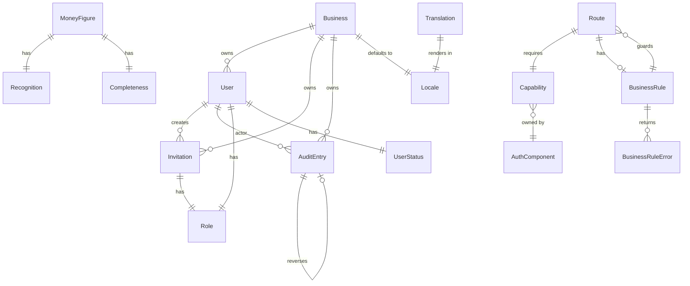

# Functional Spec — U1-foundation (B1)

> Brownfield run (SmartBiz BD). The behavioural
> specification for U1-foundation. This file is the
> **source of truth for workflows and state machines**
> for the U1 unit. The numbered step sequences a use
> case follows and the lifecycle-entity state
> transitions live here because `entities.md` (data
> shape) and `rules.md` (decision logic) do not capture
> ordered behaviour or transitions.
>
> The file also carries two **derived** views for
> readability: an entity-relationship `mermaid` diagram
> (derived from `entities.md`) and a rules summary
> (derived from `rules.md`).
>
> **Sole-developer / solo ownership posture (per
> `team.md#Walking Skeleton`).** Autonomy is `gated` —
> the Owner signs off every Bolt. The functional spec
> is the design that code-generation will implement.

## Sources

- [entities] `aidlc/spaces/default/intents/261004-mvp/construction/u1-foundation/functional-design/entities.md`
- [rules] `aidlc/spaces/default/intents/261004-mvp/construction/u1-foundation/functional-design/rules.md`
- [unit-of-work] `aidlc/spaces/default/intents/261004-mvp/inception/units-generation/unit-of-work.md` — U1 card
- [story-map] `aidlc/spaces/default/intents/261004-mvp/inception/units-generation/unit-of-work-story-map.md`
- [requirements] `aidlc/spaces/default/intents/261004-mvp/inception/requirements-analysis/requirements.md` — 12 FR / 8 NFR
- [contracts] `aidlc/spaces/default/intents/261004-mvp/inception/contract-design/contract-summary.md`
- [bolt-plan] `aidlc/spaces/default/intents/261004-mvp/inception/delivery-planning/bolt-plan.md` — B1 confidence hypothesis
- [team-rules] `aidlc/spaces/default/memory/team.md` — three-layer gate, audit-immutability, role × capability
- [project-rules] `aidlc/spaces/default/memory/project.md` — basis pill + completeness control

## Use cases (the workflows U1 ships)

### UC-1.1: Sign up and provision the business (US1.1)

The Owner signs up; the system provisions a single
Business; the Owner is created with the Owner role.

**Steps.**
1. User visits `/sign-up`; route is `auth.public`;
   required capability is `auth.sign-up`.
2. User submits { email, password, display_name,
   business_name }; form validation runs (BR1.1, BR1.2).
3. Server checks: no Business exists in the deployment
   (BR1.4).
4. Server creates Business (default locale `bn`).
5. Server creates User with role `Owner`, status
   `active`, password_hash via argon2id.
6. Server creates session; redirect to `/onboarding`
   or `/orders` (the first Owner-facing surface).
7. AuditEntry inserted: action `user.create`,
   actor_id = user.id, before/after captures the
   User row.
8. Owner sees the empty DailyCard on the home screen
   (B5 surface; stub for B1).

**Failure modes.**
- Duplicate email (BR1.1) → 400 + toast "Email already
  in use".
- Password too short (BR1.2) → 400 + toast.
- Business already exists (BR1.4) → 500 + system log
  (this is a single-tenant violation; the Owner should
  never see this; the absence of an error path is the
  point — the UI never offers a second sign-up).

### UC-1.2: Sign in (US1.2 path 1)

The Owner signs in with email + password; the session
is created.

**Steps.**
1. User visits `/sign-in`; route is `auth.public`.
2. User submits { email, password }.
3. Server fetches User by (email, business_id); if
   not found, returns 401 with a generic message (no
   user enumeration).
4. Server verifies password_hash (argon2id).
5. Server checks User.status = `active` (BR2.1).
6. Server creates session; sets session cookie.
7. AuditEntry inserted: action `user.sign-in`.
8. User redirected to `/orders` (the first
   Owner-facing surface).

**Failure modes.**
- Invalid credentials → 401 + toast "Email or
  password is incorrect".
- User not active (BR2.1) → 401 + toast "Account not
  active".

### UC-1.3: Password recovery (US1.2 path 2)

The Owner requests a password recovery email; the
system sends a 1-hour token link; the Owner clicks
the link; the Owner sets a new password.

**Steps (request).**
1. User visits `/sign-in` → click "Forgot password"
   → route `/recover`.
2. User submits email.
3. Server looks up User by email; if not found, the
   response is the same as if found (no user
   enumeration).
4. If found: create Invitation-like PasswordReset
   record with token_hash (sha256 of a 1-hour
   random token) and expires_at = now + 1h.
5. Server sends email via the free-tier email
   gateway (external surface; SMTP contract).
6. AuditEntry inserted: action `password.recover`.
7. User sees toast "If your email is registered,
   you'll receive a recovery link shortly".

**Steps (reset).**
1. User clicks the link in the email; URL contains
   the plain token.
2. Route `/reset?token=...` is loaded; route is
   `auth.public`.
3. Server hashes the token, looks up
   PasswordReset by token_hash; checks
   expires_at > now (BR1.3).
4. User submits new password; BR1.2 validation.
5. Server updates User.password_hash.
6. Server sets PasswordReset.accepted_at = now.
7. AuditEntry inserted: action `password.reset`.
8. User redirected to `/sign-in`; toast "Password
   updated".

**Failure modes.**
- Token expired (BR1.3) → 400 + toast "Recovery link
  has expired".
- Token already used → 400 + toast "Recovery link has
  already been used".
- Email gateway failure → 500 + Owner-facing toast
  "Recovery email failed"; Owner can re-trigger
  once per minute (per `contract-summary.md` external
  surface).

### UC-1.4: Invite a staff member (US1.3)

The Owner invites a staff member with a role.

**Steps.**
1. Owner visits `/settings/staff`; route is
   `settings.staff`; required capability is
   `staff.invite`; only Owner has it (BR2.3).
2. Owner submits { email, role }.
3. Server validates email (BR1.1).
4. Server creates Invitation with token_hash
   (sha256 of 1-hour random token) and expires_at =
   now + 1h.
5. Server sends invitation email via the free-tier
   email gateway.
6. AuditEntry inserted: action `invitation.create`.
7. Owner sees toast "Invitation sent".

**Failure modes.**
- Non-Owner attempt (BR2.3) → 403 + lock sheet.
- Duplicate email (BR1.1) → 400 + toast.
- Email gateway failure → 500 + Owner toast.

### UC-1.5: Accept an invitation

The invitee clicks the invitation link.

**Steps.**
1. Invitee clicks the link; URL contains the plain
   token.
2. Route `/accept?token=...` is loaded.
3. Server hashes the token, looks up Invitation by
   token_hash; checks expires_at > now (BR1.3).
4. Invitee submits { display_name, password };
   BR1.1, BR1.2 validation.
5. Server creates User with status `active`, role
   = Invitation.role.
6. Server sets Invitation.accepted_at = now.
7. Server creates session; redirect to `/orders`.
8. AuditEntry inserted: action `invitation.accept`.

**Failure modes.**
- Token expired (BR1.3) → 400.
- Token already used → 400.
- Role = `Owner` is not allowed (the Invitation
  entity constraint).

### UC-1.6: Three-layer gate enforcement (US1.4)

Every route navigation runs the three-layer gate
(BR2.4).

**Steps.**
1. User navigates to a route (e.g. `/orders`).
2. Layer 1 — auth: session is present? If no,
   redirect to `/sign-in`.
3. Layer 2 — capability: does
   `matrix.get(user.role).has(route.requiredCapability)`?
   If no, redirect to `/lock`.
4. Layer 3 — business-rule: if
   `route.businessRule` is present, does
   `route.businessRule.evaluate(state)` return Ok? If
   no, redirect to `/lock`.
5. All three pass → mount the screen.

**Failure modes.**
- Each layer's failure is a redirect; the lock
  screen renders with the reason from
  BusinessRuleError.message_key.

### UC-1.7: Edit business profile (US1.5 path 1)

The Owner edits the business profile.

**Steps.**
1. Owner visits `/settings/business`; required
   capability is `business.edit`; only Owner has it
   (BR2.3).
2. Owner submits { name, locale, timezone, settings
   (tax, currency, basis default) }.
3. Server validates; updates Business.
4. Server triggers UI re-render of chrome (locale
   change applies immediately per BR6.3).
5. AuditEntry inserted: action `business.update`.

### UC-1.8: Per-user settings (US1.5 path 2)

The Owner edits a User's per-user settings (display
name, role).

**Steps.**
1. Owner visits `/settings/staff`; clicks a User.
2. Owner submits { display_name, role }.
3. Server validates role change (BR2.3: only Owner
   can change roles).
4. Server updates User.
5. AuditEntry inserted: action `user.update`.

### UC-1.9: Audit log entry (US3.3 + US3.4 + US3.5 + US3.6 cross-cutting)

Every state-mutating action inserts an AuditEntry
(BR3.1, BR3.3).

**Steps.**
1. Caller invokes a mutation (e.g. `orders.confirm`).
2. Mutation handler computes `before` and `after`
   state.
3. Mutation handler computes the `basis` field
   (recognition value or null).
4. Mutation handler calls
   `AuditService.insert({ business_id, actor_id,
   action, entity_type, entity_id, before, after,
   basis, retention_until = now + 5y })`.
5. AuditService runs the INSERT as the application
   role; the role has INSERT only; UPDATE/DELETE are
   revoked.
6. The audit-immutability CI migration test asserts
   no migration re-grants UPDATE/DELETE.

### UC-1.10: Reversal (US3.3 + US3.5 cross-cutting)

A mutation is reversed; the audit log records the
reversal as a NEW row that references the original
(BR3.3).

**Steps.**
1. Caller invokes a reversal (e.g. `orders.cancel`
   reverses `orders.confirm`).
2. Mutation handler computes `before` and `after`
   state.
3. Mutation handler calls
   `AuditService.insert({ ..., action: 'order.cancel',
   reverses_id: original_audit_entry.id })`.
4. The original row is NEVER updated.

## State machines

U1 owns no per-entity state machine beyond the
audit-log insertion (which is append-only, not a
state machine). The state machines for `Order`,
`Payment`, `Consignment` are owned by U3, U4, and U5
respectively and are produced in their
functional-design passes.

U1's lifecycle entities and their lifecycle:

| Entity | Lifecycle |
|--------|-----------|
| Business | created at sign-up; never deleted (single-tenant) |
| User | created at sign-up or invitation accept; status transitions: `invited` → `active`; `active` → `suspended`; never deleted |
| Invitation | created at invitation; status transitions: pending → accepted (BR1.3); expires after 1h |
| AuditEntry | inserted on every state-mutating action; never modified; reverses_id self-reference for reversals |
| Translation | static; never modified at runtime; renaming a key is a 1-Bolt-cycle deprecation |
| Route | static; never modified at runtime; adding a route is a code change |

## Derived views

### Entity-relationship diagram (derived from `entities.md`)

### Rules summary (derived from `rules.md`)

| ID | Category | Statement (abbreviated) |
|----|----------|-------------------------|
| BR1.1 | validation | Email RFC 5322, lowercase, unique per business |
| BR1.2 | validation | Password argon2id, length ≥ 8, never returned |
| BR1.3 | validation | Invitation token 1h expiry; accepted Invitations cannot be reused |
| BR1.4 | validation | Exactly one Business per deployment |
| BR2.1 | authorization | User must be `active` to sign in |
| BR2.2 | authorization | Role × capability matrix + per-screen rules |
| BR2.3 | authorization | Only Owner can manage staff / business profile / settings |
| BR2.4 | authorization | Three-layer gate: auth → capability → business-rule |
| BR3.1 | constraint | Audit log append-only; UPDATE/DELETE revoked at role |
| BR3.2 | constraint | Audit retention 5y at schema layer, not cron |
| BR3.3 | constraint | Reversals are NEW rows with reverses_id; original never modified |
| BR3.4 | constraint | Single-tenant: all queries scoped by business_id |
| BR5.1 | calculation | Paise-integer arithmetic; no float |
| BR5.2 | calculation | Money math in/out are MoneyFigure; recognition + completeness derived |
| BR5.3 | calculation | Arithmetic checked in jsdom or not at all |
| BR6.1 | policy | Basis pill renders from MoneyFigure.recognition |
| BR6.2 | policy | Completeness control renders from MoneyFigure.completeness |
| BR6.3 | policy | Bangla-first default; Owner can switch to English |
| BR6.4 | policy | Missing translation returns key in dev (warn) / prod (silent) |
| BR6.5 | policy | Money rendering uses Intl with bn-BD / en-US; Bangla digits for bn |

## What this spec does NOT cover

- **U2-U5 use cases.** The Catalog / Orders / Money /
  Operate use cases are produced in their
  functional-design passes. The U1 use cases above
  cover identity, audit, role × capability, locale
  switching, and the cross-cutting audit log.
- **Order / Payment / Consignment state machines.**
  Owned by U3 / U4 / U5. U1 owns no per-entity state
  machine beyond the audit-log insertion.
- **External surface contracts.** The audit-trail CSV
  export (U5 surface) and the password-recovery email
  (U1 surface) are documented in
  `contract-design/contract-summary.md`; the U1 surface
  is the email gateway integration.

## Cross-references

- `entities.md` — the entity model (the data shape)
- `rules.md` — the business rules (the decision logic)
- `frontend-components.md` — the UI primitives
  (Shell / Screen / Field / Pill)
- `traceability.json` — the per-use-case and per-rule
  coverage against stories / FR / NFR / CC-AC
