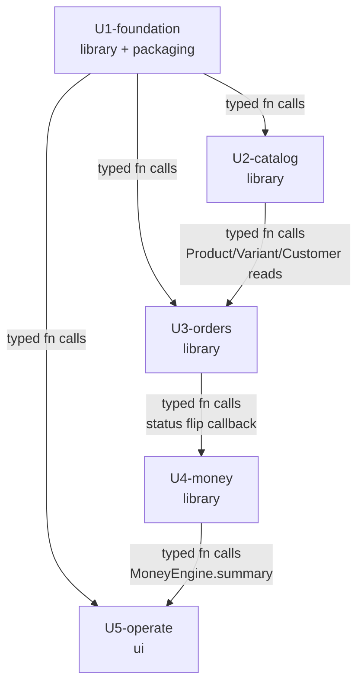

# Unit-of-Work Dependency DAG

> Brownfield run (intent `261004-mvp`). The 5 Units of Work in
> `unit-of-work.md` form a **strict-topological, cycle-free
> dependency DAG** (Q3=A) with **5 nodes and 6 edges**. This
> file is the topology only.
>
> **Stage contract.** Stage 2.7 produces the **dependency DAG**
> (this file). Stage 2.9 Delivery Planning chooses the
> **economic path through it (Bolt sequence)** using WSJF,
> risk-first, value-first, or walking-skeleton-first heuristics.
> This file does NOT recommend an implementation order, does
> NOT identify a critical path, and does NOT pre-empt the
> Delivery Planning heuristic.
>
> **Integration contract (Q4=A).** Every edge is a typed
> function-call across the module boundary (TypeScript
> imports). The Modular Monolith stays in-process; there are
> no REST surfaces, no event-bus, no shared-schema event
> notifications, no outbox-pattern obligation. The
> `depends_on` / `dependents` edges in
> `inception/domain-design/components.md` are typed calls;
> this file restates them at the unit level.

## Machine-readable units (source of truth for the engine)

```yaml
units:
  - name: U1-foundation
    depends_on: []
  - name: U2-catalog
    depends_on: [U1-foundation]
  - name: U3-orders
    depends_on: [U1-foundation, U2-catalog]
  - name: U4-money
    depends_on: [U1-foundation, U2-catalog, U3-orders]
  - name: U5-operate
    depends_on: [U1-foundation, U4-money]
```

## DAG (5 nodes, 6 edges)

```
U1-foundation  ─────────────┬──────────────┬──────────────┐
   (root)                   │              │              │
                            ▼              ▼              ▼
                       U2-catalog    U3-orders      U5-operate
                            │              │              ▲
                            └──────┐       │              │
                                   ▼       ▼              │
                                U4-money ─────────────────┘
```

| From | To | Edge type | Per-edge integration contract |
|---|---|---|---|
| U1-foundation | U2-catalog | typed function-call | CatalogComponent imports `DataComponent` (typed getters/setters for `Customer`/`Product`/`Variant`/`Supplier`/`Stock`), `I18nComponent` (`L`, `bnDigits`, `tk`), `PresentationComponent` (RiskChip, BarRow, ProvenanceCell), `AuthComponent` (audit append via AuditService). |
| U1-foundation | U3-orders | typed function-call | OrdersComponent imports `DataComponent` (typed getters/setters for `Order`/`OrderItem`), `I18nComponent`, `PresentationComponent` (BasisPill, CompletenessControl, StatusChip), `AuthComponent` (audit append via AuditService). |
| U1-foundation | U5-operate | typed function-call | OperateComponent imports `DataComponent` (typed getters/setters for `BusinessSettings`/`AuditView`), `I18nComponent`, `PresentationComponent` (BasisPill, CompletenessControl), `AuthComponent` (audit append; read of `Audit` rows for the audit-trail export). |
| U2-catalog | U3-orders | typed function-call | OrdersComponent reads `Customer` / `Product` / `Variant` from Catalog's typed surface; `OrderItem.productId` + `Order.customerId` resolve via Catalog's getter. |
| U3-orders | U4-money | typed function-call (U4 → U3) | MoneyComponent calls back into OrdersComponent to flip the order's status (`Order moves to settled`) and to read the order's items / paid amount. U3 → U4 is implicit through the typed function import of `DataComponent` (the order's `status` field is in `Order`; MoneyComponent reads / writes through DataComponent's typed setter). |
| U4-money | U5-operate | typed function-call (U5 → U4) | OperateComponent reads `MoneyEngine.summary` for the DailyCard's today-earned / today-realised / today-outstanding-dues figures. (U5 → U4, not U4 → U5 — the direction of the dependency is read from the deeper unit to the shallower.) |

> **Edge direction convention.** The DAG edge `A → B` means **A
> is depended on by B**: B imports A's typed surface. The
> foundation (U1) has zero incoming edges; U4 is depended
> on by U5 for the DailyCard read; U2 is depended on by U3
> (and by U4 for `Product`/`Variant` reads); U3 is depended
> on by U4 (for status flips). The longest path is
> `U1 → U3 → U4 → U5` (depth 4).

## Mermaid



## Per-edge contract table (machine-readable summary)

| Edge | Direction | From-API surface | To-API surface | Returns | Failure mode |
|---|---|---|---|---|---|
| U1 → U2 | one-way (U2 imports U1) | `Auth.appendAudit(actor, business, entity, before, after)` | CatalogComponent audit appends on customer/product/supplier/stock mutations | `AuditRow` (append-only) | throw `AuditImmutabilityError` if DB role holds `UPDATE`/`DELETE`; CI test catches re-grant migration |
| U1 → U2 | one-way (U2 imports U1) | `Data.getCustomer(id)`, `Data.putCustomer(c)`, `Data.listCustomers(filter)`, `Data.getProduct(id)`, `Data.listVariants(productId)`, `Data.getSupplier(id)`, `Data.adjustStock(variantKey, delta, reason)` | CatalogComponent reads / writes | typed entity | throw on missing business FK (CC-AC-TENANT) |
| U1 → U2 | one-way (U2 imports U1) | `I18n.L(bn, en)`, `I18n.bnDigits(n)`, `I18n.tk(key)` | CatalogComponent copy + numeral + token reads | `string` | never throws (pure) |
| U1 → U3 | one-way (U3 imports U1) | `Data.getOrder(id)`, `Data.putOrder(o)`, `Data.listOrders(filter)`, `I18n.*`, `Pres.BasisPill`, `Pres.CompletenessControl`, `Pres.StatusChip`, `Auth.appendAudit` | OrdersComponent reads / writes | typed entity | throw on missing business FK; status enum exhaustive (`never` default) |
| U1 → U5 | one-way (U5 imports U1) | `Data.getBusinessSettings(businessId)`, `Data.putBusinessSettings(s)`, `Data.exportAudit(filter)`, `I18n.*`, `Pres.*`, `Auth.appendAudit` | OperateComponent reads / writes | typed entity | throw on missing business FK; export is read-only projection of `Audit` |
| U2 → U3 | one-way (U3 imports U2) | `Catalog.getCustomer(id)`, `Catalog.getProduct(id)`, `Catalog.listVariants(productId)` | OrdersComponent reads for `OrderItem.productId` / `Order.customerId` resolution | typed entity | throw on missing customer / product; absence-asserted test catches cross-tenant reads (CC-AC-TENANT) |
| U3 → U4 | one-way (U4 imports U3) | `Orders.markSettled(orderId)`, `Orders.markDelivered(orderId)`, `Orders.getOrder(id)` | MoneyComponent calls back to flip status | updated `Order` | throw on illegal status transition (exhaustive `switch` + `never` default) |
| U4 → U5 | one-way (U5 imports U4) | `MoneyEngine.summary(today)` | OperateComponent reads for DailyCard | `{ earnedTotal, realisedTotal, outstandingDues, basisPill, completeness }` | never throws (pure) |

> **No reverse edges.** The 3 deferred input modules
> (`PhotoOrderComponent` / `SpreadsheetOrderComponent` /
> `VoiceOrderComponent`) are placeholders inside U3-orders
> and do not introduce new edges. The audit-trail read on
> U5 → U1 is a read-only projection of the `Audit` table
> (already owned by AuthComponent inside U1); no cycle
> is created (Q3=A — the candidate C "soft cycle" is
> rejected because the read resolves in-DAG).

## Depth table (longest dependency chain per unit)

| Unit | Depth | Longest chain | Notes |
|---|---|---|---|
| U1-foundation | 0 | — | Root; zero incoming edges. |
| U2-catalog | 1 | U1 → U2 | Depends only on U1. |
| U3-orders | 2 | U1 → U2 → U3 | Depends on U1 and U2. |
| U4-money | 3 | U1 → U2 → U3 → U4 | Depends on U1, U2, U3. |
| U5-operate | 4 | U1 → U3 → U4 → U5 | Depends on U1 and U4 (and indirectly on U2, U3). |

> **Note on U5 depth.** U5 depends on U1 (foundation) and U4
> (MoneyEngine summary for the DailyCard). U5 does **not**
> depend on U2 or U3 directly, but those units are in the
> longest chain because U4 depends on them. The chain
> `U1 → U3 → U4 → U5` is depth 4 (3 edges); U5's longest
> chain is therefore 3 incoming edges.

## Parallel development opportunities

After U1 lands, the following units can be developed in
parallel until their downstream dependents catch up:

| After U1 lands | After U2 lands | After U3 lands | After U4 lands |
|---|---|---|---|
| {U2, U3, U5} in parallel | U3 continues (with U5 still parallel) | U4 starts (with U5 still parallel) | U5 finalises DailyCard surface |

> **This is the topological view only.** Stage 2.9 Delivery
> Planning chooses the actual Bolt sequence. The walking-
> skeleton-first heuristic may pick a thin slice through
> U1 → U3 → U4 → U5 first and let U2 (catalog) ride in
> parallel; the value-first heuristic may pick U1 → U2 →
> U3 first to land the customer / order surface; the risk-
> first heuristic may pick U1 first and prove the audit-
> immutability migration test before anything else. The
> DAG bounds the possible orderings; the Delivery Planning
> stage picks the economic one.

## Why strict-topological (Q3=A) and not stub-forward (Q3=B) or cycle-tolerant (Q3=C)

- **No forward edge.** Every component-level `depends_on` in
  `inception/domain-design/components.md` resolves in-DAG
  without stubs. A stub `U1 → U4` edge (Q3=B) would let U4
  start schema / entity definitions in parallel with U1's
  AuditService finishing, but U4's typed surface
  (`MoneyComponent`) imports `AuditService` (a U1 sub-module)
  directly — the stub is redundant with the real edge. The
  5-component story is small enough that the parallelism
  win is not worth the bookkeeping.
- **No soft cycle.** The U4 → U1 audit-trail read is a
  read-only projection of the `Audit` table owned by U1. It
  does not create a cycle because U5 (the only consumer of
  the read) is a leaf; the read resolves in-DAG. Marking
  this as a "soft cycle" (Q3=C) would muddy the DAG without
  binding benefit; the absence-asserted test in U1's
  independence test (`AuditService` is a U1 sub-module, and
  the read goes through `Data.exportAudit`) already
  documents the coupling.

## Cycle check

- **Forward edges:** 0
- **Reverse edges:** 0
- **Cycles:** 0
- **Stub edges:** 0
- **Soft cycles:** 0

The DAG is a DAG: a strict-topological, cycle-free, single-
rooted dependency graph. Topological sort order (one valid
order; many exist) is `U1 → U2 → U3 → U4 → U5`.

## Sources

- [components] `aidlc/spaces/default/intents/261004-mvp/inception/domain-design/components.md` — per-component `depends_on` / `dependents`
- [decisions] `aidlc/spaces/default/intents/261004-mvp/inception/domain-design/decisions.md` — 6 ADRs
- [unit-of-work] `aidlc/spaces/default/intents/261004-mvp/inception/units-generation/unit-of-work.md` — 5 unit cards
- [architecture-patterns] `.claude/knowledge/aidlc-architect-agent/architecture-patterns.md` — Modular Monolith
- [workflow-planning-guide] `.claude/knowledge/aidlc-delivery-agent/workflow-planning-guide.md` — Bolt sequencing heuristics (WSJF, risk-first, value-first, walking-skeleton-first)