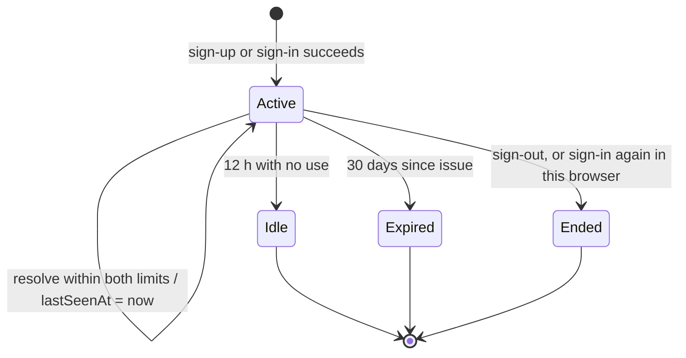
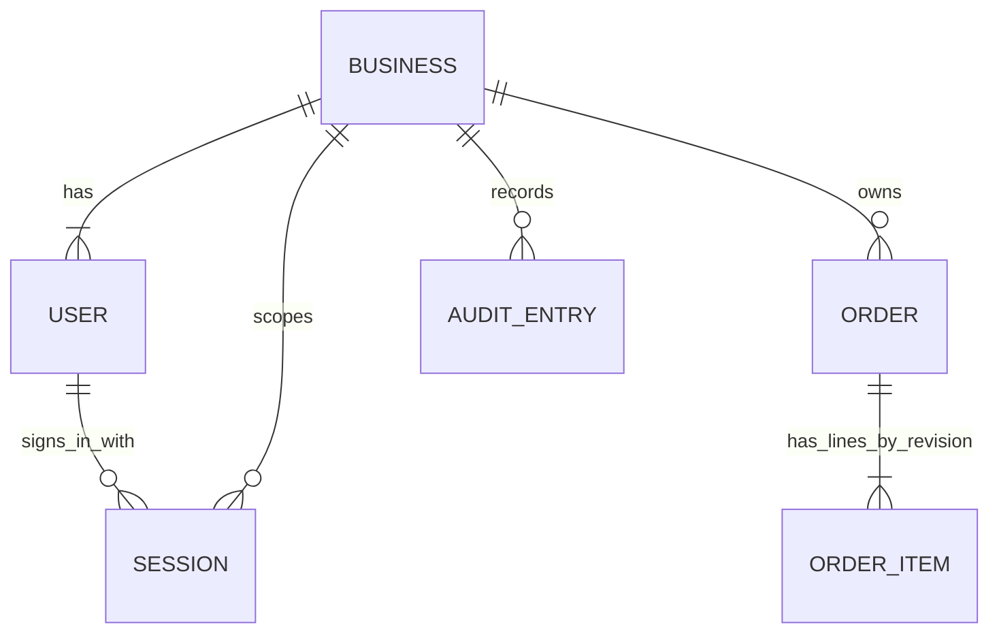

# Functional Specification — u1-skeleton

> Source of truth for U1's workflows and state machines. Data shapes: `entities.md`. Decision logic:
> `rules.md` (BR1–BR10). Decisions: `functional-design-questions.md` Q1–Q12. Contracts: C1 (HTTP
> conventions), C2 (auth), C3 (orders), C9 (grants) in `../../../inception/contract-design/contract-summary.md`.

## Overview

U1 is the walking skeleton: the thinnest slice that runs end to end on this machine. One command
builds the browser app and starts a bun server on `127.0.0.1`; the Owner creates the business on first
run, signs in with a Postgres-backed session, creates an order on the existing order screens through the
real API, sees it listed, and signs out. Everything else (other screens mounted, the full role walk,
staff, catalog) belongs to U2–U5.

Contract amendments made here are written into `contract-summary.md` §"Amendments from U1 Functional
Design": the session cookie carries `Max-Age` equal to the time left to the 30-day cap (Q3); `order_items`
loses DELETE and gains revisions (Q1); auth kinds pass through unchanged with their own statuses, and
`rate_limited` is returned by sign-in with `Retry-After` (Q2, Q6).

## Workflows

### W1 — Start the server (BR1.1–BR1.3, BR1.6, BR9.1)

1. Read `PORT` (default 3000) and `DATABASE_URL`; stop if either is invalid (BR1.3).
2. Build the route table; stop if any route has neither a capability nor a public marker (BR1.6).
3. Connect; stop if the user is a superuser or not a member of `app_role` (BR1.2).
4. Bind `127.0.0.1:PORT`; serve `dist/` for non-API paths (the SPA's `index.html` for unknown non-API paths) and `/api/` from the route table.

Error paths: any stop prints one line naming the problem and exits non-zero; nothing is served.

### W2 — Every API request (BR1.5–BR1.11, BR3.6, BR3.8)

1. Assign a correlation id.
2. Body over 64 KiB → 413. State-changing method with a missing or foreign Origin, or a non-JSON content type → 403.
3. Match the route; none → 404 `not_found`.
4. If the route is not public: read `__Host-sb_session`, resolve it (W5); no valid session → 401.
5. If the route names a capability the session's role lacks → 403.
6. Parse params, query and body with the route's strict schemas; failure → 400 with field paths.
7. Call the one domain function with the context built from the session (business, user, role).
8. Map the Result: ok → the route's success status and body; error → the C1 status table (total mapping).
9. Add the security headers, `Cache-Control: no-store` and `X-Correlation-Id`.

Error paths: a database connection or timeout error at any step → 503 `db_unavailable`; any other exception → logged 500 `internal` with the correlation id.

### W3 — First run and sign-up (BR2.1–BR2.5, BR3.1, BR3.2)

1. The app calls `GET /api/setup`; `businessExists: false` → show `#/sign-up`, else `#/sign-in`.
2. The Owner submits business name, email and password.
3. Validate (BR2.4); a business already exists → 409 `business_exists` (BR2.1).
4. One transaction: insert the User (role owner, `businessId` = new business id), the Business (`ownerUserId` = new user id), and the `auth.sign_up` audit row; the deferred reference is checked at commit (BR2.2).
5. A second racing sign-up fails at commit on the singleton rule → 409 `business_exists` (BR2.3).
6. Create a session (W4 steps 5–6) and answer 201 with the Session body and Set-Cookie.

Error paths: database unreachable → 503 and the form keeps its values (BR2.5); invalid input → 400 per field.

### W4 — Sign-in (BR3.1–BR3.3, BR4.1–BR4.4)

1. Normalise the typed email (trim, lower-case) as the rate-limit key.
2. Reserve an attempt for the key in one synchronous step; if 5 are already reserved in its fixed 15-minute window → 429 with `retryAfterMinutes` and `Retry-After`; stop (BR4.2).
3. Look up the user by email ignoring case; verify the password; require `active`.
4. On failure: keep the reservation; write `auth.sign_in.failure` (subject user id if matched, reason code, no typed text) unless no business exists; answer the identical 401 (BR4.1, BR4.3).
5. On success: clear the key; generate the token; in one transaction delete the session matching the request's cookie (if any), insert the new session (`expiresAt` = now + 30 days, `lastSeenAt` = now) and write `auth.sign_in`.
6. Answer 200 with `{user: PublicUser, businessId, capabilities}` and Set-Cookie (`Max-Age` = seconds to `expiresAt`).

### W5 — Resolve a session (BR3.4–BR3.7)

1. No cookie → unauthenticated.
2. Hash the cookie value; in one statement, using `now` from the app clock: find the session with that hash whose `expiresAt` > now and `lastSeenAt` + 12 h > now and whose user is active; set its `lastSeenAt` to now; return user id, business id, role and email.
3. No row → unauthenticated (expired, idle, inactive, signed out or forged: indistinguishable to the caller).

### W6 — Sign-out (BR5.1–BR5.3)

1. Hash the cookie (if any) and, in one transaction, delete the matching session and, only if a row was deleted, write `auth.sign_out`.
2. Always answer 204 with the clearing Set-Cookie.

### W7 — Create an order from a screen (BR6.1, BR6.2, BR8.2, BR8.5)

1. The input screen builds the request from the draft and calls the client's `createOrder`.
2. The server runs W2, then B2's `createOrder` (audit first, items at revision 1).
3. 201 → the client puts the order at the top of the loaded page and the screen opens the list with "সংরক্ষণ হয়েছে".
4. 400 → each field path's Bangla message under its input; typed values stay.
5. 401 → W9. 403 → lock screen. 503 / unreachable → banner with retry; nothing is resent automatically.

### W8 — Edit an order's lines (BR6.3, BR6.8)

1. `PATCH /api/orders/{id}` with `items` (and any other editable fields).
2. In one transaction: lock the order; refuse with `not_editable` if its status no longer allows edits; write the audit row (before/after); insert the new lines with `revision` = `itemsRevision` + 1; set `itemsRevision` to that value with the other changed fields.
3. Answer 200 with the order built from the new revision.

No line row is updated or deleted; every earlier revision stays readable for the audit trail.

### W9 — Session expiry in the app (BR8.1)

1. Any 401 → the client stores the current route in memory and navigates to `#/sign-in` with "আবার সাইন ইন করুন".
2. After W4 succeeds the app navigates back to the stored route; with none stored, to `#/orders`.

### W10 — The skeleton check (BR10.1–BR10.3)

1. Stop with a clear message if `REALDB_ADMIN_URL` or `REALDB_APP_URL` is unset.
2. Migrate a fresh database twice (idempotency), then compare `app_role`'s grants with the declared set.
3. Start the server as a child process on a free port with `DATABASE_URL` = the app URL.
4. Over HTTP: `GET /api/setup` (false) → sign-up → `GET /api/session` → `POST /api/orders` → `GET /api/orders` contains it → sign-out → the old cookie gets 401 on `GET /api/session`; check BR1.7 headers on every response.
5. Refusals: insert one active user per non-Owner role directly in the database, sign each in, and walk every route in the server route table, asserting 403 or success per the role table, 401 without a cookie, and 403 for a cross-origin or non-JSON POST.
6. In happy-dom, render every route U1 mounts for a signed-in Owner and assert each heading (U2 and U3 extend this walk).
7. Stop the child server; exit non-zero on any failure.

## Migrations (BR9.4, BR6.10)

| # | Migration | Steps | Fails when |
|---|-----------|-------|-----------|
| 0011 | `users_business_link` | add `users.business_id` nullable; fill from `businesses.owner_user_id`; set NOT NULL; add the deferrable reference; add `businesses_singleton_idx` | any user has no business (`users_without_business`) |
| 0012 | `sessions_token_hash` | only if `token_hash` is absent: delete every session row (none was ever usable), add `token_hash` NOT NULL and its unique index; a re-run signs nobody out | — |
| 0013 | `users_email_ci_unique` | check for emails equal ignoring case; drop `users_email_lower_idx`; add unique index on lower(email) | a case duplicate exists (`users_email_case_duplicate`) |
| 0014 | `auth_grants` | exact grants on users, businesses, invitations, password_resets, sessions | — |
| 0015 | `order_item_revisions` | add `orders.items_revision` and `order_items.revision` (default 1); drop `UNIQUE(order_id, line_no)`; add `UNIQUE(order_id, revision, line_no)` and an index on (order_id, revision); revoke DELETE on order_items | — |

Every migration is idempotent and runs under the admin URL; running the set twice changes nothing (the wiring check does exactly that).

## State machines

### Session state machine

Text fallback: a session starts Active at sign-up or sign-in. Each successful use keeps it Active and moves `lastSeenAt`. It becomes Idle after 12 hours without use, Expired 30 days after issue regardless of use, or Ended when signed out or replaced by a new sign-in in the same browser. Idle, Expired and Ended are terminal and all answer 401; Ended deletes the row, Idle and Expired rows stay until a later clean-up (not in this intent).

| Current | Event | Guard | Next | Actions |
|---------|-------|-------|------|---------|
| — | sign-up / sign-in | credentials valid | Active | insert row with tokenHash; Set-Cookie; audit |
| Active | request | now < expiresAt and now < lastSeenAt + 12 h and user active | Active | lastSeenAt = now |
| Active | request | now ≥ lastSeenAt + 12 h | Idle | 401 |
| Active | request | now ≥ expiresAt | Expired | 401 |
| Active | sign-out | row exists | Ended | delete row; audit auth.sign_out; clear cookie |
| Active | sign-in in same browser | new credentials valid | Ended | delete old row in the new session's transaction |

### Order lines revision

| Current | Event | Guard | Next | Actions |
|---------|-------|-------|------|---------|
| itemsRevision = n | edit with items | order editable | itemsRevision = n + 1 | audit first; insert lines at n + 1 |
| itemsRevision = n | edit without items | order editable | itemsRevision = n | audit first; update order fields only |
| itemsRevision = n | edit | not editable | unchanged | 409 not_editable |

The B2 nine-value order status machine is unchanged.

## Interfaces (U1 endpoints; full shapes in C2 and C3)

| Method and path | Capability | Success | Errors |
|-----------------|------------|---------|--------|
| GET /api/health | public | 200 {status, db} | — |
| GET /api/setup | public | 200 {businessExists} | 503 |
| POST /api/auth/sign-up | public | 201 Session + cookie | 400, 409 business_exists, 503 |
| POST /api/auth/sign-in | public | 200 Session + cookie | 401, 429, 503 |
| POST /api/auth/sign-out | public | 204 | — |
| GET /api/session | any signed-in | 200 Session | 401 |
| GET /api/orders | business.view | 200 page | 400, 401, 403 |
| POST /api/orders | money.mutate.price or full | 201 Order | 400, 401, 403 |
| GET /api/orders/{id} | business.view | 200 Order | 401, 403, 404 |
| PATCH /api/orders/{id} | money.mutate.price or full | 200 Order | 400, 403, 404, 409 |
| POST /api/orders/{id}/status | money.mutate.price or full | 200 Order | 400, 403, 404, 409 invalid_transition |
| POST /api/orders/{id}/consignment | money.mutate.price or full | 201 Order | 400, 403, 404, 409 |

## Entity-relationship view (derived from `entities.md`)

Text fallback: one Business has one or more Users and any number of Sessions, Orders and AuditEntries; a User has any number of Sessions; an Order has one or more OrderItems, grouped by revision, of which only the current revision is read.

## Rules summary (derived from `rules.md`)

| Area | Key rules |
|------|-----------|
| Start and requests | 127.0.0.1 only (BR1.1); refuse superuser or non-`app_role` (BR1.2); gated-or-public route table (BR1.6); headers (BR1.7); Origin + JSON on writes (BR1.8); 64 KiB (BR1.9); total error mapping (BR1.10); 503 and 500 behaviour (BR1.5, BR1.11) |
| Sign-up | first run only, singleton, one transaction, ≥ 10-character password, no false `email_taken` (BR2.1–BR2.6) |
| Sessions | random token, hash stored, `__Host-` cookie, 30-day cap, 12-hour idle, one-statement resolve, survives restart, context from session only (BR3.1–BR3.8) |
| Sign-in / out | identical 401, per-email limit with 429, audit without typed text, idempotent sign-out (BR4.1–BR5.3) |
| Orders | capabilities, audit first, strict parsing, 404 for non-UUID and foreign ids, 50-row keyset, append-only line revisions, p95 ≤ 300 ms (BR6.1–BR6.9) |
| Split and client | browser import rules, ≤ 350 KB, Web Crypto helpers, one-way imports, 401 return, field errors, list states, 10 s timeout, no write retry (BR7.1–BR8.6) |
| Grants and check | exact grant set, auth grants added, `order_items` DELETE revoked, audit insert-only, scripted end-to-end check (BR9.1–BR10.3) |

## Validation (fields U1 adds or changes)

| Field | Type | Required | Min | Max | Rule |
|-------|------|----------|-----|-----|------|
| sign-up `businessName` | text | yes | 1 | 120 | trimmed |
| sign-up / sign-in `email` | text | yes | 3 | 254 | one `@`, a dot after it; compared ignoring case |
| sign-up `password` | text | yes | 10 | 200 | not trimmed |
| orders list `limit` | integer | no | 1 | 50 | default 50 |
| orders list `cursor` | text | no | — | 200 | must decode to an ISO time and a UUID |
| orders list `customerId` | text | no | 1 | 100 | exact match until U5 |

## Error catalogue (U1)

| Kind | Status | Where | Shown to the person (Bangla) |
|------|--------|-------|-------------------------------|
| invalid_input, invalid_email, password_too_short | 400 | parse failure; sign-up input | per field, from the client copy table |
| invalid_credentials | 401 | sign-in failure (identical body every time) | "ইমেইল বা পাসওয়ার্ড ভুল" |
| unauthenticated | 401 | no, expired or idle session | "আবার সাইন ইন করুন" |
| email_taken | 409 | sign-up with an existing email (no business case) | "এই ইমেইল আগেই ব্যবহার হয়েছে" |
| forbidden | 403 | capability, Origin, content type | lock screen "এই অংশ আপনার দায়িত্বের বাইরে" |
| not_found | 404 | unknown route or order | "পাওয়া যায়নি" |
| business_exists | 409 | sign-up | "এই ব্যবসা আগেই তৈরি হয়েছে। মালিকের কাছে আমন্ত্রণ লিংক চান।" |
| not_editable / invalid_transition / already_linked / conflict | 409 | order edits | the B2 copy for each |
| payload_too_large | 413 | any write | "তথ্য অনেক বড়" |
| rate_limited | 429 (+ Retry-After) | sign-in | "অনেকবার চেষ্টা হয়েছে। N মিনিট পর আবার চেষ্টা করুন।" |
| internal | 500 | thrown error | "কিছু একটা ভুল হয়েছে" with the correlation id |
| db_unavailable | 503 | database down | "ডাটাবেস চালু নেই। কিছুক্ষণ পর আবার চেষ্টা করুন।" |
| unreachable (client only) | — | network failure or 10 s timeout | "সার্ভারের সাথে যোগাযোগ হচ্ছে না" |

## Traceability

Every U1 acceptance criterion maps to rules in `traceability.json` (42 ACs, 0 gaps; AC5.2a.2 is narrowed to U1's routes per the units review).
