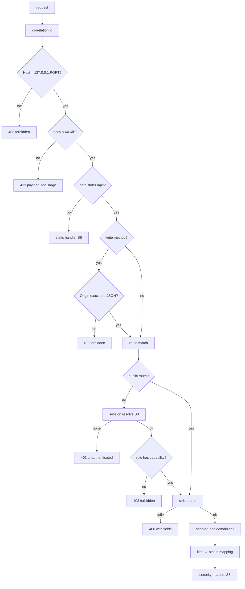

# Security Design — u1-skeleton

> Requirements: `../nfr-requirements/security-requirements.md` (NFR1.1–NFR1.3, NFR2.1–NFR2.3,
> NFR3.1–NFR3.9, NFR4.1, NFR5.1–NFR5.5, NFR10.1; threats T1–T15). Functional rules BR1–BR9.
> Decisions: `nfr-design-questions.md` Q1, Q4.

## S1 — Request pipeline (defence in depth)

Text fallback: every request gets a correlation id, then the Host check (403), the 64 KiB size check (413), and a split into static files or the API. API writes need an exact Origin and JSON (403). The route is matched; non-public routes resolve the session (401) and check the role's capability (403); every route parses strictly (400) and calls one domain function, whose result kind maps to a status; headers are added last. Covers NFR1.1, NFR3.3, NFR5.1, NFR5.2, NFR5.5.

- **Body cap mechanism** (NFR5.2): `Bun.serve({ maxRequestBodySize: 65536 })` makes bun refuse larger bodies, chunked or not; the pipeline also refuses a declared `Content-Length` over 65536 before reading. Our 413 response carries the S5 headers; a body bun rejects before our handler runs gets bun's own 413, accepted as is.
- **Route table as data** (NFR1.1): `src/server/routes.ts` exports an array of `{ method, path, access: 'public' | Capability | Capability[], schemas, handler }`. Start-up fails if any entry lacks `access`. The public list is exactly health, setup, sign-up, sign-in, sign-out.
- **Context from the session** (NFR3.3, NFR1.3): handlers receive `{ businessId, userId, role }` from S3 only; schemas are `.strict()`, so a body carrying `role` or `businessId` is a 400.

## S2 — Authentication

| Concern | Design | Requirement |
|---------|--------|-------------|
| Password storage | argon2id m=64 MiB, t=3, p=1 via `src/auth/argon2.ts`; minimum length constant raised to 10 | NFR3.1 |
| Unknown-email timing | one `verifyPassword(DUMMY_HASH, password)` for an unknown email, where `DUMMY_HASH` is an argon2id hash of a random string computed once at start | NFR3.5, T15 |
| Attempt limiter | `attempt-limiter.ts`: `Map<key, {count, windowEndsAt}>`; `reserve(key, now)` checks and increments synchronously before any await; `clear(key)` on success; fixed 15-minute window; hard cap 10 000 keys (sweep expired, then drop oldest `windowEndsAt`) | NFR3.5, NFR6.11, T2, T8 |
| Hash gate | `hash-gate.ts`: semaphore 2, FIFO queue 20; overflow → `rate_limited` | NFR6.12, T9 |
| Identical failure | one constant body `{"error":"invalid_credentials"}` and status 401 for unknown email, wrong password and inactive user | NFR3.5 |

## S3 — Sessions

| Concern | Design | Requirement |
|---------|--------|-------------|
| Token | 32 bytes from `crypto.getRandomValues`, base64url; `token_hash` = SHA-256 hex via Web Crypto `subtle.digest` | NFR3.2, T1 |
| Cookie | `__Host-sb_session=<value>; Max-Age=<seconds to expires_at>; Path=/; HttpOnly; Secure; SameSite=Lax`; clearing sets an empty value and `Max-Age=0` | NFR3.2 |
| Resolve | one statement: `UPDATE sessions s SET last_seen_at = $now FROM users u WHERE s.token_hash = $hash AND u.id = s.user_id AND u.active AND s.expires_at > $now AND s.last_seen_at > $now - interval '12 hours' RETURNING …`; `$now` is the app clock | NFR3.3, NFR6.2 |
| Fixation | sign-in deletes the presented session in the same transaction as the new insert | NFR3.4, T3 |
| Sign-out | delete by hash + `auth.sign_out` in one transaction; 204 whether or not a session existed; if the database is unavailable the response is 503 `db_unavailable` and still clears the cookie, so the browser is signed out locally and the server row expires by its own limits | NFR3.4 |

## S4 — Data protection

| Concern | Design | Requirement |
|---------|--------|-------------|
| No hash in responses | `UserRecord` (private, has `passwordHash`) vs `PublicUser` (`id, email, role, locale`); every auth function returns `PublicUser`; the response serialiser for sessions takes only `PublicUser` | NFR3.6, T7 |
| No-secret test | integration test serialises every U1 route's success and error bodies and greps for `passwordHash`, `password_hash`, `token_hash`, and the live cookie value | NFR3.6 |
| Log redaction | recursive redactor over objects/arrays; case-insensitive deny-list `password, passwordhash, password_hash, token, token_hash, cookie, authorization, sessionid, link, t`; request bodies never passed to the logger | NFR3.7 |
| Audit payloads | auth payloads carry only reason codes; the email is removed from `auth.sign_up` and `auth.sign_in` | NFR3.6, BR4.3 |
| Secrets in the repo | `scripts/secret-scan.ts` (regexes for private keys, `postgres://user:pass@`, AWS-style keys, `.env` files tracked by git) with `secret-scan.allow` listing allowed lines and reasons; a gate step | NFR3.8, NFR3.9 |

## S5 — Headers (NFR4.1)

A frozen header map applied as the last pipeline step to every response, static or API: `Content-Security-Policy: default-src 'self'; frame-ancestors 'none'; base-uri 'none'; form-action 'self'`, `X-Content-Type-Options: nosniff`, `Referrer-Policy: no-referrer`, `X-Frame-Options: DENY`; API responses add `Cache-Control: no-store` and `X-Correlation-Id`. One test asserts the set on every U1 route and on a static file.

## S6 — Static files (NFR5.4, T13)

1. On the raw (still-encoded) path, refuse (404) any `%2f`, `%5c` or `%00` in any case. Then decode once; refuse (404) if the decoded path contains `..`, `\`, a NUL, or a segment starting with `.`; refuse `*.map`. Only GET and HEAD are served on non-API paths; other methods get 405 with the S5 headers.
2. Resolve against the absolute `dist/` real path; `realpath` the target; refuse unless it starts with `dist/` + separator.
3. Existing file → send it with its content type; otherwise, for a path with no extension, send `index.html` (the SPA); otherwise 404.

## S7 — Origin, Host and CSRF (NFR5.1, NFR5.5, T4, T14)

The expected origin and host are computed once from `PORT`: `http://127.0.0.1:${PORT}` and `127.0.0.1:${PORT}`. Exact string comparison; `localhost`, `[::1]` and any other name are refused. Together with `SameSite=Lax` and JSON-only writes this closes CSRF for a loopback server.

## S8 — Database privilege (NFR2.1–NFR2.3, T11)

- Start-up check: `SELECT rolsuper FROM pg_roles WHERE rolname = current_user` must be false and `pg_has_role(current_user, 'app_role', 'MEMBER')` must be true.
- `src/db/declared-grants.ts` holds the C9 set; `tests/realdb/grants.realdb.test.ts` reads `information_schema.role_table_grants` (and sequence privileges) for `app_role` and asserts set equality per table.
- Migrations use `MIGRATE_DATABASE_URL`; the server process never reads it.

## S9 — Bind address (NFR5.3)

`Bun.serve({ hostname: '127.0.0.1', port })`; the hostname is a constant, not configuration.

## S10 — Free tooling (NFR10.1)

All security checks are ESLint rules, bun scripts in `scripts/`, `bun audit`, and the realdb tests — nothing hosted or paid.
