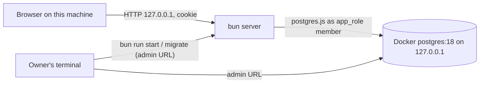

# Security Requirements — u1-skeleton

> Derived from inception NFR1–NFR5 and NFR10, U1 rules BR1–BR9, contracts C1–C3/C9 (with amendments
> A1–A4), team.md (Code Style, Deployment, Testing Posture) and `nfr-requirements-questions.md` Q3–Q6.

## Scope and trust boundaries

Text fallback: three boundaries — the browser to the server (untrusted input, cookie-authenticated), the server to Postgres (least-privilege `app_role` member), and the Owner's terminal (trusted, holds the admin URL used only by migrations). Nothing listens on a non-loopback address.

## Data classification (Q5)

| Class | Data | Handling |
|-------|------|----------|
| Restricted | password hashes, session token hashes, raw session cookie | never logged, never in a response body (cookie only in `Set-Cookie`), never in audit payloads |
| Confidential | user emails, order contact name/phone/address, order money | never in logs or audit payloads (emails removed from auth payloads); returned only to authorised roles |
| Internal | ids, statuses, timestamps, capability lists | normal handling |

## Requirements

### Authentication and sessions (NFR3, NFR5)

| ID | Requirement | Verification |
|----|-------------|--------------|
| NFR3.1 | Passwords hashed with argon2id (m=64 MiB, t=3, p=1); minimum 10 characters; never stored or logged in plain text | unit test on sign-up; log-redaction test |
| NFR3.2 | Session cookie `__Host-sb_session`: `Secure`, `HttpOnly`, `SameSite=Lax`, `Path=/`, no `Domain`; value = 32 random bytes (Web Crypto); only its SHA-256 stored | header test; realdb test reads `sessions` and finds no raw value |
| NFR3.3 | Session validity: absolute 30 days from issue, idle 12 hours, user active; resolved on the server for every request; role and business taken only from the session row | frozen-clock boundary tests at 11 h 59 m / 12 h / 30 d; handler tests ignore body-supplied ids |
| NFR3.4 | Re-sign-in in the same browser ends the previous session (fixation defence); sign-out deletes the row | realdb test |
| NFR3.5 | Failed sign-ins answer a byte-identical 401; at most 5 attempts per typed email per 15-minute fixed window, 429 with `Retry-After`, never locking the account; counted for unknown emails too. An unknown email still runs one argon2 verify against a fixed dummy hash, so its timing matches a wrong password | unit tests incl. parallel attempts; byte comparison test; a timing test asserts unknown-email and wrong-password medians differ by < 20 % over 20 tries |
| NFR3.6 | No response body contains `passwordHash`, `password_hash`, `token_hash` or the session value; domain functions return the public User | serialisation test over every U1 route (extended to all routes in U2) |
| NFR3.7 | Logs redact `password`, `passwordHash`, `password_hash`, `token`, `token_hash`, `cookie`, `authorization`, `sessionId`, `link`, `t`; full request bodies are never logged | logger unit test |
| NFR3.8 | A blocking secret pattern scan in the local gate (keys, tokens, passwords, committed `.env`), with a committed allow-list carrying reasons | gate step |
| NFR3.9 | `.env` is gitignored; `.env.example` holds placeholders only | secret scan + review |

### Authorization (NFR1)

| ID | Requirement | Verification |
|----|-------------|--------------|
| NFR1.1 | Every route in the server route table is either public (allow-list: health, setup, sign-up, sign-in, sign-out) or names a capability; the server refuses to start otherwise | start-up test |
| NFR1.2 | For each role, every U1 route answers per the role table (403 without the capability, success with it, 401 without a session) — the server walk over the route table, not a sample | wiring check refusals (BR10.1); full walk in U2 |
| NFR1.3 | Order reads and writes are scoped to the session's business; a foreign or non-UUID id is 404 | realdb tests |

### Database privileges (NFR2)

| ID | Requirement | Verification |
|----|-------------|--------------|
| NFR2.1 | The server refuses to start as a superuser or as a user outside `app_role` | start-up test against a superuser URL |
| NFR2.2 | `app_role` holds exactly the declared set (C9 with amendment A3): DELETE only on `sessions`; `audit_log` INSERT and SELECT; `order_items` INSERT and SELECT | realdb exact-set test over `pg_catalog` |
| NFR2.3 | Migrations run only under the separate admin URL and never `GRANT ALL` | migration review + exact-set test |

### Transport and browser (NFR4, NFR5)

| ID | Requirement | Verification |
|----|-------------|--------------|
| NFR4.1 | Every response carries `Content-Security-Policy: default-src 'self'; frame-ancestors 'none'; base-uri 'none'; form-action 'self'`, `X-Content-Type-Options: nosniff`, `Referrer-Policy: no-referrer`, `X-Frame-Options: DENY`; API responses add `Cache-Control: no-store` | header test on every U1 route and static file |
| NFR5.1 | Every POST, PATCH and DELETE requires `Content-Type: application/json` and an `Origin` exactly `http://127.0.0.1:PORT`; a missing or different Origin (including `localhost`) is 403 | handler-pipeline tests |
| NFR5.2 | Bodies over 64 KiB are refused (413) before parsing; every body, param and query is parsed with a strict schema | pipeline tests |
| NFR5.3 | The server binds 127.0.0.1 only | start-up test |
| NFR5.4 | Static files are served only from the resolved `dist/` directory: the decoded request path is normalised, any path containing `..`, a NUL byte, a backslash or an encoded slash is 404, the resolved real path must stay inside `dist/` (symlinks resolved), and dotfiles and source maps are not served; unknown non-API paths get `index.html` | static-handler tests with traversal, encoded-traversal, symlink and dotfile requests |
| NFR5.5 | Every request's `Host` header must be exactly `127.0.0.1:PORT`; anything else (including `localhost` or a rebinding hostname) is 403 before routing — this defends against DNS rebinding | pipeline tests with forged Host values |

### Zero spend (NFR10)

| ID | Requirement | Verification |
|----|-------------|--------------|
| NFR10.1 | Every security tool in U1 is free and local: ESLint rules, `bun audit --audit-level=high`, the secret scan script, the realdb gate. No hosted or paid scanner is a gate | dependency list review in Build and Test |

## Threat model (STRIDE)

| # | Element | Threat | Likelihood × impact | Mitigation |
|---|---------|--------|---------------------|------------|
| T1 | Session cookie | **S**poofing: a guessed or stolen cookie | Low × High = Medium | 256-bit random value; hash at rest; `HttpOnly`; 12 h idle / 30 d cap; sign-out deletes |
| T2 | Sign-in | **S**poofing: password guessing at the shared laptop or by script | Medium × High = High | per-email limit 5 / 15 min; argon2id cost; 10-character minimum |
| T3 | Sign-in fixation | **S**poofing: a planted session survives sign-in | Low × High = Medium | new session at every sign-in; the presented one is deleted |
| T4 | State-changing requests | **T**ampering via a malicious page (CSRF) | Medium × High = High | `SameSite=Lax`, exact Origin check on every write, JSON-only |
| T5 | Request bodies | **T**ampering: unknown keys smuggling role/business ids | Medium × High = High | strict schemas; context only from the session row (BR3.8) |
| T6 | Order lines | **R**epudiation: edits hide earlier lines | Low × Medium = Low | append-only revisions and audit-first writes (BR6.8) |
| T7 | Responses and logs | **I**nformation disclosure: hashes, tokens, emails, stack traces | Medium × High = High | public User only; redaction; 500 body = code + correlation id; no-secret test |
| T8 | Sign-in responses | **I**nformation disclosure: account existence | Medium × Medium = Medium | identical 401; limit counts unknown emails; no typed text in audit |
| T9 | Server | **D**enial of service: large bodies, request floods | Low × Medium = Low | 64 KiB cap; loopback only; pool max 5 with timeouts; at most 2 concurrent argon2 operations (NFR6.12) |
| T13 | Static file handler | **I**nformation disclosure: path traversal reads `.env` or source | Medium × High = High | NFR5.4 normalisation, real-path containment in `dist/`, no dotfiles or maps |
| T14 | Any request | **S**poofing via DNS rebinding: a remote page reaches 127.0.0.1 through its own hostname | Low × High = Medium | NFR5.5 exact Host check; Origin check on writes |
| T15 | Sign-in | **I**nformation disclosure: timing reveals unknown emails | Medium × Low = Low | dummy-hash verify for unknown emails (NFR3.5) |
| T10 | Rate limiter | **D**enial of service: an attacker locks the Owner out by typing her email | Medium × Low = Low | limit only delays (≤ 15 min), never disables; the Owner can restart the server (SEC-R1) |
| T11 | Database role | **E**levation: app connects with excess privilege | Low × High = Medium | start-up role check; exact-grant gate; admin URL only for migrations |
| T12 | Browser bundle | **E**levation / disclosure: server modules or env in the bundle | Medium × Medium = Medium | browser import rules; build gate scanning for `process.env`, `postgres`, `argon2`, `node:` |

## Accepted risks

| ID | Risk | Why accepted |
|----|------|--------------|
| SEC-R1 | The sign-in limiter resets on server restart (Q3) | restarting requires control of this machine |
| SEC-R2 | Plain HTTP on 127.0.0.1 | traffic never leaves the machine; `Secure` cookies are accepted on loopback by current browsers (real-browser check in Build and Test, stories R-07; fallback is local TLS, never a weaker cookie) |
| SEC-R3 | Disk encryption is not enforced by the app | outside the app's control; FileVault recommended in the README |

## Compliance (Q6)

| Obligation | Control in U1 |
|------------|---------------|
| Income Tax Ordinance 1984 §53 — keep books 5 years (TC9) | `audit_log` insert-only at the database, 5-year `retention_until`, reversals as new rows; order lines never deleted |
| Personal data kept erasable | no customer or user PII in the append-only audit log; emails removed from auth payloads |
| Card data out of scope | `src/orders/**` card-identifier deny-list stays |
