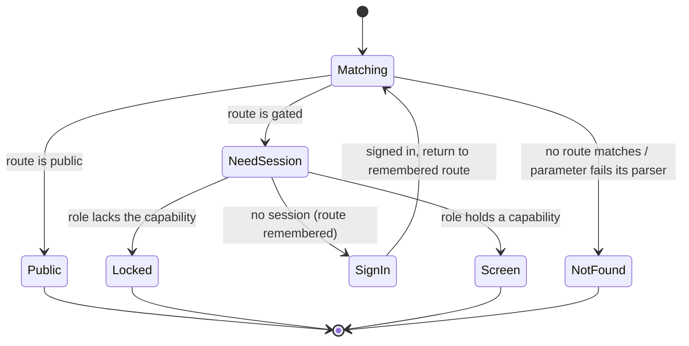
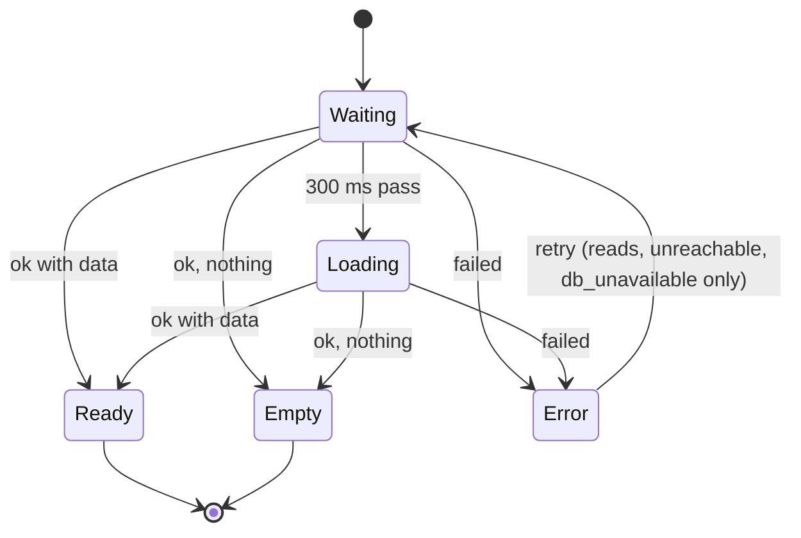
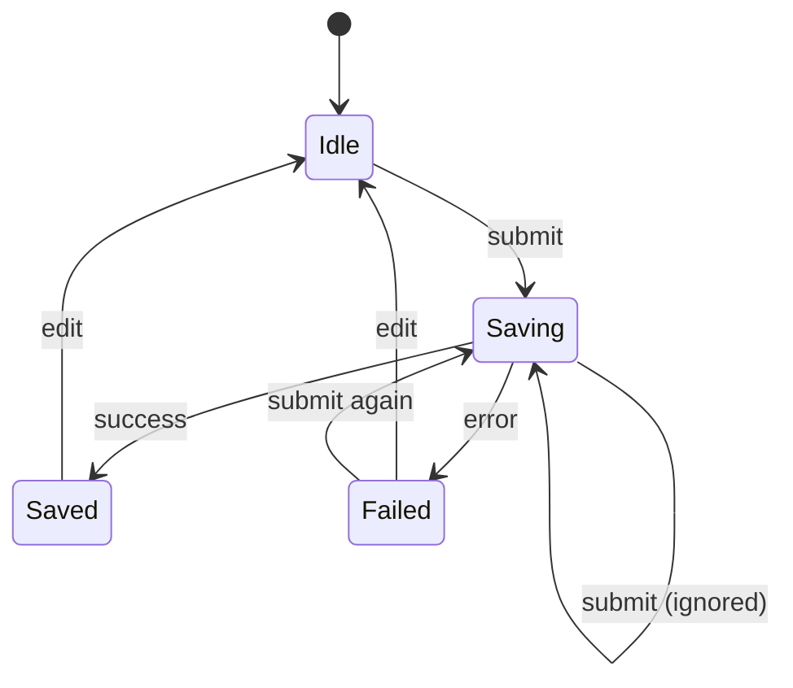
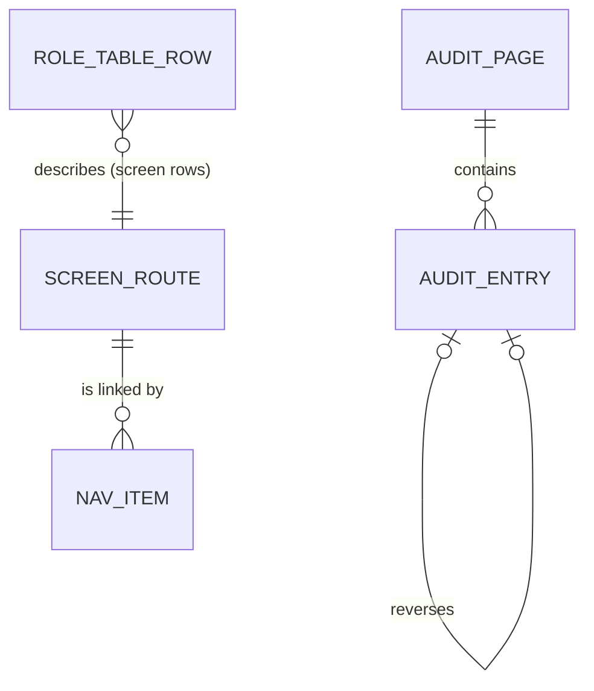

# Functional Specification — u2-app-shell

> Source of truth for U2's workflows and state machines. Data shapes: `entities.md`. Decision logic:
> `rules.md` (BR1–BR10). Decisions: `functional-design-questions.md` Q1–Q13. Contracts: C1 (HTTP
> conventions), C4 (audit read), C5 (role table and `link` allow-list) in
> `../../../inception/contract-design/contract-summary.md`. Screens: `frontend-components.md`.

## Overview

U1 proved one path end to end. U2 makes the whole app hold together: every screen route opens a real
screen (or an honest "not available yet" screen), the navigation offers each role only what it may
open, every screen says plainly what is happening, and two walks driven by one inline role table prove
that each role gets exactly its answer on every API route and every screen route. U2 also ships the
audit trail read (C4) and the no-secret walk over every response.

U2 adds one API route (`GET /api/audit`) and no table, grant or migration. It changes no contract
except renaming the client route `/accept` to `/accept-invite`, which C6 already uses (Q2).

## Workflows

### W1 — Open a screen route (BR1.1–BR1.5, BR3.4, BR4.1)

1. Read the hash path. If it matches no route, go to `/not-found` (BR1.4).
2. If the route has parameters, parse each with its parser; a failure shows the not-found screen and sends no request (BR1.3).
3. If the route is public, render it (BR1.5).
4. If there is no session, remember the route and show sign-in (U1 W9).
5. If the role holds none of the route's capabilities, show the lock screen naming the feature, with a link to the first screen the role can open (BR4.1).
6. Otherwise render the route's screen; a feature not built in this intent renders the not-available screen with its name and a link home (BR1.1).

Error paths: none of these steps calls the server except the screen itself once it renders.

### W2 — A screen loads data (BR5.1–BR5.5)

1. The screen asks the client; `ApiState` starts in `loading` and shows nothing for 300 ms.
2. After 300 ms still waiting: show the loading message.
3. Answer ok with rows: `ready`. Answer ok with none: `empty`, with the screen's own empty message and action.
4. Answer error: `error` with the kind; the view follows BR5.2's one mapping. For `unauthenticated` the client remembers the route and shows sign-in (BR5.4).
5. Retry, where offered, starts again at step 1 (BR5.3).

### W3 — A form saves (BR6.1–BR6.3)

1. Submit (button or Enter). If the guard is `saving`, ignore it.
2. Guard → `saving`; the submit control is disabled.
3. Success: guard → `saved`; the polite toast says "সংরক্ষণ হয়েছে"; the screen moves on as it already does (for example to the order detail).
4. Failure: guard → `failed`; fields keep their values; field kinds show under their fields; other kinds follow BR5.2; focus moves to the first refused field or the message.
5. Any edit after `failed` or `saved` returns the guard to `idle`.

### W4 — Read the audit trail (BR7.1–BR7.5)

1. `GET /api/audit?cursor&limit` passes U1's pipeline (session, `audit.view`, strict query schema: `limit` 1–50, `cursor` decodable).
2. Read this business's rows whose retention date is after the app clock's now, newest first by (occurredAt, id), one more than `limit`.
3. Join the acting user's email when the row has one.
4. Return the entries without payload and `nextCursor` (null on the last page).
5. The `/audit-trail` screen lists entries with the action's label (the raw action name when no label exists), the time in Bangla digits, the actor's email or "সিস্টেম", and a "আরও দেখুন" button while `nextCursor` is not null.

Error paths: bad query → 400 `invalid_input`; Sales Staff → 403 (lock screen in the app); database down → 503.

### W5 — The server role walk (BR3.1–BR3.3, BR3.5, BR3.6)

1. Load the API rows of `tests/spec/role-table.ts` and the registered server route table; fail on any difference either way (BR3.2).
2. For each non-public route: no cookie, an expired session, an idle session and an inactive user each get 401.
3. For each role and route: a role outside the row gets 403 and no money field; a role in the row gets neither 401 nor 403.
4. For each state-changing route: a non-JSON content type, a missing Origin, and `http://localhost:<port>` each get 403.
5. The Owner gets no 403 anywhere (BR3.5).

### W6 — The client role walk (BR1.1, BR1.2, BR3.4, BR3.5)

1. Load the screen rows of the role table and the screen route map; fail on any difference either way.
2. For each public route with no session: it renders and shows no sign-in redirect.
3. For each role and route: outside the row shows the lock screen; inside renders a named heading (never empty).
4. For each role, the navigation shows exactly the nav items whose routes the row allows (BR2.1).

### W7 — The no-secret walk (BR8.1–BR8.4)

1. For every registered route, record a success response and its error responses (401, 403, 400 where the route takes input, 404 where it takes an id).
2. Fail on any password hash, session token or token hash outside `Set-Cookie`, invitation or reset token or hash, and on a `link` field from a route not on the allow-list.
3. Write one log line per redacted key and check that each value is `[redacted]`.

## State machines

### Screen route resolution

Text fallback: Matching → NotFound (no match or bad parameter) | Public | NeedSession; NeedSession → SignIn (no session) | Locked (no capability) | Screen; SignIn → Matching after sign-in.

### ApiState

Text fallback: Waiting → Loading after 300 ms; Waiting or Loading → Ready | Empty | Error; Error → Waiting on retry where retry is offered.

### Submit guard

Text fallback: Idle → Saving on submit; a submit while Saving is ignored; Saving → Saved | Failed; any edit returns to Idle; Failed → Saving on a new submit.

## Entity relationships (derived from `entities.md`)

Text fallback: an AuditPage holds AuditEntries; an AuditEntry may reverse another; a NavItem links one ScreenRoute; a screen RoleTableRow describes one ScreenRoute (API rows describe server routes).

## Screen route map after U2

| Path | Access | Screen in U2 |
|------|--------|--------------|
| `/` | gated (any role) | goes on to `/orders` |
| `/sign-in`, `/sign-up`, `/not-found` | public | real (U1) |
| `/accept-invite`, `/reset`, `/recover` | public | not-available until U3 (Q2) |
| `/orders`, `/orders/:id` | `business.view` | real (U1) |
| `/orders/new`, `/orders/new/paste-parse`, `/orders/new/repeat`, `/orders/:id/transition` | `money.mutate.full` or `money.mutate.price` | real (U1) |
| `/audit-trail` | `audit.view` | real (W4) |
| `/daily-card` | `business.view` | not-available (B5) |
| `/business` | `business.edit` | not-available (B5) |
| `/settings` | `settings.edit.own` | not-available (B5) |
| `/lock` | public | real (BR4.1) |

U3 adds `/staff` and the real screens for the three public routes; U4 adds the catalog routes (AC5.1.4).

## Rules summary (derived from `rules.md`)

| Group | Rules |
|-------|-------|
| Screen routes | BR1.1–BR1.5 |
| Navigation and Shell | BR2.1–BR2.3 |
| Role table and walks | BR3.1–BR3.6 |
| Lock screen | BR4.1–BR4.2 |
| Screen states | BR5.1–BR5.5 |
| Save feedback | BR6.1–BR6.3 |
| Audit trail read | BR7.1–BR7.5 |
| No secret | BR8.1–BR8.4 |
| Small screens and keyboard | BR9.1–BR9.3 |
| Load time | BR10.1 |

## Business scenarios

| # | Scenario | Path | Outcome |
|---|----------|------|---------|
| S1 | The Owner opens every screen | W1, W6 | every route renders a named heading; no lock screen |
| S2 | Sales Staff open `/audit-trail` | W1 | lock screen naming the audit trail, link to the order list |
| S3 | Sales Staff call `GET /api/audit` directly | W4, W5 | 403 with no money field |
| S4 | `/orders/not-a-uuid` | W1 | not-found screen; no request sent |
| S5 | The server is stopped while the list is open and the person retries | W2 | "সার্ভারের সাথে যোগাযোগ হচ্ছে না" with retry; retry loads once the server is back |
| S6 | The database is down | W2 | the database-not-reachable message with retry |
| S7 | A double click on save | W3 | one request; the second click is ignored |
| S8 | Two people edit the same order; the second save gets 409 | W3 | the conflict message with reload; the form keeps its values |
| S9 | A new route is added to the server table without a role-table row | W5 | the walk fails naming the route |
| S10 | The session expires while a screen is open | W2 | sign-in, then back to the same screen |
