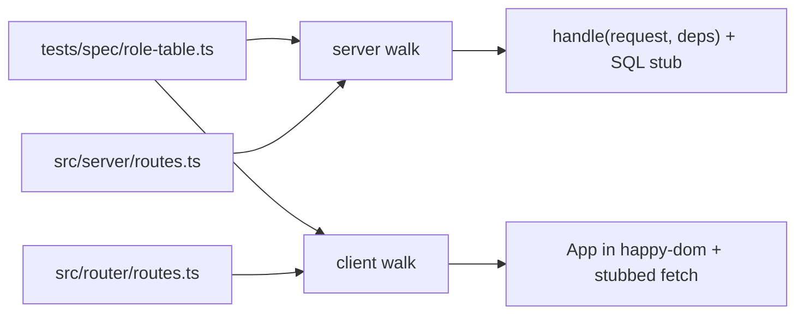

# Security Design — u2-app-shell

> Designs for NFR1.4–NFR1.8, NFR2.4, NFR3.10–NFR3.15, NFR4.2, NFR5.6–NFR5.7 and NFR10.2
> (`../nfr-requirements/security-requirements.md`, including its review follow-ups). Decisions:
> `nfr-design-questions.md` Q1, Q2, Q4. U1's patterns S1–S10 (route table invariant, cookie, sessions,
> Origin and content type, headers, static handler, redaction, declared grants, bind, secret scan) are
> unchanged; U2 adds S11–S17.

## S11 — One role table, two walks (NFR1.4–NFR1.7, NFR5.6)

Text fallback: the inline role table feeds both walks; the server walk also reads the registered server route table and calls `handle` with the SQL stub; the client walk reads the screen route map and mounts `App` in happy-dom with a stubbed `fetch`.

- **Row shape:** `{ surface: "api", method, path, allowed }` and `{ surface: "screen", path, allowed }`; `allowed` is a role list or `"public"`. Paths use `:name` on both sides.
- **Exact match:** each walk first compares its registered table with the rows (as sets of `method path` or `path`) and fails naming every missing or extra entry.
- **Server checks per non-public route:** no cookie, an expired, an idle and an inactive-user session → 401; each role outside `allowed` → 403 and the body has no key ending in `Paise`; each role inside → status not 401 or 403, using fixtures that satisfy the domain so no domain 403 appears (F-07).
- **Server checks per state-changing route:** `Content-Type: text/plain`, no `Origin`, and `Origin: http://localhost:<port>` → 403 (NFR5.6).
- **Owner inverse:** the Owner never sees 403 or the lock screen (NFR1.7).
- The role table never imports `src/auth`; it restates US5.1 (BR3.1).

## S12 — Navigation from the route map (NFR1.8)

`App` (RouterComponent) builds `NavItem[]` from a list of `{ to, label }` and looks up each `to` in the screen route map for its access; it passes only the items the role may open to `Shell` as a prop. `Shell` (PresentationComponent) renders the list and imports neither the router nor `src/auth` (F-01). The client walk asserts the rendered links for each role equal the role table's allowed screen rows that have a nav item.

## S13 — The audit read path (NFR2.4, NFR3.12, NFR3.13, NFR3.15)

| Step | Control |
|------|---------|
| Route | `GET /api/audit`, access `["audit.view"]`, in the route table (so S1's invariant and S11's walks cover it) |
| Query | `.strict()` zod schema: `limit` an integer 1–50 (default 50, coerced from the query string), `cursor` an optional string; unknown keys refused |
| Cursor | base64url of `<ISO time>|<uuid>`; decoding failure, a bad time or a bad UUID → 400 `invalid_input` with `fields: [{ path: "cursor" }]`; the body never echoes the cursor |
| Scope | `business_id` from the session only; a cursor carries no business, so a cursor from another business's row seeks inside the caller's own rows |
| Retention | `retention_until > $now` with `$now` from the app clock (Q5 of NFR requirements) |
| Columns | `id, occurred_at, action, subject_kind, subject_id, correlation_id, reverses_id` and `users.email AS actor_email`; never `payload`, never `retention_until` |
| Grants | existing SELECT on `audit_log` and `users` only; the new index needs no grant (NFR2.4) |
| Old function | `listAuditForBusiness` is removed; `audit-export.ts` moves to the new read (F-09) |
| Logging | only the standard request line with the route pattern; no query string, cursor or email (NFR3.13) |

## S14 — No-secret walk (NFR3.10, NFR3.11, NFR3.14)

- **Coverage:** for every registered route the walk needs a fixture (success body and its error bodies); a route without one fails.
- **Known values:** read from the seeded stub rows: the stored password hash, the live session token (raw and SHA-256 hex), and any invitation or reset token hashes (none until U3).
- **Scans on every body and header:** the known values (except the raw token in `Set-Cookie`), the key names `passwordHash`, `password_hash`, `token_hash`, and a key named `link` from a route not on the allow-list (`[]` in U2).
- U1's public-user and redaction tests stay in place and are cited by U2's traceability (NFR3.14).

## S15 — Exhaustive kind mapping (supports NFR1.5, NFR7.9–NFR7.13)

`viewForKind(kind): View` in PresentationComponent is one `switch` over the 18 C1 kinds plus `unreachable`, with `assertNever` in the default branch. `ApiState` and the form field-error helper both call it, so a new kind on the wire fails the type-check before any screen can show nothing.

## S16 — Query strings never remembered (NFR5.7)

The hash router splits the path from the query before matching. U2 changes `src/client/session-store.ts`: `returnTarget(route)` returns the path only (everything from `?` dropped), and `NOT_A_RETURN_TARGET` lists `/accept-invite` in place of `/accept`. After sign-in the app navigates to the stored path with no query. A unit test opens `#/accept-invite?t=abc`, triggers a 401, signs in, and asserts that neither the stored route nor any later request carries `t`.

## S17 — No new dependency (NFR10.2)

The real-browser script uses bun's `WebSocket` and `Bun.spawn`; the walks use bun test, happy-dom and Testing Library, already installed. A test compares `package.json` dependencies with the committed list in the gate and fails on an unreviewed addition.

## Headers on the new route (NFR4.2)

`GET /api/audit` goes through U1's pipeline, so S5's headers (CSP with `frame-ancestors 'none'`, `nosniff`, `no-referrer`, `X-Frame-Options: DENY`, `Cache-Control: no-store`) apply unchanged. U1's header test walks the route table, so it picks up the new route; the wiring check reads the headers of one audit call.

## Revision after review iteration 1 (NOT-READY)

Decided on the Owner's standing instruction. Each row binds Code Generation; where it disagrees with an
earlier paragraph in any U2 NFR design file, this section wins.

| Finding | Revision |
|---------|----------|
| D-01 Query kept in the return route | `src/client/session-store.ts` is a changed file. `returnTarget` keeps the path only, and the not-a-return-target set uses `/accept-invite` (S16 and R9 rewritten above). Test: open `#/accept-invite?t=abc` signed out and `#/orders?x=1` with an expiring session; the stored `returnTo` is `null` and `/orders` respectively, and no later request URL contains `t=` or `x=`. Added to logical-components. |
| D-02 Real-browser script wiring | `scripts/browser-check.ts` is **gate step 14b**, right after the wiring check, with the same `REALDB_ADMIN_URL`/`REALDB_APP_URL` the gate exports. It never runs `bun run start` and never reads `.env`. It: (1) creates and migrates its own `browser_<random>` database through the admin URL, as the wiring check does, and drops it at the end; (2) starts the server in-process with `startServer(config, { distDir: "dist" })` on a free loopback port, using the app login on that database, after step 8 has built `dist/`; (3) signs up the Owner through `POST /api/auth/sign-up` with the fixed test credentials `owner@browser.test` / `browser-pass-1` and creates one order through `POST /api/orders`, keeping its id for `/orders/:id`; (4) launches Chrome from `CHROME_PATH`, default `/Applications/Google Chrome.app/Contents/MacOS/Google Chrome`, with `--headless=new --remote-debugging-port=0 --user-data-dir=<temp dir> --no-first-run`, reading the `DevTools listening on ws://…` line from stderr; a missing binary exits 2. The sign-in form is filled with `Input.insertText` after focusing each field through `Runtime.evaluate`, then submitted with Enter (`Input.dispatchKeyEvent`), so React sees real input events. Each route's expected heading comes from a `heading` field the screen route rows in `tests/spec/role-table.ts` carry (the same field the client walk asserts), and the script waits up to 5 s for an element with `data-testid="screen-title"` whose text equals it. Load timing polls `performance.timing.loadEventEnd` until it is greater than 0 (up to 10 s) before computing `loadEventEnd - navigationStart`. |
| D-03 Gate and inventory | Changed files added to logical-components: `scripts/gate.ts` (step 14b, the walk step, the `browser:` fact, the dependency check), `tests/perf/order-api.bench.ts` (audit timings), and `tests/spec/dependencies.json` (the committed dependency list S17 compares `package.json` against). The walks get their own **gate step 5b**: `bun test tests/integration/server-gate-absence.test.ts tests/unit/three-layer-gate-absence.test.ts tests/integration/no-secret-responses.test.ts --timeout 60000`, timed by the gate (its wall time is the walk duration); a run over 60 s is rerun once, and the step fails if the rerun is also over 60 s. Step 5 keeps running them as part of the full suite, so their pass/fail is unchanged. Each walk test sets `{ timeout: 60_000 }` because it loops routes × roles in one case. |
| D-04 Client walk assertions | Per screen row, for each role: (a) **outside** `allowed`: the element `data-testid="lock-sheet"` appears, its text contains the row's feature name, and the stubbed `fetch` received **no** request to a gated API path while resolving that route (the client gate refuses before any call); (b) **inside**: `data-testid="screen-title"` has the row's `heading` text and no `data-testid="error-banner"` is present; (c) **public** rows render their heading with no session and without redirecting to sign-in. Response bodies come from `tests/spec/fixtures.ts`: one recorded success body per API route, each parsed in the test with the route's shared zod response schema before use, so an invalid fixture fails the test rather than silently rendering the error view. The server walk's inside-role fixtures come from the same file. |
| D-05 Audit SQL details | The seek uses casts as the order list does: `(a.occurred_at, a.id) < (${cursorAt}::timestamptz, ${cursorId}::uuid)`. Precondition, stated in `audit-read.ts`'s header and kept by a realdb test: `insertAudit` writes `occurred_at` from the app clock at millisecond precision (never a database `now()` default), so the ISO time in a cursor is exact. The cursor schema is `z.string().max(200)`. |
| D-06 Audit export | `exportAudit(sql, businessId, now)` (B5's CSV contract #4) keeps its own read: retention-filtered with the same `$now` rule, keyset-paged internally in batches of 500 until done, and it returns the payload because the export needs it; it is not an API route in this intent and stays behind no endpoint. `listAuditForBusiness` is removed. `tests/unit/observability.test.ts`'s cases for it move to `tests/unit/audit-read.test.ts` (the page read) and `tests/unit/audit-export.test.ts` (the export). |
| D-07 One kind mapping | `src/i18n/error-copy.ts` stays the one switch for **copy** (`errorMessage`). `viewForKind` in `src/pres/view-for-kind.ts` is the one switch for **behaviour** (`banner`, `lock`, `not-found`, `conflict`, `sign-in`, `field`) and has no strings; `ApiState` combines both. A test asserts both switches cover the same key set (the `ErrorKind` union plus `unreachable`), so they cannot drift. |
| D-08 Save guard re-entrancy | `useSubmitGuard` latches with a `useRef<boolean>` set synchronously before the first `await`; React state mirrors it for rendering only. Test: two `submit()` calls in the same tick send one request. |
| D-09 Probes on write routes | Every server-walk probe of a POST, PATCH or DELETE (the 401, 403 and inside-role probes) carries `Origin: http://127.0.0.1:<port>` and `Content-Type: application/json`, so the Origin and content-type refusal cannot mask the gate. Only the NFR5.6 probes leave them out on purpose. |
| D-10 Large profile and stylesheet rules | NFR6.13's 20 000-row timing and the `EXPLAIN` assertion run in `bun run gate --large`; the Bolt 1 merge runs `--large` (recorded in the squash body). The default gate adds a small audit check: 2 000 rows, first page and a cursor page, p95 ≤ 300 ms. Stylesheet test rules: a literal colour is any `#hex`, `rgb()`, `rgba()`, `hsl()`, `hsla()` or named CSS colour other than `transparent`, `currentColor` and `inherit`, outside `tokens.css`; a width rule is any `width` or `min-width` above 360 px in any block, `@media` blocks included, outside a selector containing `.scroll-x`. |
