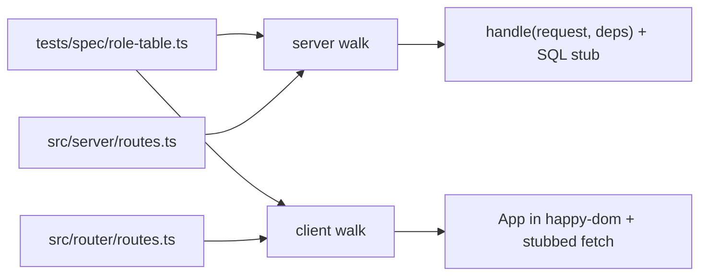

# Security Design — u2-app-shell

> Designs for NFR1.4–NFR1.8, NFR2.4, NFR3.10–NFR3.15, NFR4.2, NFR5.6–NFR5.7 and NFR10.2
> (`../nfr-requirements/security-requirements.md`, including its review follow-ups). Decisions:
> `nfr-design-questions.md` Q1, Q2, Q4. U1's patterns S1–S10 (route table invariant, cookie, sessions,
> Origin and content type, headers, static handler, redaction, declared grants, bind, secret scan) are
> unchanged; U2 adds S11–S17.

## S11 — One role table, two walks (NFR1.4–NFR1.7, NFR5.6)

Text fallback: the inline role table feeds both walks; the server walk also reads the registered server route table and calls `handle` with the SQL stub; the client walk reads the screen route map and mounts `App` in happy-dom with a stubbed `fetch`.

- **Row shape:** `{ surface: "api", method, path, allowed }` and `{ surface: "screen", path, allowed }`; `allowed` is a role list or `"public"`. Paths use `:name` on both sides.
- **Exact match:** each walk first compares its registered table with the rows (as sets of `method path` or `path`) and fails naming every missing or extra entry.
- **Server checks per non-public route:** no cookie, an expired, an idle and an inactive-user session → 401; each role outside `allowed` → 403 and the body has no key ending in `Paise`; each role inside → status not 401 or 403, using fixtures that satisfy the domain so no domain 403 appears (F-07).
- **Server checks per state-changing route:** `Content-Type: text/plain`, no `Origin`, and `Origin: http://localhost:<port>` → 403 (NFR5.6).
- **Owner inverse:** the Owner never sees 403 or the lock screen (NFR1.7).
- The role table never imports `src/auth`; it restates US5.1 (BR3.1).

## S12 — Navigation from the route map (NFR1.8)

`App` (RouterComponent) builds `NavItem[]` from a list of `{ to, label }` and looks up each `to` in the screen route map for its access; it passes only the items the role may open to `Shell` as a prop. `Shell` (PresentationComponent) renders the list and imports neither the router nor `src/auth` (F-01). The client walk asserts the rendered links for each role equal the role table's allowed screen rows that have a nav item.

## S13 — The audit read path (NFR2.4, NFR3.12, NFR3.13, NFR3.15)

| Step | Control |
|------|---------|
| Route | `GET /api/audit`, access `["audit.view"]`, in the route table (so S1's invariant and S11's walks cover it) |
| Query | `.strict()` zod schema: `limit` an integer 1–50 (default 50, coerced from the query string), `cursor` an optional string; unknown keys refused |
| Cursor | base64url of `<ISO time>|<uuid>`; decoding failure, a bad time or a bad UUID → 400 `invalid_input` with `fields: [{ path: "cursor" }]`; the body never echoes the cursor |
| Scope | `business_id` from the session only; a cursor carries no business, so a cursor from another business's row seeks inside the caller's own rows |
| Retention | `retention_until > $now` with `$now` from the app clock (Q5 of NFR requirements) |
| Columns | `id, occurred_at, action, subject_kind, subject_id, correlation_id, reverses_id` and `users.email AS actor_email`; never `payload`, never `retention_until` |
| Grants | existing SELECT on `audit_log` and `users` only; the new index needs no grant (NFR2.4) |
| Old function | `listAuditForBusiness` is removed; `audit-export.ts` moves to the new read (F-09) |
| Logging | only the standard request line with the route pattern; no query string, cursor or email (NFR3.13) |

## S14 — No-secret walk (NFR3.10, NFR3.11, NFR3.14)

- **Coverage:** for every registered route the walk needs a fixture (success body and its error bodies); a route without one fails.
- **Known values:** read from the seeded stub rows: the stored password hash, the live session token (raw and SHA-256 hex), and any invitation or reset token hashes (none until U3).
- **Scans on every body and header:** the known values (except the raw token in `Set-Cookie`), the key names `passwordHash`, `password_hash`, `token_hash`, and a key named `link` from a route not on the allow-list (`[]` in U2).
- U1's public-user and redaction tests stay in place and are cited by U2's traceability (NFR3.14).

## S15 — Exhaustive kind mapping (supports NFR1.5, NFR7.9–NFR7.13)

`viewForKind(kind): View` in PresentationComponent is one `switch` over the 18 C1 kinds plus `unreachable`, with `assertNever` in the default branch. `ApiState` and the form field-error helper both call it, so a new kind on the wire fails the type-check before any screen can show nothing.

## S16 — Query strings never remembered (NFR5.7)

The hash router splits the path from the query before matching. The 401 handoff stores only the path; after sign-in it navigates to that path with no query. A unit test opens `#/accept-invite?t=abc`, triggers a 401, signs in, and asserts that neither the stored route nor any later request carries `t`.

## S17 — No new dependency (NFR10.2)

The real-browser script uses bun's `WebSocket` and `Bun.spawn`; the walks use bun test, happy-dom and Testing Library, already installed. A test compares `package.json` dependencies with the committed list in the gate and fails on an unreviewed addition.

## Headers on the new route (NFR4.2)

`GET /api/audit` goes through U1's pipeline, so S5's headers (CSP with `frame-ancestors 'none'`, `nosniff`, `no-referrer`, `X-Frame-Options: DENY`, `Cache-Control: no-store`) apply unchanged. U1's header test walks the route table, so it picks up the new route; the wiring check reads the headers of one audit call.
