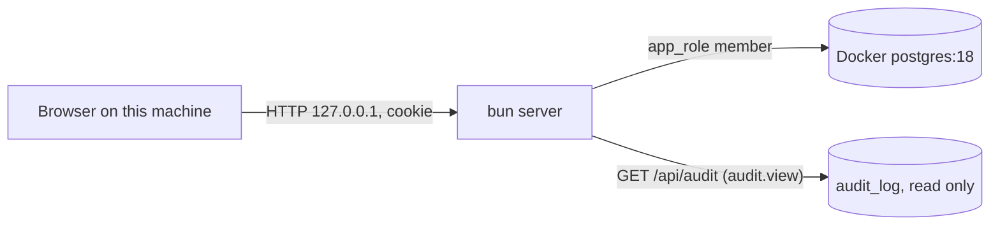

# Security Requirements — u2-app-shell

> Derived from inception NFR1–NFR5 and NFR10, U2 rules BR1–BR10 with review follow-ups F-01..F-10,
> contracts C1, C4, C5, team.md (Testing Posture: role gate by absence on both sides, no secret in any
> response; Deployment: NBR retention) and `nfr-requirements-questions.md` Q3–Q5. U1's controls (session
> cookie, Origin and content-type checks, headers, redaction, exact grants) stay as they are; U2 adds the
> walks that prove them over every route, and one new read route.

## Scope and trust boundaries

Text fallback: the browser talks to the server over loopback with the session cookie; the server reads `audit_log` as an `app_role` member that holds only SELECT and INSERT on it. U2 adds no new boundary; it adds one read path across the existing server-to-database boundary.

## Data classification (Q3)

| Class | Data in U2 | Handling |
|-------|------------|----------|
| Restricted | password hashes, session token and hash, invitation and reset token hashes | the no-secret walk proves none appears in any response body or header (cookie only in `Set-Cookie`) |
| Confidential | `actorEmail` in audit entries | returned only to `audit.view` roles; never logged; never in audit payloads |
| Internal | audit action names, subject kinds and ids, correlation ids, timestamps | normal handling |

The audit payload is not returned at all in this intent (U2 Q3), so no customer field can reach the audit screen.

## STRIDE over U2's surface

| Threat | Where | Control (requirement) |
|--------|-------|-----------------------|
| Spoofing | a request without a session reaching a gated route | 401 on every non-public route, proven by walk (NFR1.4) |
| Tampering | a forged cross-site POST | Origin and content-type refusal on every state-changing route, proven by walk (NFR5.6) |
| Repudiation | none new; audit rows stay append-only | the read path never updates or deletes (NFR2.4) |
| Information disclosure | a new route leaking a hash or token; the audit view leaking payload or another business's rows | no-secret walk (NFR3.10, NFR3.11); business scope and no payload (NFR3.12) |
| Denial of service | an unbounded audit page | `limit` 1–50 and keyset paging (NFR6.13) |
| Elevation of privilege | a role reaching a forbidden route through the API when the screen hides it | the server walk checks every role on every route, independent of the client (NFR1.4, NFR1.5) |

## Requirements

### Role gate by absence (NFR1)

| ID | Requirement | Verification |
|----|-------------|--------------|
| NFR1.4 | For every role and every registered API route, the answer matches `tests/spec/role-table.ts`: non-public routes give 401 without a valid session (none, expired, idle, inactive user); a role outside the row gives 403 with no money field; a role in the row gets neither 401 nor 403 | server walk (BR3.3), driven by the registered route table |
| NFR1.5 | For every role and every screen route, a role outside the row sees the lock screen and a role inside sees a named screen; public routes render without a session | client walk in happy-dom (BR3.4) |
| NFR1.6 | The role table and both registered tables match exactly in both directions; a route added without a row fails the walk | both walks (BR3.2) |
| NFR1.7 | The Owner reaches every route (no 403, no lock screen), the audit trail and the daily card included | both walks (BR3.5) |
| NFR1.8 | The navigation offers a role only links it can open, derived from the route map in RouterComponent | client walk nav assertions (BR2.1, F-01) |

### Grants (NFR2)

| ID | Requirement | Verification |
|----|-------------|--------------|
| NFR2.4 | U2 adds no grant: the audit read uses the existing SELECT on `audit_log` and `users`; the exact-set grant gate stays unchanged | realdb grant test unchanged and green |

### No secret or PII leaks (NFR3)

| ID | Requirement | Verification |
|----|-------------|--------------|
| NFR3.10 | No response body or header from any registered route holds a password hash, a session token or its hash outside `Set-Cookie`, or an invitation or reset token or hash; the key-name scan (`passwordHash`, `password_hash`, `token_hash`) runs on every body; a route without a recorded fixture fails the walk | no-secret walk (BR8.1, F-08); known values read from the seeded rows |
| NFR3.11 | A field named `link` appears only in responses from routes on the closed allow-list (empty in U2) | no-secret walk (BR8.2) |
| NFR3.12 | The audit view returns only the session's business, only rows inside retention (Q5), and never the payload or `retentionUntil` | realdb tests (F-09) and the response schema test |
| NFR3.13 | `actorEmail` and audit entries are never written to the server log | redaction and log tests: the audit handler logs only the standard request line |
| NFR3.14 | The public user and the redaction already shipped by U1 stay proven: no returned user carries `passwordHash`; every deny-listed key (incl. `link`, `t`) is redacted | the U1 tests stay green and are named in U2's traceability (F-04) |

### Headers (NFR4)

| ID | Requirement | Verification |
|----|-------------|--------------|
| NFR4.2 | The new `GET /api/audit` route and the not-available screen's static responses carry the C1 headers (CSP with `frame-ancestors 'none'`, `nosniff`, `no-referrer`, `X-Frame-Options: DENY`, and `Cache-Control: no-store` on `/api/`) | U1's header test walks the route table, so it covers the new route; asserted in the wiring check |

### Cross-site requests (NFR5)

| ID | Requirement | Verification |
|----|-------------|--------------|
| NFR5.6 | Every POST, PATCH and DELETE in the route table refuses a non-JSON content type, a missing Origin and `http://localhost:<port>` with 403 | server walk (BR3.6) |
| NFR5.7 | A token in a URL query (`?t=`) is never stored in the remembered route or resent after sign-in | client unit test over the 401 handoff (F-06) |

### Zero spend (NFR10)

| ID | Requirement | Verification |
|----|-------------|--------------|
| NFR10.2 | The walks and the real-browser check use only bun, happy-dom and the installed Chrome; no new dependency, no hosted scanner | `package.json` diff review; the dependency list is unchanged by U2 |

## Anti-requirements

No new authentication method, no MFA and no CSRF token beyond the Origin rule in this intent (requirements: CSRF hardening beyond NFR5 was deferred to NFR Design and settled there by U1). No static application scanner (team.md: no Semgrep for now).
