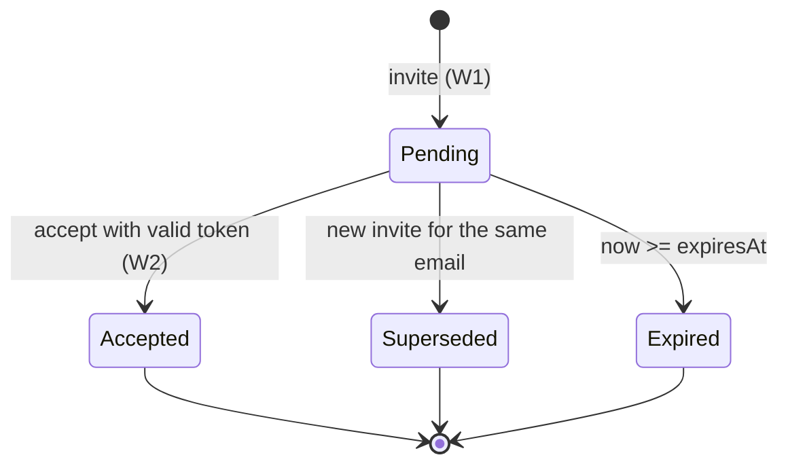
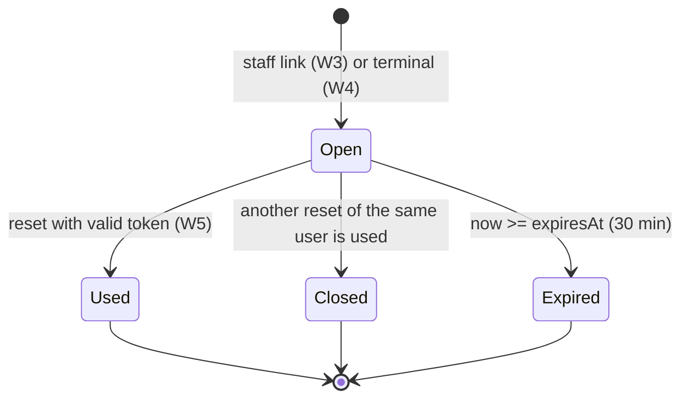
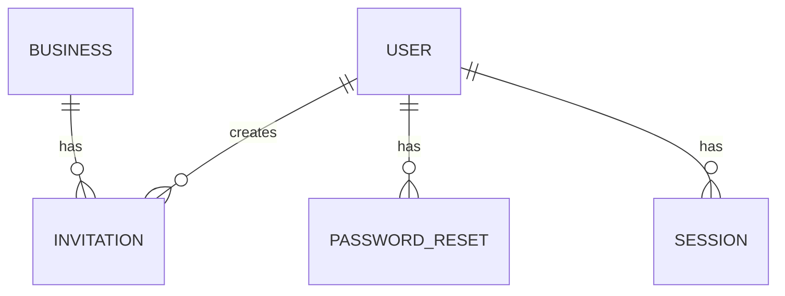

# Functional Specification — u3-staff

> Source of truth for U3's workflows and state machines. Data shapes: `entities.md`. Decision logic:
> `rules.md` (BR1–BR10). Decisions: `functional-design-questions.md` Q1–Q12. Contracts: C1, C5, C6, C9 in
> `../../../inception/contract-design/contract-summary.md`. Screens: `frontend-components.md`.

## Overview

U3 lets the Owner bring staff in and lets anyone who forgets a password get back in, with no email
service. An Owner or Manager creates an invitation or a reset link; the server returns the link once and
keeps only its hash; the person opens it, the app takes the token out of the address bar before talking to
the server, and they set a password. The Owner's own way back is a terminal command on this machine.
Recovery from the browser answers the same neutral sentence for every email and does nothing.

U3 adds six API routes, one screen (`/staff`), real screens for `/accept-invite`, `/reset` and `/recover`,
one migration (0017, unique indexes) and one script (`bun run reset-password`). It settles the delegation
matrix (Q1) and the `/accept-invite` name (already applied in U2).

## Workflows

### W1 — Invite (BR1.1, BR1.2, BR2.1–BR2.4, BR8.1, BR9.2)

1. Owner or Manager submits email and role on `/staff`.
2. Pipeline: session, `staff.invite`, strict body (`email` valid, `role` in manager/sales_staff/accountant).
3. Domain: Manager inviting `manager` → 403. Email already a member (ignoring case) → 409 `conflict`.
4. Transaction: write `auth.invite_created`; mark any pending invitation for that email used; insert the invitation with the token hash and `expiresAt` = now + 7 days.
5. 201 `{ invitation: {id, email, role, expiresAt}, link }`; the screen opens the link sheet; the pending list reloads.

### W2 — Accept (BR3.1–BR3.5, BR7.1, BR8.1, BR9.3, BR9.5)

1. Invitee opens `…/#/accept-invite?t=<token>`; the screen reads `t`, calls `history.replaceState` to `#/accept-invite`, and keeps the token in memory.
2. Invitee sets a password (≥ 10, confirmed) and submits `POST /api/invitations/accept {token, password}` (public; Origin and JSON rules still apply).
3. Password too short → 400 before any lookup.
4. Transaction: lock the invitation by token hash; unknown, used or expired → 410; email now a user → 409 `email_taken`; insert the user; mark used; write `auth.invite_accepted`.
5. After commit: create a session (U1 W5) and answer 201 with `Set-Cookie`; the app goes to `/orders`.

### W3 — Staff reset link (BR1.3, BR4.1, BR8.1, BR9.2)

1. Owner or Manager presses "রিসেট লিংক" on a member row (shown only where `canReset`).
2. Pipeline: session, `staff.invite`, `:userId` a UUID.
3. Domain: target not in the business → 404; target is the Owner, the caller, or (caller Manager and target Manager) → 403; target inactive → 409 `conflict`.
4. Transaction: write `auth.reset_link_created {targetUserId, by, via: "staff"}`; insert the reset with `expiresAt` = now + 30 minutes.
5. 201 `{ link, expiresAt }`; the link sheet shows it once.

### W4 — Terminal reset link (BR6.1, BR8.1)

1. The Owner runs `bun run reset-password owner@example.com` on this machine.
2. Find an active user by email ignoring case; none → stderr "no active account for that email", exit 1, nothing written.
3. Transaction as W3 step 4 with `by: null`, `via: "terminal"`.
4. Print `http://127.0.0.1:<PORT>/#/reset?t=<token>` and exit 0.

### W5 — Reset (BR3.4, BR4.2, BR4.3, BR7.1, BR8.1, BR9.3, BR9.5)

1. The person opens `…/#/reset?t=<token>`; the screen drops `t` from the address bar first.
2. They set a password and submit `POST /api/auth/reset {token, password}`.
3. Too short → 400. Transaction: lock the reset by token hash; unknown, used, expired, or user inactive → 410; write `auth.password_reset`; set the hash; mark this and every other unused reset of the user used; delete every session of the user.
4. 204; the app shows sign-in with "পাসওয়ার্ড বদলানো হয়েছে; নতুন পাসওয়ার্ড দিয়ে সাইন ইন করুন". Any old cookie of that user now gets 401.

### W6 — Recovery from the browser (BR5.1, BR9.4)

1. `/recover`: the person types an email and submits `POST /api/auth/recover {email}`.
2. The server takes one hash-gate slot (same timing for every email), writes nothing, logs only the request line, and answers 202 with an empty body.
3. The screen shows "আপনার মালিক বা এই কম্পিউটারের টার্মিনাল থেকে রিসেট লিংক নিন".

### W7 — Staff list (BR2.5, BR9.1)

1. `GET /api/staff` (Owner, Manager): members of the business, pending invitations, `invitableRoles`, each member's `canReset`, `truncated` above 200.
2. `/staff` renders both tables with `ApiState`, the invite form and the reset buttons.

## State machines

### Invitation

Text fallback: Pending → Accepted (accept) | Superseded (new invite for the email) | Expired (7 days). Accepted and Superseded both set `usedAt`; every state but Pending answers 410 on accept.

### Password reset

Text fallback: Open → Used | Closed (sibling used) | Expired; only Open accepts a reset.

## Entity relationships (derived from `entities.md`)

Text fallback: a Business has Invitations, each created by a User; a User has PasswordResets and Sessions; a completed reset deletes the user's Sessions.

## Delegation matrix (Q1)

| Caller | May invite | May create a reset link for |
|--------|------------|-----------------------------|
| Owner | manager, sales_staff, accountant | any active member except the Owner |
| Manager | sales_staff, accountant | active sales_staff and accountant (never self) |
| Sales Staff, Accountant | — (403) | — (403) |
| Terminal | — | any active user, the Owner included |

## Rules summary (derived from `rules.md`)

| Group | Rules |
|-------|-------|
| Delegation | BR1.1–BR1.3 |
| Invitations | BR2.1–BR2.5 |
| Accepting | BR3.1–BR3.5 |
| Resets | BR4.1–BR4.3 |
| Recovery | BR5.1 |
| Terminal | BR6.1 |
| Tokens | BR7.1–BR7.2 |
| Audit | BR8.1 |
| Screens | BR9.1–BR9.5 |
| Role table | BR10.1 |

## Business scenarios

| # | Scenario | Outcome |
|---|----------|---------|
| S1 | Owner invites a Sales Staff member; they accept | user created with sales_staff in the business; signed in; two audit rows without email |
| S2 | Manager tries to invite a Manager | 403 |
| S3 | Owner invites the same email twice | the first link answers 410; the second works |
| S4 | Invitation opened on day 8, or twice | 410 and "নতুন লিংক চান" |
| S5 | Manager creates a reset link for the Owner | 403 |
| S6 | Owner forgets the password | `bun run reset-password <email>` prints a link; reset ends every session; sign in again |
| S7 | `/recover` with an unknown email | the same neutral sentence; nothing written |
| S8 | A reset link opened after 31 minutes | 410 |
| S9 | Sales Staff open `/staff` | lock screen; no staff link in navigation; API 403 |
| S10 | A copied invitation link left in browser history | the address bar never held the token after load (replaced before any request) |

## Review follow-ups (architecture review, iteration 1, READY)

Decided on the Owner's standing instruction; each binds U3's later stages and wins over earlier text.

| Finding | Decision |
|---------|----------|
| F-01 Hashing, locks and limits on accept and reset | Order for both public routes: (1) strict zod parse; (2) password length (400); (3) look up the token hash without a lock — unknown, used, expired or (reset) inactive user → 410 with no hashing; (4) hash the new password through `deps.hashGate` **outside** any transaction — a full gate answers 429 `rate_limited` and leaves the token unused; (5) one transaction that locks the row `FOR UPDATE`, re-checks used/expired/inactive (→ 410), and writes audit-first. The old `flowLimiters` (invite, accept, recovery) are retired: tokens are 256-bit, so guessing is not a threat; the hash gate bounds the cost of the argon2 work; and recover does no work at all. C6 gains 429 on accept and reset (amendment B1 below). |
| F-02 Concurrent invites and accepts | The invite transaction first locks the business row (`SELECT … FROM businesses WHERE id = $b FOR UPDATE`), which serialises invites per business, so two invites for one email cannot both survive. Accept catches only the unique violation on `users_email_lower_unique_idx` (23505) and answers 409 `email_taken`, as sign-up does; any other database error is rethrown. A Manager may supersede only a pending invitation whose role the Manager could have issued (`sales_staff`, `accountant`); superseding a pending `manager` invitation needs the Owner → 403. |
| F-03 Manager reset links and revocation | Q1's rationale is reworded: one level down prevents a capability gain; a Manager acting under a staff member's identity after a reset is an accepted attribution risk, visible as `auth.reset_link_created {by}` followed by `auth.password_reset`. Creating a reset link for a user closes that user's other open resets in the same transaction (sets `usedAt`), so a lost link is revoked by issuing a new one. |
| F-04 Lock order on reset | The reset transaction locks the `users` row of the target first (`FOR UPDATE`), then the reset rows of that user; the reset-link transaction does the same. A deadlock or serialisation failure (40P01, 40001) is retried once; a second failure answers 410 `gone` and changes nothing. |
| F-05 C6 amendments | Recorded in `contract-summary.md` as U3 amendments B1–B5: B1 accept and reset may answer 429 `rate_limited`; B2 `GET /api/staff` adds `canReset` per member, `invitableRoles` and `truncated`; B3 reset-links answers 409 `conflict` for an inactive target; B4 accept's 201 body is the public user `{id, email, role, locale}` (as sign-in) with `Set-Cookie`; B5 a short password on accept or reset is 400 `password_too_short` (an auth kind passed through, as U1 amendment A2), and `invalid_email` for a bad invite email. Recover stays 202 only (it never waits on a full gate: it takes a slot without blocking and skips it when the gate is full). |
| F-06 LinkSheet | U3 creates `src/pres/LinkSheet.tsx` (PresentationComponent); the frontend-components row is its specification. |
| F-07 Retired code | Removed: `requestRecovery` and its route; `auditRecoveryRequest`, `auditRecoveryReset`, `auditInvite`, `auditAcceptInvite` (old action names, email in payload); the zero-UUID business fallback in `recover.ts`; the `uuid.uuid` tokens; the 1-hour expiry; the active-only duplicate check in `invite.ts`. They are replaced by the BR8.1 actions. A unit test asserts that no auth audit payload (all four actions) contains an `@` or any key named `email`, with a mutant that puts the email back. |
| F-08 Email handling and links | Invite emails are trimmed and lower-cased on store; duplicate checks and accept compare lower-cased. Inactive users count as members (BR2.3). Links use `127.0.0.1` and work on this machine only until LAN access is decided (team.md Deployment); the staff screen says so under the link. Accept deletes a session the browser already presented before creating the new one, as sign-in does. |
