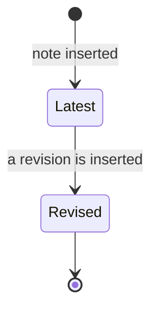
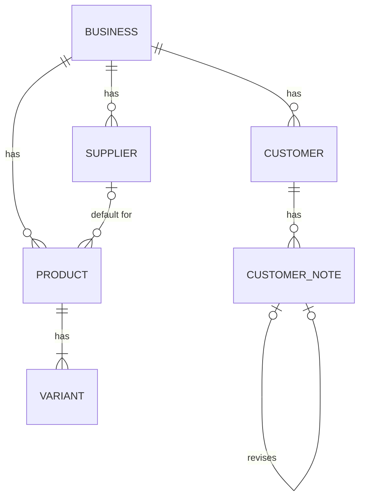

# Functional Specification — u4-catalog

> Source of truth for U4's workflows. Data shape: `entities.md`; decision logic: `rules.md`; decisions:
> `functional-design-questions.md`. U4 adds CatalogComponent (`src/catalog/`): customers with append-only
> notes, suppliers, products with variants and stock, the low-stock list, the purchase-cost operation, the
> C8 read functions U5 uses, ten screens, and the catalog part of the scripted check. It does not change
> orders (U5 does).

## 1. Scope

| In | Out (named, so nobody assumes it) |
|----|-----------------------------------|
| US3.1–US3.7, US5.2b; the catalog rows of US5.1's role table and AC5.1.4's routes | Linking orders to customers and variants (U5, US4.1); paste-parse matching (U5, US4.2) |
| Migrations 0018–0022 and their grants | Deleting customers, products or suppliers; editing axes or adding variants after creation |
| C8 read functions (`getCustomer`, `getVariant`, `customerNames`, `variantLabels`) | Payments, dues, customer lifetime value (B4 and the follow-up "insights" work) |
| Demo data for the catalog in `bun run seed:demo` (Q16) | Product photos, invoices (follow-up work the Owner chose on 2026-10-29) |

## 2. Workflows

Every write below runs in one transaction; after the locking read of the row being edited (edits only), the
audit row comes before the data change, and an edit that changes nothing writes nothing (BR10.1). Every request first
passes the server pipeline (session, Origin and JSON checks, the route's capability, the `.strict()` zod
schema), so the steps start after that.

### W1 — Record a customer (`POST /api/customers`; US3.1)

1. Normalise the phone (BR2.1); refuse with 400 on `phone` if it fails.
2. Validate name, address, risk level and the optional first note (BR3.1, BR3.2, BR4.1).
3. Begin; insert `customer.create` audit row; insert the customer (risk level default 0).
4. If a note was sent: insert `customer.note.add` audit row, then the note (BR3.4).
5. Find the oldest other customer of the business with the same phone (BR3.3). Commit.
6. 201 `{ customer, duplicatePhoneOf: {id, name} | null }`. The screen opens `/customers/:id` with the
   toast ক্রেতা যোগ হয়েছে and, when `duplicatePhoneOf` is not null, the warning linking to that customer.
   There is no separate pre-save check (BR3.3).

### W2 — Edit a customer (`PATCH /api/customers/:id`)

1. Every field is optional, at least one is sent; an omitted field stays as stored, `address: null` clears
   it, and the risk default never applies (BR3.1). Sent fields are validated as in W1 steps 1–2 (no note).
2. Begin; lock the customer row of the session's business (404 if none, BR11.2).
3. Compute the changed fields. None → commit nothing, 200 with the stored customer. Otherwise insert
   `customer.update` with their names and the risk change only (BR10.2); update the row and `updatedAt`.
   Commit. 200 `{ customer, duplicatePhoneOf }`.

### W3 — Add or revise a note (`POST /api/customers/:id/notes`; US3.2)

1. Validate the text (BR4.1). Begin; check the customer belongs to the business (404).
2. If `revisesNoteId`: check it is a note of this customer (404, BR4.2) and that no note revises it yet
   (409, BR4.3).
3. Insert `customer.note.add`; insert the note. A unique violation on `revises_note_id` alone becomes 409;
   anything else is rethrown. Commit. 201 `{ note }`.

### W4 — Find and open a customer (`GET /api/customers`, `GET /api/customers/:id`; US3.3)

1. List: apply BR5.1 to `q`; newest first; at most `limit` (≤ 50) rows plus `nextCursor`.
2. Detail: the customer with every note newest first (BR4.4), or 404.
3. The screen then loads `GET /api/orders?customerId=<id>` for the history (BR5.4) and shows the
   লেনদেন ও বাকি section as not available yet (BR5.5).

### W5 — Record a supplier (`POST /api/suppliers`, `PATCH /api/suppliers/:id`; US3.6)

1. Validate name and phone (BR8.1, BR2.1).
2. Begin; insert `supplier.create` (or lock, then `supplier.update` with changed field names); write the row.
   Commit. 201 / 200 `{ supplier }`.

### W6 — Record a product with variants (`POST /api/products`; US3.4)

1. Validate the fields, axes and variants (BR6.1, BR6.3, BR6.4); if `defaultSupplierId` is set, check it is a
   supplier of the business (404, BR8.2).
2. Begin; insert `product.create` with SKU, variant and axis counts; insert the product; insert every
   variant with its suffix (BR6.5). A unique violation on (business, lower(sku)) alone becomes 409
   (BR6.2). Commit.
3. 201 `{ product }` with variants, supplier and, for cost readers only, the cost (BR9.2).

### W7 — Edit a product (`PATCH /api/products/:id`)

1. Accept only name, category, selling price and default supplier, at least one (BR6.7).
2. Begin; lock the product (404); check a new supplier (404); insert `product.update` with the changed
   field names and the price and supplier before/after (BR10.2); update. Commit. 200 `{ product }`.

### W8 — Set stock (`PATCH /api/variants/:id/stock`; US3.5)

1. Validate (BR7.1). Begin; lock the variant of the business (404).
2. Insert `variant.stock.set` with old→new for each changed field; update. Commit.
3. 200 `{ variant }` with `low` computed (BR7.2). The product screen sends one request per changed row and
   lists the rows that failed, keeping their typed values.

### W9 — Change purchase cost (`PATCH /api/products/:id/cost`; US3.7)

1. Validate (BR9.1). Begin; lock the product (404).
2. Insert `product.cost.set` {before, after}; update the cost only. Commit. 200 `{ product }`.

### W10 — See what is running low (`GET /api/low-stock`; US3.5)

1. Query every low variant of the business with its product and default supplier (BR7.3); cap at 200 and set
   `truncated`. This replaces the MoneyEngine stub `src/money/low-variants.ts`, which is deleted with its test
   (AC3.5.3's "`low-variants` query" now names this catalog query).
2. The screen lists them; a row without a supplier shows BR7.4; no rows shows BR7.5.

### W11 — Orders read the catalog (C8; for U5)

`getCustomer`, `getVariant`, `customerNames`, `variantLabels` run inside the caller's transaction, read only,
scoped by business (BR14.1, BR14.2). C8's signatures are unchanged; `NotFound` moves to
`src/data/not-found.ts`; callers dedupe and chunk ids by 50. U4 ships and tests them; U5 calls them and deletes the B2 stubs in
`src/orders/customer.ts` and `src/orders/variant.ts`.

### W12 — The scripted check (US5.2b)

The wiring check gains the catalog steps of BR15.1, and the realdb grant gate gains the five tables
(BR12.2). AC5.2b.1's last step (an order for that customer and variant) is added by U5, which owns linking
orders to the catalog (as AC3.3.2's order rows, units review R-05).

## 3. State and lifecycles

The catalog has no status machine. Two lifecycles matter:

- **Note history.** A note is either the *latest* version (no note revises it) or *revised* (exactly one later
  note revises it). `latest → revised` happens once, by inserting the revision; nothing moves back, and no row
  changes (BR4.2, BR4.3).
- **Variant stock level.** `ok` (stock ≥ minimum) ↔ `low` (stock < minimum), recomputed on every read from the
  two stored numbers, never stored (BR7.2).

Text fallback: a note starts as the latest version and becomes revised, once, when a revision is inserted.

## 3a. Response bodies

Every entity is returned with its `entities.md` attributes minus `businessId`, plus the computed fields named
here. Ids are UUID strings; timestamps ISO-8601 UTC; money in paise.

| Body | Fields |
|------|--------|
| `Customer` | id, name, phone, address, riskLevel, createdAt, updatedAt |
| `CustomerRow` (list) | id, name, phone, address, riskLevel, createdAt |
| `CustomerList` | `{ customers: CustomerRow[], nextCursor, total }` |
| `Note` | id, text, revisesNoteId, createdAt, authorName (the author's email, as the audit trail shows it) — never the user id |
| `CustomerDetail` | `Customer` + `{ notes: Note[], notesTruncated }` |
| `Supplier` | id, name, phone, productCount, createdAt, updatedAt |
| `SupplierList` | `{ suppliers: Supplier[], truncated }` |
| `Variant` | id, axisValues, skuSuffix, fullSku, stock, minimumStock, low |
| `Product` | id, name, sku, category, sellingPricePaise, purchaseCostPaise (cost readers only, BR9.2), axes, variants: Variant[], defaultSupplier: {id, name, phone} \| null, createdAt, updatedAt |
| `ProductList` | `{ products: ProductSummary[], nextCursor, total }` (D6) |
| `LowStock` | `{ variants: [{variantId, productId, productName, axisValues, fullSku, stock, minimumStock, supplier: {id, name, phone} \| null}], truncated }` |

## 4. Entity relationships (derived from `entities.md`)

Text fallback: a business has customers, suppliers and products; a customer has notes, and a note may revise
one earlier note; a supplier may be the default for many products; a product has one or more variants.

## 5. Contract amendments (C7, C8, C9)

Recorded on the Owner's standing instruction. All are additive except D4, which narrows a response for one
role as R-04 required.

| # | Contract | Change |
|---|----------|--------|
| D1 | C7 capabilities | reads `business.view`; customers and notes any of `money.mutate.price`, `money.mutate.full`; products, stock, suppliers `money.mutate.full`; cost any of `money.mutate.cost`, `money.mutate.full` (Q1) |
| D2 | C7 `CustomerWrite` | gains optional `note` on create only; `address` ≤ 300; `riskLevel` default 0 |
| D3 | C7 create/edit customer | `duplicatePhoneOf` is `{id, name} | null` (the name is needed for the warning) |
| D4 | C7 product reads | `purchaseCostPaise` (integer or null) only for cost readers; the key is absent for Sales Staff (Q2, closes refined-mockups R-04 and C7's open question) |
| D5 | C7 `ProductCreate` / product edit | gains optional `category` (≤ 60); edit takes `name`, `category`, `sellingPricePaise`, `defaultSupplierId`, at least one |
| D6 | C7 `ProductSummary` | `{id, name, sku, category, sellingPricePaise, purchaseCostPaise?, variantCount, totalStock, lowCount, defaultSupplier: {id, name} | null}`; `q` matches name or SKU |
| D7 | C7 `/api/suppliers`, `/api/low-stock` | both add `truncated: boolean`; suppliers carry `productCount` |
| D8 | C7 notes | `revisesNoteId` already revised → 409 `conflict` |
| D9 | C9 | migrations 0018 suppliers, 0019 customers, 0020 customer_notes, 0021 products, 0022 variants; declared set as C9 already lists |
| D10 | C7 edit customer | partial: omitted fields unchanged, `address: null` clears, at least one field; a no-op edit is 200 with no audit row |
| D11 | C7 lists | `GET /api/customers` and `GET /api/products` add `total` (matching `q`); customer detail adds `notesTruncated` (newest 200 notes) |
| D12 | C7 product create | axis values ≤ 12 per axis and without `-`; at most 144 variants |
| D13 | C7 ids | non-UUID path or body ids answer 404 (plain strings in the schemas, checked in the domain) |
| — | C8 | signatures unchanged; `NotFound` moves to `src/data/not-found.ts`; callers chunk by 50 |
| — | MoneyEngine | `src/money/low-variants.ts` deleted (replaced by the catalog low-stock query) |

These amendments are also appended to `../../../inception/contract-design/contract-summary.md` as
"Amendments from U4 Functional Design", which closes C7's open cost question.

## 6. Error mapping

| Situation | Kind | Status |
|-----------|------|--------|
| Bad field, unknown key, bad axes or variants, bad phone | `invalid_input` (with `fields`) | 400 |
| Role lacks the route's capability | `forbidden` | 403 |
| Foreign, missing or non-UUID id (path or body) | `not_found` | 404 |
| SKU taken (ignoring case); note already revised | `conflict` | 409 |
| Database down | `db_unavailable` | 503 |

Only the two named unique violations are translated to `conflict`; every other database error is rethrown
and becomes a logged 500 (team.md error rules).

## 7. Rules summary (derived from `rules.md`)

Everyone reads the catalog; Owner, Manager and Sales Staff write customers and notes; Owner and Manager write
products, stock and suppliers; the Accountant also changes cost, and only cost readers see it. Phones are
normalised to `01XXXXXXXXX`. Notes and the audit trail are insert-only. A variant is low when stock is below
its minimum. Every write is audited first with no personal data in the payload, and every id outside the
session's business is a 404.
