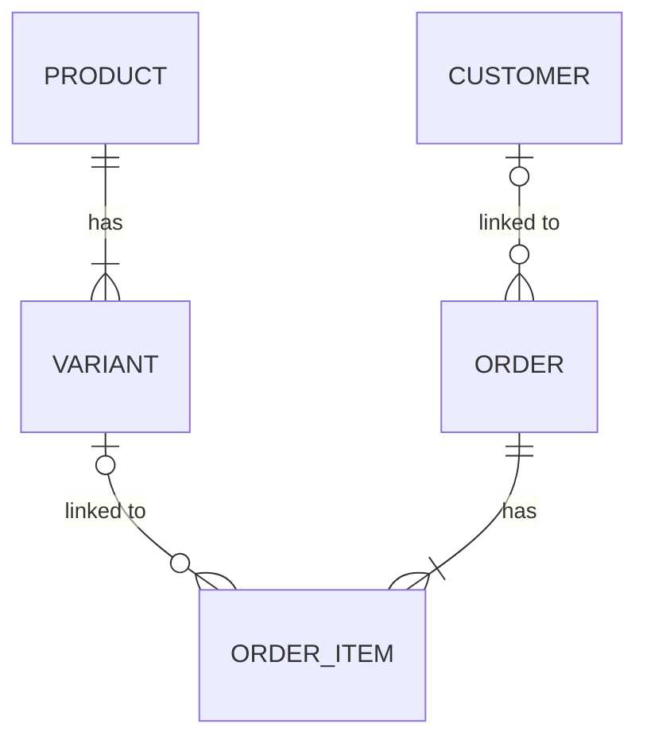

# Functional Specification — u5-orders-catalog

> Source of truth for U5's workflows. Data shape: `entities.md`; decision logic: `rules.md`; decisions:
> `functional-design-questions.md`. U5 links orders to U4's catalog: real customer and variant ids, names on
> the order list, pickers on the order screens, and paste matching against the shop's own products.

## 1. Scope

| In | Out (named, so nobody assumes it) |
|----|-----------------------------------|
| US4.1, US4.2; AC3.3.2's order rows and AC5.2b.1's order step deferred from U4 | Stock deduction or reservation when an order is taken (Q7) |
| Migration 0023 and the composite keys | Fuzzy or spelling-tolerant product matching |
| `GET /api/catalog/match-index` (read only) | Any catalog write from orders |
| U4 review fixes R-01, R-02 (Q8) | Customer and product insights (follow-up work the Owner chose) |

## 2. Workflows

### W1 — Take an order for a real customer and product (US4.1)

1. On `/orders/new` the person picks a customer (BR4.1) and, per line, a product variant (BR4.2), or leaves
   either as free text.
2. `POST /api/orders` sends `customerId` and each line's `variantId` with the filled, possibly edited,
   contact, descriptions and prices.
3. In the order transaction: check the customer and each variant through C8 (BR1.1; 404 and nothing
   written on failure); then the existing change-log-first create. Commit; 201.
4. The list (`GET /api/orders`) shows the customer's name and the variant labels (BR3.1); the customer's
   detail shows the order in its history (BR3.2).

### W2 — Edit or repeat an order

As W1 from step 2, with the past order's ids (BR4.3). An id that no longer resolves is a 404 that the screen
shows next to the customer or the line.

### W3 — Order from a pasted message (US4.2)

1. Opening `/orders/new/paste-parse` loads `GET /api/catalog/match-index` once (BR5.1).
2. Parsing runs as today with that catalog: each segment's own words link at most one product (BR5.2), and
   the variant comes from that segment's own size and colour (BR5.3). Ambiguous items stay unlinked and
   incomplete for the person to pick.
3. The contact phone is normalised and looked up; one match pre-selects the customer (BR6.1).
4. Saving builds the create request with the linked ids and continues as W1 step 3.

### W4 — Migration 0023 (BR2.1)

Run by `bun run migrate` as the admin: add `UNIQUE (business_id, id)` to variants; null non-matching TEXT ids;
alter both columns to uuid; add the two composite foreign keys. Applying it again changes nothing.

### W5 — The scripted check (BR7.1)

After U4's catalog steps, Sales Staff take an order for the check's customer and low variant; the check
asserts the names on the list and the order on the customer's history.

## 3. State

No new lifecycle. Order statuses are unchanged; a link is set or cleared only by create or edit.

## 4. Entity relationships

Text fallback: an order may be linked to one customer; each order line may be linked to one variant; a product
has variants.

## 5. Contract amendments (C3, C7, C8)

Recorded on the Owner's standing instruction.

| # | Contract | Change |
|---|----------|--------|
| E1 | C3 create/edit | `customerId` and `variantId` are UUIDs of the session's business; otherwise 404 `not_found` (as C3 already planned for U5) |
| E2 | C3 `OrderSummary` | `customerName` from the catalog when linked, else the contact name; `itemLabels` from the variant label when linked, else the description |
| E3 | C7 | new read `GET /api/catalog/match-index` (`business.view`) → `{ products: [{productId, name, sku, axisNames, variants: [{variantId, axisValues}]}], truncated }`, ≤ 2 000 variants, whole products, ordered by name then id |
| E5 | C3 order detail | `GET /api/orders/:id` adds `customerName` and per-item `label` (additive), computed as the list does |
| — | C8 | unchanged; orders now call it, chunking ids by 50 |

## 6. Error mapping

| Situation | Kind | Status |
|-----------|------|--------|
| Foreign, missing or non-UUID customer or variant id | `not_found` | 404 |
| Everything else | unchanged from B2 / U1 | — |

## 7. Rules summary (derived from `rules.md`)

Orders may link only to their own business's customers and variants, checked inside the order's transaction
and enforced again by composite keys. The list shows current catalog names with free-text fallbacks. Pickers
fill editable fields. Paste matching links a product only from an item's own words and only when exactly one
product matches, and picks the variant only from that item's own size and colour.
