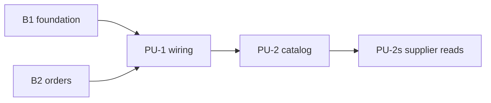

# Intent Backlog — App Wiring (B6)

Proto-Units, prioritised with MoSCoW and sequenced risk-first (scope Q2, Q4).

| ID | Proto-Unit | Priority | Order | Contains | Depends on | Done when |
|----|------------|----------|-------|----------|------------|-----------|
| PU-1 | wiring | Must | 1 | Sessions and sign-in, API server, server-side role gate, typed client, mounted router, end-to-end check | B1, B2 on `main` | Success measures 1–4 and 6 pass in local CI |
| PU-2 | catalog | Must | 2 | Customers (US1.6, US1.7), products and variants with low stock (US1.8, US1.9), real `getCustomer`/`getVariant` for orders | PU-1 | Success measure 5 passes; B2 order tests and `tests/realdb` stay green |
| PU-2s | supplier reads | Should | 2 (inside PU-2) | Supplier records as read by the catalog (US2.6/US2.7 reads) | PU-2 | Products link to a supplier and show it |

## Won't have (this time)

- B4 money, B5 operate, email/SMS invitations, hosted services (scope document, "Out of scope").

## Dependency sketch

Text fallback: B1 and B2 → PU-1 wiring → PU-2 catalog → supplier reads.
