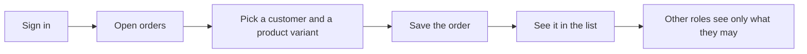

# Scope Document — App Wiring (B6)

> Inputs:
> - `../intent-capture/intent-statement.md`;
> - `../feasibility/feasibility-assessment.md` and `constraint-register.md`;
> - the answers in `scope-definition-questions.md` (Q1–Q5, decided on the Owner's standing instruction
>   and confirmed "Looks correct").

## Scope boundary

### In scope

| Capability | Priority | Bolt | Source |
|------------|----------|------|--------|
| Sign-in and sign-out with real accounts, sessions with server-side expiry | Must | Wiring | intent [desc]; Q2 |
| A local API server that owns the database connection and offers the order operations (create, update, transition, link consignment, get, list) | Must | Wiring | intent [desc]; Q2 |
| The role gate enforced at the server for every API route, in addition to the existing screen and database layers | Must | Wiring | constraint C-6; Q2 |
| A typed client the screens call; screens never reach the database | Must | Wiring | intent [desc] |
| Router mounted in the app: every U1 and U3 route renders for a signed-in user | Must | Wiring | intent [desc]; review R-06 |
| A scripted end-to-end check that drives the API without a browser, in local CI | Must | Wiring | intent Q3 |
| Customers: record a profile, search and review (US1.6, US1.7) | Must | Catalog | intent Q9; Q2 |
| Products with variants and supplier link; review variants and low stock (US1.8, US1.9) | Must | Catalog | intent Q9; Q2 |
| Orders read real customers and variants (B2 `getCustomer`/`getVariant` stubs replaced) | Must | Catalog | Q3 |
| Supplier records, as read by the catalog (US2.6/US2.7 reads) | Should | Catalog | Q2 |
| Low-stock highlighting polish | Could | Catalog | Q2 |

### Out of scope

| Item | Why | Source |
|------|-----|--------|
| B4 money: payments, consignment settlement, dues | Later Bolt | intent Q9 |
| B5 operate: daily summary, audit-trail export, settings beyond what U1 already renders | Later Bolt | intent Q9; review R-04 |
| Staff invitations sent by email or SMS | No hosted provider (zero spend); Owner-only users for now | constraint C-10; intent Q2 |
| Any hosted hosting, database or CI | Zero spend | constraint C-1 |

## Success measures

1. On this machine, the Owner signs in, opens the orders screen, creates an order and sees it in the
   list (intent Q3).
2. For each role (Owner, Manager, Sales Staff, Accountant), the API refuses every operation that role's
   capability does not allow, with the allow/deny table tested by absence over every route
   (intent Q3; review R-04).
3. Every U1 and U3 route renders in the running app for a signed-in Owner (intent Q3; review R-06).
4. A scripted end-to-end check proves 1–3 against the local Postgres in local CI, without a browser
   (intent Q3).
5. An order created from a real catalog customer and product variant shows their names in the order
   list (closes review R-01).
6. Zero spend: no hosted service is used (constraint C-1).

## Sequencing

Risk-first (Q4). The wiring Bolt ships first, because session security and the end-to-end path are
the largest unknowns (feasibility RK-2). The catalog Bolt follows and builds on the wiring Bolt's API
server and sessions (Q3). No deadline applies (Q5).

## Value stream

Text fallback: sign in → open orders → pick a customer and product variant → save → see it listed →
other roles are limited by the role gate.

## Assumptions & Open Questions

- [assumption] The Owner is the only real user for now; the other roles are exercised by tests, not
  by real staff accounts (intent Q2).
