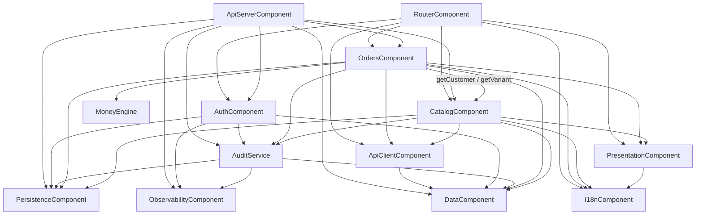

# SmartBiz BD — Component Catalogue (App Wiring, B6)

> Brownfield. Starting point: the production components in `codekb/SmartBiz/component-inventory.md`
> (P.1–P.12) and the MVP catalogue (`261004-mvp/inception/domain-design/components.md`), whose 1:1
> module-to-component decomposition this intent keeps (project.md §Corrections). Inputs:
> `../requirements-analysis/requirements.md` (FR1–FR7, NFR1–NFR10), `../user-stories/stories.md`
> (US1.1–US5.4), `../refined-mockups/`, `domain-design-questions.md` (Q1–Q7). Decisions: `decisions.md`.
>
> **New:** `ApiServerComponent` (`src/server/`), `ApiClientComponent` (`src/client/`),
> `CatalogComponent` (`src/catalog/`). **Changed:** AuthComponent, OrdersComponent, MoneyEngine,
> RouterComponent, PresentationComponent, I18nComponent, DataComponent, PersistenceComponent,
> ObservabilityComponent. **Unchanged in shape:** AuditService.
> Entities are captured at ownership and shape level only; types and constraints belong to Functional Design.

## Part A — Machine-readable catalogue

```yaml
components:
  - name: ApiServerComponent
    summary: The bun HTTP server, the composition root that turns HTTP requests into domain calls
    behaviour: >
      Listens on 127.0.0.1 only and serves the built app and /api/ from one origin. Holds the route
      table as data (method, path, capability, schema, handler) so the role walk enumerates it. For
      every request: caps body size; for state-changing calls requires application/json and an Origin
      exactly equal to http://127.0.0.1:<port>; reads the __Host- session cookie, resolves the session
      through AuthComponent (which checks both limits and users.active), and derives role and
      businessId from the session row only; checks the route's capability before any domain call;
      parses body, params and query with a .strict() zod schema; calls one domain function; maps the
      Result kind to the fixed HTTP status table; adds the security headers to every response and
      Cache-Control: no-store on /api/. A thrown error becomes a logged 500 with only an error code and
      the correlation id. Refuses to start when the database user is a superuser or not a member of
      app_role. Also hosts the terminal reset command, which prints the Owner's one-time reset link.
    responsibilities:
      - the server entry and the one-command start (FR1.1)
      - the route table as data and the public-route allow-list
      - cookie handling, security headers, Origin and content-type checks
      - the Result-kind to HTTP status table (closed set)
      - the health endpoint and the database-unavailable 503
      - the terminal reset command (US1.6)
      - static serving of the Vite build
    depends_on:
      - component: AuthComponent
        interaction: sign-up, sign-in, sign-out, session resolve, invitations, resets, staff list, capability check
        style: sync
      - component: OrdersComponent
        interaction: order create, update, status, consignment, get, list
        style: sync
      - component: CatalogComponent
        interaction: customer, note, product, variant, stock, supplier and low-stock operations
        style: sync
      - component: AuditService
        interaction: audit trail read for the audit endpoint
        style: sync
      - component: PersistenceComponent
        interaction: the connection pool and the start-up role check
        style: sync
      - component: ObservabilityComponent
        interaction: request logging with redaction and correlation ids
        style: sync
      - component: DataComponent
        interaction: zod request and response schemas, Result type, app clock
        style: sync
    dependents: []
    external_dependencies:
      - name: Bun.serve
        kind: other
        purpose: the HTTP server runtime
    entities: []

  - name: ApiClientComponent
    summary: The browser's only path to data — typed functions over same-origin fetch
    behaviour: >
      One typed function per endpoint. Sends JSON with credentials on the same origin, parses every
      response with the shared zod schemas, and returns Result values whose error kinds are the
      server's closed set plus unreachable for a network failure. On 401 it records the current
      route and sends the app to sign-in; after sign-in the app returns there. Exposes a request
      status union used by the screens' loading, empty and error states. Never imports a module that
      takes sql, and never stores a token: the one-time link from an invitation or reset response is
      handed to the caller and not kept.
    responsibilities:
      - typed endpoint functions for auth, staff, orders and catalog
      - response parsing and the error-kind mapping on the browser side
      - the 401 redirect-and-return behaviour (AC1.3.5)
      - the request status union for screen states (US5.4)
    depends_on:
      - component: DataComponent
        interaction: shared zod schemas and the Result type
        style: sync
    dependents:
      - component: RouterComponent
        interaction: auth, session and staff calls from the auth screens and Shell
      - component: OrdersComponent
        interaction: order screens load and save through it
      - component: CatalogComponent
        interaction: catalog screens load and save through it
    external_dependencies:
      - name: browser fetch
        kind: other
        purpose: HTTP to the same origin
    entities: []

  - name: RouterComponent
    summary: The mounted browser app — hash routes, role gate, Shell wiring and the auth and staff screens
    behaviour: >
      Holds the typed route map for every screen route, including the public routes (sign-in,
      sign-up, accept-invite, reset, recover). Gates each route by capability on the client (advisory
      once data comes over HTTP), renders the lock screen for a refused route with a way home, and the
      not-found screen for an unknown path. Passes typed route parameters to screens. Decides between
      first-run sign-up and sign-in from the server. Builds the Shell navigation from one typed list
      filtered by the user's capabilities. Owns the auth screens and the new staff screen, and reads a
      one-time token from the URL hash then replaces the address before any request.
    responsibilities:
      - the typed route map and hash router with parameters (AC1.7.2)
      - client-side role gate, lock and not-found screens (AC5.1.5, AC5.1.6)
      - sign-up, sign-in, recover, reset, accept-invite and staff screens
      - the browser entry that mounts the router (FR4.1)
    depends_on:
      - component: AuthComponent
        interaction: the pure role x capability matrix and gate rules (no server code)
        style: sync
      - component: OrdersComponent
        interaction: renders the order screens on order routes
        style: sync
      - component: CatalogComponent
        interaction: renders the catalog screens on catalog routes
        style: sync
      - component: ApiClientComponent
        interaction: session, sign-in, sign-up, invitations, resets, staff list
        style: sync
      - component: PresentationComponent
        interaction: Shell, Screen, Field, LockSheet, LinkSheet, ApiState
        style: sync
      - component: I18nComponent
        interaction: labels, locale, Bangla digits
        style: sync
    dependents: []
    external_dependencies:
      - name: React 18
        kind: other
        purpose: rendering
    entities: []

  - name: PresentationComponent
    summary: Shared UI primitives and design tokens
    behaviour: >
      Shell, Screen, Field (with error, hint, tel and number types), Pill, BasisPill, LockSheet, Toast,
      CompletenessControl, plus the new ApiState, LinkSheet, SearchBox, RiskChip and LowStockMark.
      Every indicator carries text, never colour alone; every token meets the contrast floors.
    responsibilities:
      - UI primitives and tokens.css (including the new warning colour token)
      - the five screen states via ApiState
    depends_on:
      - component: I18nComponent
        interaction: labels
        style: sync
    dependents:
      - component: RouterComponent
        interaction: Shell and screen primitives
      - component: OrdersComponent
        interaction: primitives on order screens
      - component: CatalogComponent
        interaction: primitives on catalog screens
    external_dependencies: []
    entities: []

  - name: I18nComponent
    summary: Bangla-first labels, locale and digits
    behaviour: >
      L(bn, en) labels for every user-facing string including navigation, bnDigits and toAsciiDigits.
      Typed input accepts both digit sets.
    responsibilities:
      - label table and lookup, locale store, digit conversion
    depends_on: []
    dependents:
      - component: RouterComponent
        interaction: labels
      - component: OrdersComponent
        interaction: labels and digits
      - component: CatalogComponent
        interaction: labels and digits
      - component: PresentationComponent
        interaction: labels
    external_dependencies: []
    entities: []

  - name: AuthComponent
    summary: Accounts, the business, sessions, invitations, password resets and the role x capability gate
    behaviour: >
      Sign-up creates the single business and its Owner in one transaction, refused once a business
      exists. Sign-in checks the password, counts failed attempts per typed email (429 after 5 in 15
      minutes, never disabling the account), issues a new random session id and stores only its hash.
      Session resolve looks up the hash, checks the 12-hour idle limit and the 30-day absolute cap on
      the app clock, checks users.active, and touches last_seen_at in the same statement. Sign-out
      deletes the session and is idempotent. Owner or Manager create invitations (7 days) and staff
      reset links (30 minutes) that return their raw token once; only hashes are stored. A Manager
      cannot create an Owner invitation or reset the Owner. A completed reset ends every session of
      that user. Domain functions return the public User, never UserRecord with its hash. Audit rows
      for auth events hold no email and no typed text.
    responsibilities:
      - Business, User, Session, Invitation and PasswordReset
      - the role x capability matrix and gate (pure, shared with the browser)
      - the sign-in rate limit
      - the staff list (members and pending invitations)
    depends_on:
      - component: AuditService
        interaction: audit row first in the same transaction for each auth event
        style: sync
      - component: PersistenceComponent
        interaction: queries on the auth tables
        style: sync
      - component: DataComponent
        interaction: app clock, Result, schemas
        style: sync
      - component: ObservabilityComponent
        interaction: redacted logging
        style: sync
    dependents:
      - component: ApiServerComponent
        interaction: every auth endpoint and session resolve on every request
      - component: RouterComponent
        interaction: the capability matrix for the client gate
    external_dependencies:
      - name: argon2
        kind: other
        purpose: password hashing (server only)
      - name: PostgreSQL
        kind: database
        purpose: users, businesses, sessions, invitations, password_resets tables
    entities:
      - name: Business
        identifier: id
        attributes: [id, name, locale, ownerUserId, createdAt, updatedAt]
      - name: User
        identifier: id
        attributes: [id, businessId, email, passwordHash, role, active, locale, createdAt, updatedAt]
        references:
          - entity: Business
            owned_by: AuthComponent
            relationship: every User belongs to the one Business
      - name: Session
        identifier: id
        attributes: [id, tokenHash, userId, businessId, issuedAt, lastSeenAt, expiresAt]
        references:
          - entity: User
            owned_by: AuthComponent
            relationship: every Session belongs to one User
      - name: Invitation
        identifier: id
        attributes: [id, businessId, email, role, acceptTokenHash, expiresAt, usedAt, createdBy, createdAt]
        references:
          - entity: Business
            owned_by: AuthComponent
            relationship: every Invitation is into the one Business
      - name: PasswordReset
        identifier: id
        attributes: [id, userId, tokenHash, expiresAt, usedAt, createdBy, createdAt]
        references:
          - entity: User
            owned_by: AuthComponent
            relationship: every PasswordReset is for one User

  - name: AuditService
    summary: Append-only audit trail
    behaviour: >
      insertAudit writes one row in the caller's transaction; app_role holds only INSERT and SELECT on
      audit_log. Reversals are new rows. Reads apply the retention filter. Payloads never hold customer
      or supplier name, phone or address, nor email or typed sign-in text.
    responsibilities:
      - AuditEntry writes and retention-filtered reads
    depends_on:
      - component: PersistenceComponent
        interaction: insert and select on audit_log
        style: sync
      - component: ObservabilityComponent
        interaction: correlation id on each row
        style: sync
      - component: DataComponent
        interaction: app clock and Uuid
        style: sync
    dependents:
      - component: ApiServerComponent
        interaction: audit trail endpoint
      - component: AuthComponent
        interaction: auth event rows
      - component: OrdersComponent
        interaction: order event rows
      - component: CatalogComponent
        interaction: catalog event rows
    external_dependencies:
      - name: PostgreSQL
        kind: database
        purpose: audit_log table
    entities:
      - name: AuditEntry
        identifier: id
        attributes: [id, businessId, actorUserId, correlationId, action, subjectKind, subjectId, payload, reversesId, occurredAt, retentionUntil]
        references:
          - entity: Business
            owned_by: AuthComponent
            relationship: every AuditEntry belongs to the one Business

  - name: OrdersComponent
    summary: Orders, their items, status and consignment links, the paste parser and the order screens
    behaviour: >
      Unchanged domain rules from B2 (nine-value status FSM, buckets, audit first, segment isolation).
      Changed: getCustomer and getVariant now call CatalogComponent's read functions scoped to the
      session's business (a foreign id is not_found); the list accepts status, date range and customer
      filters with a 50-row keyset cursor and returns customer names and variant labels resolved
      through CatalogComponent; a non-UUID order id is not_found. The screens load and save through
      ApiClientComponent; the paste parser may link an item to a catalog product only from that
      item's own words.
    responsibilities:
      - Order, OrderItem and ConsignmentLink
      - status FSM and status buckets
      - paste parser and segment isolation
      - order screens (list, manual, paste, repeat, detail)
    depends_on:
      - component: CatalogComponent
        interaction: getCustomer, getVariant, and name and label lookups by id list
        style: sync
      - component: AuditService
        interaction: audit row first for each order change
        style: sync
      - component: PersistenceComponent
        interaction: queries on the order tables
        style: sync
      - component: DataComponent
        interaction: schemas, Result, app clock
        style: sync
      - component: MoneyEngine
        interaction: totals and money figures with basis
        style: sync
      - component: ApiClientComponent
        interaction: order screens load and save through it
        style: sync
      - component: PresentationComponent
        interaction: screen primitives
        style: sync
      - component: I18nComponent
        interaction: labels and digits
        style: sync
    dependents:
      - component: ApiServerComponent
        interaction: order endpoints
      - component: RouterComponent
        interaction: order routes render its screens
    external_dependencies:
      - name: PostgreSQL
        kind: database
        purpose: orders, order_items, consignment_link tables
    entities:
      - name: Order
        identifier: id
        attributes: [id, businessId, orderNo, customerId, contact, status, source, repeatOfOrderId, orderDiscountPaise, deliveryChargePaise, totalPaise, createdBy, createdAt, updatedAt]
        references:
          - entity: Customer
            owned_by: CatalogComponent
            relationship: an Order may belong to one Customer
          - entity: Business
            owned_by: AuthComponent
            relationship: every Order belongs to the one Business
      - name: OrderItem
        identifier: id
        attributes: [id, orderId, businessId, lineNo, variantId, description, quantity, unitPricePaise, lineDiscountPaise]
        references:
          - entity: Order
            owned_by: OrdersComponent
            relationship: every OrderItem belongs to one Order
          - entity: Variant
            owned_by: CatalogComponent
            relationship: an OrderItem may name one Variant
      - name: ConsignmentLink
        identifier: id
        attributes: [id, businessId, orderId, courier, consignmentRef, linkedBy, linkedAt]
        references:
          - entity: Order
            owned_by: OrdersComponent
            relationship: every ConsignmentLink belongs to one Order

  - name: CatalogComponent
    summary: Customers and their notes, products with variants and stock, suppliers, low stock, and the catalog screens
    behaviour: >
      Every create or change writes one audit row first in the same transaction, with no name, phone
      or address in the payload. Phones are normalised (Bangla digits, spaces, hyphens, +880 or 880
      prefix) to 01XXXXXXXXX and must match 01[3-9] plus 8 digits; a duplicate customer phone is a
      warning, not a refusal. Risk is a whole number 0 to 3. Notes are append-only: a revision is a new
      note that references the one it revises. A product has up to two axes; one variant is created per
      combination with its own SKU suffix, stock and minimum stock; SKU is unique per business ignoring
      case. Stock is a whole number of at least 0, set by Owner or Manager; purchase cost is also
      editable by the Accountant through its own operation. A variant is low when stock is below its
      minimum. Every read is scoped to the session's business, so a foreign id is not_found.
    responsibilities:
      - Customer, CustomerNote, Product, Variant and Supplier
      - phone normalisation (pure, shared with the browser)
      - customer search by name or by at least 4 phone digits
      - the low-stock query (moved from MoneyEngine)
      - read functions for orders (getCustomer, getVariant, names and labels by id)
      - catalog screens (customers, products, low stock, suppliers)
    depends_on:
      - component: AuditService
        interaction: audit row first for each catalog change
        style: sync
      - component: PersistenceComponent
        interaction: queries on the catalog tables
        style: sync
      - component: DataComponent
        interaction: schemas, Result, app clock
        style: sync
      - component: ApiClientComponent
        interaction: catalog screens load and save through it, including a customer's order history
        style: sync
      - component: PresentationComponent
        interaction: screen primitives, RiskChip, LowStockMark
        style: sync
      - component: I18nComponent
        interaction: labels and digits
        style: sync
    dependents:
      - component: ApiServerComponent
        interaction: catalog endpoints
      - component: OrdersComponent
        interaction: customer and variant lookups for orders
      - component: RouterComponent
        interaction: catalog routes render its screens
    external_dependencies:
      - name: PostgreSQL
        kind: database
        purpose: customers, customer_notes, products, variants, suppliers tables
    entities:
      - name: Customer
        identifier: id
        attributes: [id, businessId, name, phone, address, riskLevel, createdBy, createdAt, updatedAt]
        references:
          - entity: Business
            owned_by: AuthComponent
            relationship: every Customer belongs to the one Business
      - name: CustomerNote
        identifier: id
        attributes: [id, customerId, businessId, text, revisesNoteId, createdBy, createdAt]
        references:
          - entity: Customer
            owned_by: CatalogComponent
            relationship: every CustomerNote belongs to one Customer
      - name: Product
        identifier: id
        attributes: [id, businessId, sku, name, sellingPricePaise, purchaseCostPaise, axes, defaultSupplierId, createdBy, createdAt, updatedAt]
        references:
          - entity: Supplier
            owned_by: CatalogComponent
            relationship: a Product may have one default Supplier
          - entity: Business
            owned_by: AuthComponent
            relationship: every Product belongs to the one Business
      - name: Variant
        identifier: id
        attributes: [id, productId, businessId, skuSuffix, axisValues, stock, minimumStock, updatedAt]
        references:
          - entity: Product
            owned_by: CatalogComponent
            relationship: every Variant belongs to one Product
      - name: Supplier
        identifier: id
        attributes: [id, businessId, name, phone, createdBy, createdAt, updatedAt]
        references:
          - entity: Business
            owned_by: AuthComponent
            relationship: every Supplier belongs to the one Business

  - name: MoneyEngine
    summary: Money figures with recognition basis and completeness
    behaviour: >
      Pure. MoneyFigure, add and subtract with the basis guard, econ, summary, risk, countByStatus.
      lowVariants is removed from here (it compared paise to a threshold and had no notion of stock)
      and replaced by CatalogComponent's low-stock query.
    responsibilities:
      - money arithmetic with basis and completeness
    depends_on: []
    dependents:
      - component: OrdersComponent
        interaction: totals and money figures
    external_dependencies: []
    entities: []

  - name: DataComponent
    summary: Shared kernel — zod schemas, Result, Uuid, app clock, typed state containers
    behaviour: >
      Browser-safe only. Uuid generation uses Web Crypto (crypto.randomUUID), so the browser bundle has
      no node:crypto. The app clock is the only place a live "now" is read. Request and response zod
      schemas are shared by ApiServerComponent and ApiClientComponent so both sides parse the same shapes.
    responsibilities:
      - shared schemas and types, Result, Uuid, app clock, state container factory
    depends_on: []
    dependents:
      - component: ApiClientComponent
        interaction: schemas and Result
      - component: ApiServerComponent
        interaction: schemas, Result, clock
      - component: AuthComponent
        interaction: clock, Result, schemas
      - component: AuditService
        interaction: clock, Uuid
      - component: OrdersComponent
        interaction: schemas, Result, clock
      - component: CatalogComponent
        interaction: schemas, Result, clock
    external_dependencies:
      - name: zod
        kind: other
        purpose: boundary schemas
    entities: []

  - name: PersistenceComponent
    summary: Connection pool, migration runner, migrations and the grant check
    behaviour: >
      The pool connects as a login member of app_role from DATABASE_URL; migrations run under a
      separate admin URL. Migrations only add exact grants. The grant check compares app_role's
      privileges on every table with the declared set and is used by the start-up check and the realdb
      gate. Each table has exactly one owning component (named in this catalogue); this component only
      runs the DDL.
    responsibilities:
      - pool, migrate, migrations, declared grant set and grant check
    depends_on: []
    dependents:
      - component: ApiServerComponent
        interaction: pool and start-up role check
      - component: AuthComponent
        interaction: queries
      - component: AuditService
        interaction: queries
      - component: OrdersComponent
        interaction: queries
      - component: CatalogComponent
        interaction: queries
    external_dependencies:
      - name: PostgreSQL 18 (Docker, 127.0.0.1)
        kind: database
        purpose: all application tables
    entities: []

  - name: ObservabilityComponent
    summary: Server-side JSON logging with redaction, and correlation ids
    behaviour: >
      Server only. The logger replaces a deny-list of keys with "[redacted]" and never logs full request
      bodies. Correlation ids come from Web Crypto. Browser code never imports the logger.
    responsibilities:
      - redacted JSON-line logger and correlation ids
    depends_on: []
    dependents:
      - component: ApiServerComponent
        interaction: request logging
      - component: AuthComponent
        interaction: logging
      - component: AuditService
        interaction: correlation ids
    external_dependencies: []
    entities: []
```

## Part B — Human-readable view

### Component Diagram



Text fallback: the browser side is RouterComponent → (Orders, Catalog screens) → ApiClientComponent → DataComponent. The server side is ApiServerComponent → (Auth, Orders, Catalog, AuditService) → PersistenceComponent. OrdersComponent calls CatalogComponent for customer and variant lookups; nothing calls back from Catalog to Orders, so the graph is acyclic. RouterComponent imports only the pure capability matrix from AuthComponent, and OrdersComponent and CatalogComponent's screens import only their browser-safe modules, as the ESLint browser-file rule enforces (team.md Code Style).

### Component Summary

| Component | Purpose | Depends On | Dependents | Entities Owned |
|-----------|---------|------------|------------|----------------|
| ApiServerComponent | HTTP composition root | Auth, Orders, Catalog, Audit, Persistence, Observability, Data | — | — |
| ApiClientComponent | Browser data access | Data | Router, Orders, Catalog | — |
| RouterComponent | Mounted app, routes, auth and staff screens | Auth, Orders, Catalog, ApiClient, Presentation, I18n | — | — |
| PresentationComponent | UI primitives and tokens | I18n | Router, Orders, Catalog | — |
| I18nComponent | Labels, locale, digits | — | Router, Orders, Catalog, Presentation | — |
| AuthComponent | Accounts, sessions, invitations, resets, role gate | Audit, Persistence, Data, Observability | ApiServer, Router | Business, User, Session, Invitation, PasswordReset |
| AuditService | Append-only audit | Persistence, Observability, Data | ApiServer, Auth, Orders, Catalog | AuditEntry |
| OrdersComponent | Orders and order screens | Catalog, Audit, Persistence, Data, MoneyEngine, ApiClient, Presentation, I18n | ApiServer, Router | Order, OrderItem, ConsignmentLink |
| CatalogComponent | Customers, products, suppliers, stock | Audit, Persistence, Data, ApiClient, Presentation, I18n | ApiServer, Orders, Router | Customer, CustomerNote, Product, Variant, Supplier |
| MoneyEngine | Money figures | — | Orders | — |
| DataComponent | Shared kernel | — | ApiClient, ApiServer, Auth, Audit, Orders, Catalog | — |
| PersistenceComponent | Pool, migrations, grants | — | ApiServer, Auth, Audit, Orders, Catalog | — |
| ObservabilityComponent | Redacted logging, correlation | — | ApiServer, Auth, Audit | — |

### Entity Ownership

| Entity | Owning Component | Identifier | Attributes | References |
|--------|------------------|------------|------------|------------|
| Business | AuthComponent | id | name, locale, ownerUserId, timestamps | — |
| User | AuthComponent | id | businessId, email, passwordHash, role, active, locale, timestamps | Business |
| Session | AuthComponent | id | tokenHash, userId, businessId, issuedAt, lastSeenAt, expiresAt | User |
| Invitation | AuthComponent | id | businessId, email, role, acceptTokenHash, expiresAt, usedAt, createdBy | Business |
| PasswordReset | AuthComponent | id | userId, tokenHash, expiresAt, usedAt, createdBy | User |
| AuditEntry | AuditService | id | businessId, actorUserId, correlationId, action, subject, payload, reversesId, occurredAt, retentionUntil | Business |
| Order | OrdersComponent | id | orderNo, customerId, contact, status, source, money fields, timestamps | Customer, Business |
| OrderItem | OrdersComponent | id | orderId, lineNo, variantId, description, quantity, prices | Order, Variant |
| ConsignmentLink | OrdersComponent | id | orderId, courier, consignmentRef, linkedBy, linkedAt | Order |
| Customer | CatalogComponent | id | name, phone, address, riskLevel, timestamps | Business |
| CustomerNote | CatalogComponent | id | customerId, text, revisesNoteId, createdBy, createdAt | Customer |
| Product | CatalogComponent | id | sku, name, sellingPricePaise, purchaseCostPaise, axes, defaultSupplierId, timestamps | Supplier, Business |
| Variant | CatalogComponent | id | productId, skuSuffix, axisValues, stock, minimumStock | Product |
| Supplier | CatalogComponent | id | name, phone, timestamps | Business |

New attributes against today's tables: `users.business_id` (P-3), `sessions.token_hash` (P-4), `password_resets.created_by` (staff reset links). The catalog tables are all new.

### External Dependencies

| Component | Dependency | Kind | Purpose |
|-----------|------------|------|---------|
| ApiServerComponent | Bun.serve | other | HTTP server runtime |
| ApiClientComponent | browser fetch | other | same-origin HTTP |
| RouterComponent | React 18 | other | rendering |
| AuthComponent | argon2 | other | password hashing |
| AuthComponent, AuditService, OrdersComponent, CatalogComponent | PostgreSQL | database | their own tables |
| PersistenceComponent | PostgreSQL 18 (Docker, 127.0.0.1) | database | all tables, migrations |
| DataComponent | zod | other | boundary schemas |

All are free and run on this machine (project.md Forbidden; NFR10).

### Rationale

| Component | Why it is a separate building block |
|-----------|-------------------------------------|
| ApiServerComponent | Distinct concern: HTTP transport, cookies and headers change for transport reasons, not business ones; one route table makes the server role walk possible (Q1, ADR-001) |
| ApiClientComponent | Distinct runtime (browser) and one place for the 401 and error-kind behaviour (Q2, ADR-002) |
| RouterComponent | Existing; now mounted; owns client routing and the auth screens |
| PresentationComponent, I18nComponent | Existing; shared by every screen; change for design and copy reasons |
| AuthComponent | Existing; sole owner of the auth tables, including the new staff list and reset links (Q6, ADR-005) |
| AuditService | Existing; append-only invariant enforced at the database |
| OrdersComponent | Existing; order lifecycle; now reads the catalog only through Catalog's functions (Q4, ADR-003) |
| CatalogComponent | New; distinct data ownership and change rate (Bolt 2) (Q3, ADR-004) |
| MoneyEngine | Existing; pure money arithmetic; loses the stock-blind lowVariants (Q5, ADR-004) |
| DataComponent | Existing shared kernel; becomes strictly browser-safe (ADR-002) |
| PersistenceComponent | Existing; DDL and grants are code with tests (Q7) |
| ObservabilityComponent | Existing; becomes server-only (ADR-002) |

**Alternatives Rejected** (detail in `decisions.md`): handlers per feature directory (ADR-001); screens calling `fetch` directly (ADR-002); orders reading catalog tables (ADR-003); separate Customer and Product components, and keeping `lowVariants` in MoneyEngine (ADR-004); a separate Staff component (ADR-005).

## Sources

- Requirements FR1–FR7, NFR1–NFR10: `../requirements-analysis/requirements.md`
- Stories US1.1–US5.4 and their ACs: `../user-stories/stories.md`
- Screens and components: `../refined-mockups/mockups.md`, `interaction-spec.md`, `design-system-mapping.md`
- Current code and its findings P-1..P-19: `aidlc/spaces/default/codekb/SmartBiz/component-inventory.md`, `architecture.md`, `code-quality-assessment.md`
- Existing table columns: `src/db/migrations/0001–0010`
- Team rules: `aidlc/spaces/default/memory/team.md` (Code Style, Testing Posture, Deployment)

## Assumptions & Open Questions

- `[assumption]` A Product's `axes` (names and value lists) are stored on the product and each Variant's `axisValues` on the variant; the exact column shape is a Functional Design decision.
- `[assumption]` The order list's customer names come through CatalogComponent's lookup by id list rather than a SQL join across owners; Functional Design may prove a join view faster, in which case CatalogComponent owns that view.
- Carried from earlier reviews to Functional Design: the Manager's `audit.view` (P-18), the delegation matrix for invitations and resets (user-stories R-05), purchase-cost visibility for Sales Staff (refined-mockups R-04), the token-in-hash link format (refined-mockups R-03).
- The process-local sign-in rate limiter resets when the server restarts; whether that is acceptable is an NFR Requirements question.
