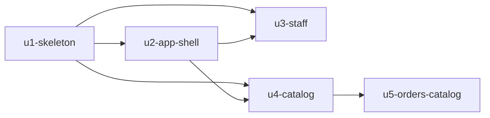

# Unit Dependencies — App Wiring (B6)

> Topology only. Delivery Planning chooses the order and the Bolts. Units: `unit-of-work.md`.

## Dependency DAG

```yaml
units:
  - name: u1-skeleton
    kind: service
    depends_on: []
  - name: u2-app-shell
    depends_on: [u1-skeleton]
  - name: u3-staff
    kind: service
    depends_on: [u1-skeleton, u2-app-shell]
  - name: u4-catalog
    kind: service
    depends_on: [u1-skeleton, u2-app-shell]
  - name: u5-orders-catalog
    kind: service
    depends_on: [u4-catalog]
```



Text fallback: u2-app-shell depends on u1-skeleton; u3-staff and u4-catalog each depend on u1-skeleton and u2-app-shell; u5-orders-catalog depends on u4-catalog. No cycles.

## Why each edge exists

| Edge (A depends on B) | Reason |
|-----------------------|--------|
| u2-app-shell → u1-skeleton | Mounts screens on U1's router, walks U1's route table, wraps U1's client |
| u3-staff → u1-skeleton | Needs sessions, the server route table and the auth tables' grants |
| u3-staff → u2-app-shell | The staff screen uses the shared screen states, and its routes join U2's role walk and no-secret allow-list |
| u4-catalog → u1-skeleton | Needs the server, sessions and the client core |
| u4-catalog → u2-app-shell | Catalog screens use `ApiState`; catalog routes join both role walks |
| u5-orders-catalog → u4-catalog | Calls `getCustomer` and `getVariant`; needs the catalog tables before the UUID references |

U5 does not list U1 or U2 directly: it reaches them through U4.

## Integration points

| Between | Mechanism | What crosses |
|---------|-----------|--------------|
| All Units ↔ ApiServerComponent | in-process: entries added to the one route table | method, path, capability, schema, handler |
| All Units ↔ ApiClientComponent | in-process: one typed function per endpoint | request and response shapes from shared zod schemas |
| U4 → U5 | in-process function calls | `getCustomer(sql, ctx, id)`, `getVariant(sql, ctx, id)`, names and labels by id list, scoped to `ctx.businessId` |
| All Units ↔ PersistenceComponent | numbered migrations in Unit order; one declared grant set | DDL and exact grants per table |
| U2 ↔ U3, U4 | test data | `tests/spec/role-table.ts` rows and the `link` allow-list |

Contract Design formalises the endpoint shapes and the U4 → U5 read functions.

## Parallel development

- After U2: **U3 and U4 are independent** of each other and can be built at the same time.
- U5 can run in parallel with U3 once U4 is done.
- Valid topological orders include U1, U2, U3, U4, U5 and U1, U2, U4, U5, U3 and U1, U2, U4, U3, U5.

## Walking skeleton

`u1-skeleton` is the first Unit in every valid order (it has no dependencies) and runs on its own: one
command starts the server against a fresh Docker Postgres, and the Owner can sign up, sign in, create an
order on the existing order screens, see it listed and sign out. Nothing in U1 calls into U2–U5. The
proving command is selected and authorised at the Construction checkpoint.
